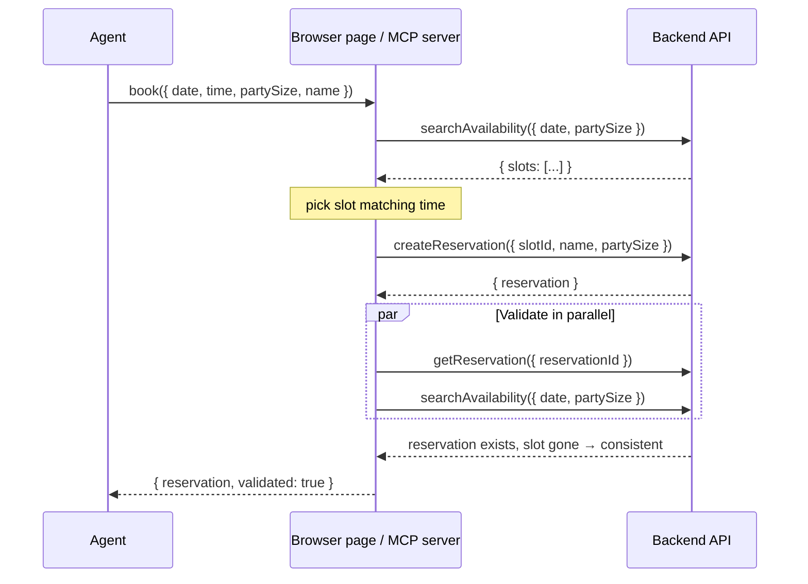
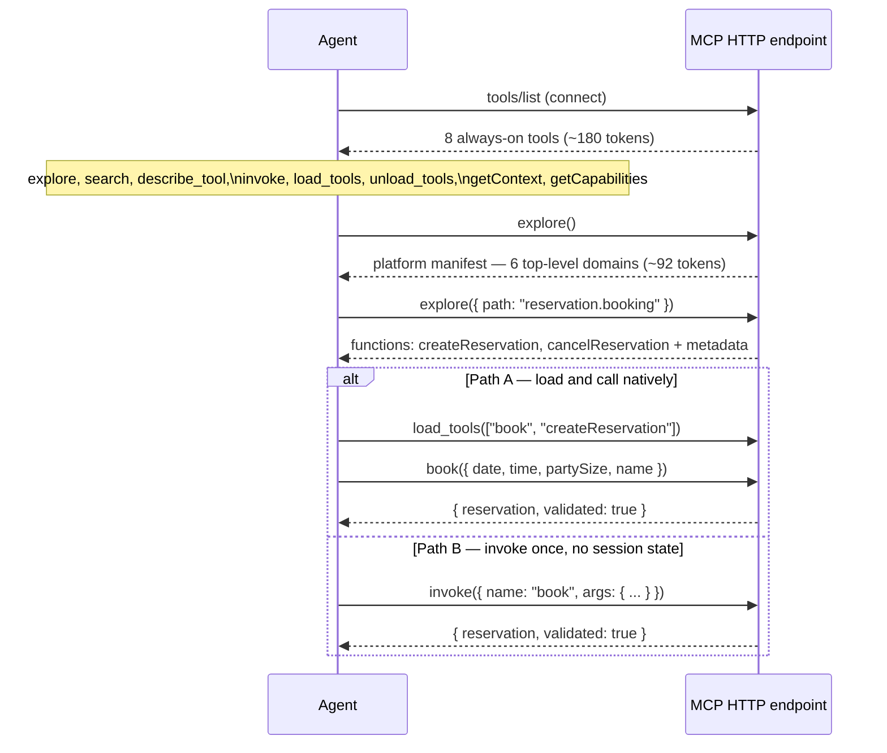
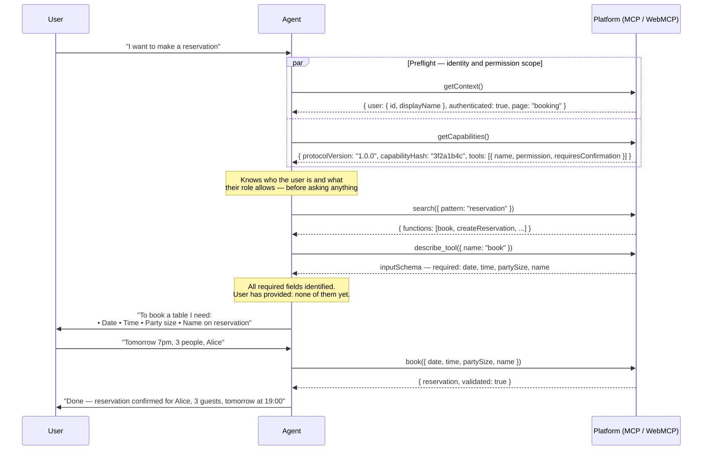
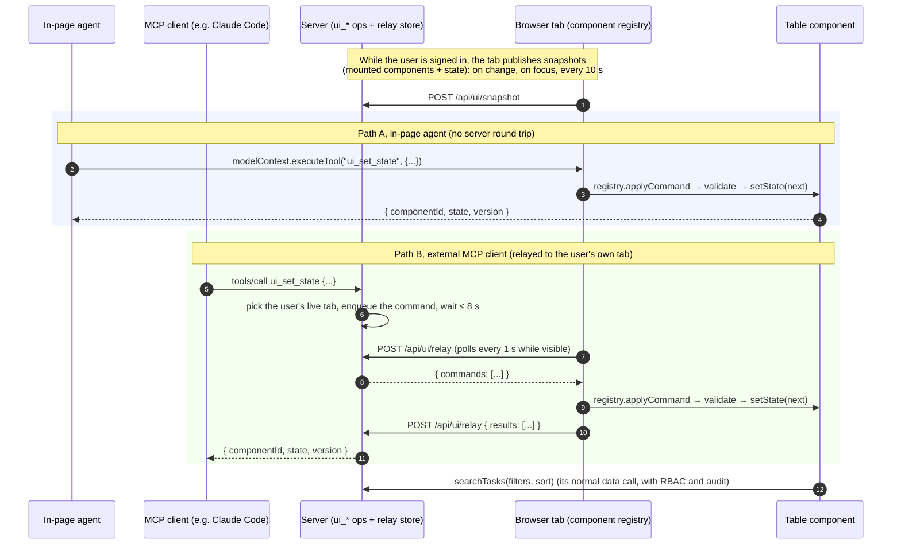

# WebMCP / AgentBridge

**Business logic that lives in the browser page, exposed to agents as structured tools through the WebMCP standard.**

WebMCP (`document.modelContext`) is a browser-native API that lets a page register callable tools for AI agents — the same way it registers event listeners for users. **NavWebMcp** is the protocol layered on top: progressive tool disclosure, RBAC, and composite operations. **AgentBridge** is this repo's reference implementation of NavWebMcp: it adds RBAC, progressive tool disclosure, audit logging, a polyfill for today's browsers, and an MCP Streamable HTTP surface so external agents (Claude Code, Claude Desktop, MCP Inspector) can connect with no browser required. A [protocol-level agent skill](skills/navwebmcp-agent/SKILL.md) ships alongside it, for any agent talking to any NavWebMcp server.

Built on [Next.js](https://nextjs.org) and the [Model Context Protocol](https://modelcontextprotocol.io).

> This repo is also the implementation proof of the **AOD/ADD** methodology (AI-Oriented
> Development / AI-Driven Development) — its own code and docs were produced by following that
> approach: intent specs framed up front, work delegated to agents, and independent verification
> before anything was accepted. The methodology itself is documented separately in `add-aod`.

---

## Benchmarks — efficiency, cost, effectiveness

All numbers below are measured, not estimated: real MCP Streamable HTTP transport, a real headless browser for the WebMCP and UI-automation lanes, `n=5` runs, production build. Reproduce with the commands at the end of this section. Token model: 1 token ≈ 4 characters (`chars/4`).

### Composite calls vs. multi-call orchestration — booking flow

| Lane | Transport | Calls/booking | Avg latency | Tokens/booking* |
|---|---|---|---|---|
| Raw MCP (`load_tools` + native) | Real MCP HTTP | 3 | 15 ms | 366 |
| Raw MCP (`invoke`, no load step) | Real MCP HTTP | 3 | 15 ms | 418 |
| **`book()` composite — NavWebMcp** | Real MCP HTTP | **1** | **5 ms** | **91** |
| WebMCP, raw (primitive ops, one at a time) | Real browser | 3 | 40 ms | 259 |
| **`book()` composite — NavWebMcp** | Real browser (WebMCP) | **1** | **26 ms** | **75** |
| Playwright UI automation | Real browser, 7 clicks | 1 user action | 342 ms | 5,721† |

\* input + output tokens, excludes the one-time tool-schema cost of `load_tools`. † cumulative accessibility-tree tokens an agent would need to *read* the page before each click — not directly comparable to the other rows, but that's the point: it's the cost nothing else on this list pays.

**Composite call vs. raw multi-call: −72 to −87% tokens, per booking, on both surfaces.** Latency drops −67 to −88% over MCP; the WebMCP composite still wins over raw calls made from the same page — −71% tokens, −35% latency — even though both are driven from inside a real browser. All lanes succeeded 5/5 — the savings cost nothing in reliability.

### It compounds with scope

| Scenario | Raw calls | Composite calls | Token saving | Latency saving |
|---|---|---|---|---|
| `book` — 3-op booking | 3 | 1 | −75% | −67% |
| `journey` — book + seat a guest (2 real actions, one session) | 6 | 2 | −81% | −63% |
| `vip` — 7-op chain across CRM + front desk | 7 | 1 | −68% | −87% |

The `journey` flow's Playwright lane (one continuous UI session doing both actions) costs **695 ms** and **11,300 cumulative tokens** of DOM reads — versus **7 ms** and **154 tokens** for the two composite calls. The `vip` flow has no Playwright row at all: CRM has no UI in this app, so there's nothing to click — a real limit of browser automation that composite calls don't have.

### Testing the architecture, not just the agent

A separate question from the above: how long does it take to *test* the business logic itself? `runOne()` (`lib/operations/dispatch.ts`) called in-process — zero HTTP, zero MCP, zero browser — versus a Playwright script driving the same scenario through the UI:

| Scenario | Function call | Playwright | Speedup |
|---|---|---|---|
| `book()` | 0.89 ms | 388 ms | **437×** |
| `seatGuest()` | 0.35 ms | 459 ms | **1,314×** |
| `hostVipGuest()` | 0.18 ms | — (no UI exists) | — |

Same Zod validation, same RBAC, same handler code as every other lane — no transport at all. This is the argument for testing the Operation layer directly instead of only through end-to-end browser tests.

### Reproduce

```bash
npm run build && npm start          # separate terminal — both scripts need a running server

node scripts/bench.mjs --n=5        # agent-transport comparison: booking, checkin, journey, vip
node scripts/speedbase.mjs --n=5    # test-execution speed: function call vs Playwright

node scripts/bench.mjs --flow=checkin --headed --slowmo=250 --demo   # watch a lane live
```

Both write their results to `docs/*-data.js` / `docs/*-results.json`. Open `docs/presentation.html` in a browser for the full slide deck with live numbers.

The Playwright lane (D) drives the real, tabbed UI. Each step first selects its own tab (Reservations or Front Desk), including after a reload, and matches labels exactly. A loose match would also hit Activity Log rows such as `searchAvailability`, or the walk-in "Party size" input that shares the Reservations tab. If you rename a tab or a form label, update `scripts/bench.mjs` to match.

---

## The core idea

Every existing approach makes the **agent** orchestrate multiple calls:

```
Agent → searchAvailability()   →  parse slot list, extract slotId
Agent → createReservation()    →  parse result, decide to validate
Agent → getReservation()       →  finally confirm success
```

Three round-trips. Three reasoning gaps. Growing context. The agent must understand your domain well enough to sequence the calls correctly — that knowledge lives in the prompt, re-processed on every call, and can hallucinate.

**AgentBridge flips this.** Business logic lives in the frontend as a composite function registered into `document.modelContext`. The agent calls one tool and gets a validated result:

```
Agent → book({ date, time, partySize, name })  →  { reservation, validated: true }
```

One call. Zero reasoning gaps. The orchestration runs invisibly — in the browser (session-cookie auth) or in-process on the server (bearer token auth).

---

## Protocol flow

### 1. Composite tool — `book()` as a single agent call



The agent sees none of steps 1–3. Source: `lib/core/book.ts`. `seatGuest` (`lib/core/seatGuest.ts`) and `hostVipGuest` (`lib/core/hostVipGuest.ts`) follow the same pattern for front-desk seating and a 7-step CRM+front-desk chain, respectively.

**When the post-condition check disagrees.** The check runs right after a write that succeeded. On a multi-instance deploy it can land on a server instance that hasn't seen that write yet, so a failed check usually means a stale read, not a failed write. The composites therefore only act when the write itself is genuinely missing:

| Composite | Write not visible afterwards | Secondary check disagrees |
|---|---|---|
| `book` | Reservation missing → cancels it (harmless if absent) and returns `VALIDATION_FAILED` | Slot still shows open → success with `validated: false` |
| `seatGuest` | Status not `checked-in` → `VALIDATION_FAILED`, no rollback | Table not yet shown occupied → success with `validated: false` |
| `hostVipGuest` | Status not `checked-in` → `VALIDATION_FAILED` before any points are awarded, no rollback | — |

`seatGuest` and `hostVipGuest` never "undo" with `checkOutGuest`. Checking out bills the visit and frees the table, which is the wrong outcome for a guest who really was seated.

### 2. One registry, two surfaces

```mermaid
flowchart TD
    REG["lib/operations/\nOperation registry\n(48 business ops + 8 meta)"]

    REG -->|lib/adapters/mcp.ts| MCP["MCP Streamable HTTP\napp/api/[transport]/\nBearer token · 8h TTL"]
    REG -->|lib/adapters/webmcp.ts| WEB["In-page WebMCP\ndocument.modelContext\nSession cookie"]

    MCP --> EXT["External agents\nClaude Code · Claude Desktop\nMCP Inspector"]
    WEB --> BRW["Browser agents\nin-page JS · console"]

    subgraph book_surfaces["book() — same orchestration, different caller injection"]
        OP["lib/core/book.ts\nbookOrchestration(input, call)"]
        OP -->|makeDispatch(ctx)\nin-process handlers| MCP
        OP -->|serverCall → fetch('/api/call')\nbrowser HTTP| WEB
    end
```

Both surfaces expose `book()`, `seatGuest()`, and `hostVipGuest()` (the latter two gated to `support`/`admin`). The only difference is the `call` function injected into the `lib/core/*.ts` orchestration:

| Surface | `call` implementation | Auth |
|---|---|---|
| In-page WebMCP | `serverCall` → `fetch("/api/call")` | Session cookie |
| MCP Streamable HTTP | `makeDispatch(ctx)` → handler in-process | Bearer token |

### 3. Progressive tool disclosure — how agents discover operations



On connection only the 8 always-on navigation tools appear — about **180 tokens**. If all 56 operations were loaded at connect it would cost proportionally more on every single request; with progressive disclosure that cost stays flat regardless of registry size — see the deck's slide 6 for measured numbers at 7 and 50 operations.

### 4. Gather first, ask once — the full conversation pattern

The protocol is designed so the agent does all its research before saying a word to the user. The user gets one question, provides all the information in one reply, and the operation executes.



`getContext` tells the agent who the user is and what page they're on. `getCapabilities` gives the role-scoped tool catalogue — name, permission level, and whether confirmation is required — without full input schemas, plus `protocolVersion` (the semver of the protocol contract, identical for every role) and `capabilityHash` (an 8-hex content hash of that role's tool set, used to cache-bust when the registry drifts). Together they answer: *who is this person and what are they allowed to do?* The agent has this before the first `explore` call, so it can skip irrelevant domains, identify every required parameter by inspecting schemas, and surface a single consolidated question rather than a sequential Q&A.

This behaviour is enforced by the agent instructions delivered at connect time (MCP `initialize.instructions` / `document.modelContext.instructions`). See `lib/agent-instructions.ts`.

---

## The steps, explained

### Connect + preflight

When an agent connects to the MCP HTTP endpoint, `tools/list` returns **only the always-on tools**: the 8 below, plus the 4 `ui_*` tools for operating on-screen components (since 1.3.0; see [Agent-operable UI components](#agent-operable-ui-components-navwebmcp-13)):

| Tool | Role | What it returns |
|---|---|---|
| `getContext` | **Preflight** | Who the user is: `{ page, authenticated, locale, user: { id, displayName } }` |
| `getCapabilities` | **Preflight** | What their role allows: `{ protocolVersion, capabilityHash, tools: [{ name, permission, requiresConfirmation }] }` |
| `explore` | Discovery | Module tree navigation by dot-path |
| `search` | Discovery | Find operations by Linux-style glob |
| `describe_tool` | Discovery | Full input and output JSON Schema for named operation(s) |
| `invoke` | Execution | Call any operation, single or batch, without loading |
| `load_tools` | Session | Promote operations to native MCP tools for this session |
| `unload_tools` | Session | Remove promoted tools from `tools/list` |

**The agent should call `getContext` and `getCapabilities` in parallel immediately after connecting.** This is the preflight:

- `getContext` answers *who is this user?* — identity, current page, locale. The agent can personalise its behaviour and skip domains the user won't need.
- `getCapabilities` answers *what is this role allowed to do?* — the full tool list scoped to the caller's role, including which operations require explicit confirmation. The agent can rule out unauthorised tools without fetching their schemas first.

With this information in hand before any `explore` call, the agent can identify every relevant operation, fetch only the schemas it needs, aggregate all required parameters in one pass, and ask the user a **single consolidated question** rather than sequential one-at-a-time prompts.

### Discover

**`explore()` — tree navigation by path you already know:**

```json
// Step 1: understand the platform (no args)
// → { app: "AgentBridge Hospitality", modules: [reservation, crm, frontoffice, tasks, housekeeping, finance] }
// Cost: ~92 tokens

// Step 2: inspect a domain
explore({ "path": "reservation" })
// → { submodules: [reservation.availability, reservation.booking, reservation.search, reservation.admin] }

// Step 3: inspect a leaf module
explore({ "path": "reservation.booking" })
// → { functions: [{ name: "createReservation", permission: "write" }, { name: "cancelReservation", requiresConfirmation: true }] }

// Wildcard: entire subtree in one call
explore({ "path": "reservation.*" })

// Multi-path: two modules in one round-trip
explore({ "path": ["reservation.booking", "crm.guests"] })
```

**`search()` — discovery when you don't know the path:**

Patterns are Linux-style globs matched against `module/path/functionName` strings. A bare keyword with no metacharacters is auto-expanded to `**/*keyword*`.

```json
search({ "pattern": "**/*reservation*" })
// → { functions: [createReservation, cancelReservation, ...], modules: [...] }

search({ "pattern": "reservation" })
// identical — bare keyword auto-expanded

search({ "pattern": "*refund*" })
// → { functions: [{ name: "issueRefund", module: "finance.adjustments" }] }
```

Search is **role-scoped**: a `customer` token running `search({ pattern: "finance/**" })` returns nothing — finance is admin-only and results are filtered by role.

**`describe_tool()` — get the full input and output schema before calling:**

```json
describe_tool({ "name": ["searchAvailability", "createReservation"] })
// → { tools: [{ name, description, permission, inputSchema: { ... }, outputSchema: { ... } }, ...] }
```

`outputSchema` describes the success `data`, e.g. `searchAvailability` → `{ slots: Slot[], count, message }`, so an agent can plan the next call (here: pass a slot's `id` to `createReservation`) without a trial run.

### Execute

**Path A — load tools for the session** (best when calling the same ops 3+ times):

```
explore()                                 → platform manifest (92 tokens)
explore({ path: "reservation.booking" })  → see booking functions
load_tools(["book", "searchAvailability"])→ promote to native tools
book({ date, time, partySize, name })     → call as a native MCP tool
```

Loaded tools persist per-token for the 8-hour session lifetime. Different agents get independent load states.

**Path B — invoke once without loading** (best for one-off calls):

```json
// Single:
invoke({ "name": "searchAvailability", "args": { "date": "2026-07-23", "partySize": 2 } })

// Batch — reads run in parallel, writes run sequentially:
invoke({
  "calls": [
    { "name": "searchAvailability", "args": { "date": "2026-07-23", "partySize": 2 } },
    { "name": "listReservations",   "args": {} }
  ]
})
// → { "results": [ <availability>, <reservations> ] }  — one round-trip, two results
```

| Situation | Use |
|---|---|
| Calling the same ops 3+ times in a session | Path A — load once, call cheaply |
| One-off call | Path B — invoke directly |
| Don't know what the platform offers yet | `explore()` first |
| Know the function name but not the schema | `describe_tool()` then Path B |
| Two read results needed simultaneously | Path B batch — parallel dispatch |

---

## Agent-operable UI components (NavWebMcp 1.3)

> **Who this section is for:** teams adding agent control of on-screen components (table
> filters, sort, tabs) to their **own** application. It is self-contained: the contract,
> the protocol, a step-by-step build, and a worked example. Nothing here depends on this
> repo's code. This repo's files are named only as a reference implementation you can read.
> The formal spec is in [docs/ui-components.md](docs/ui-components.md).

**Contents:**

- [The problem](#the-problem)
- [The idea](#the-idea-operate-component-state-not-the-dom)
- [How a call flows](#how-a-call-flows)
- [The contract](#the-contract)
- [The four operations](#the-four-operations)
- [Patch rules](#patch-rules)
- [Error codes](#ui-error-codes)
- [The relay](#the-relay-for-mcp-clients)
- [Build it in your app](#build-it-in-your-app-step-by-step)
- [Worked example](#worked-example-show-me-the-open-tasks-highest-priority-first)
- [Security](#security-requirements)
- [Conformance checklist](#conformance-checklist)
- [Reference implementation map](#reference-implementation-in-this-repo)

### The problem

Business operations return data **to the agent**. Take a page with a filterable task table,
and a user who says *"show me the open tasks, highest priority first"*. The agent can call
`searchTasks({ status: "open" })`, but that changes nothing on screen:

- the user's filter still says "Any status";
- the table is still in its default order;
- the agent can only read the rows back in chat.

That's the right tool when the agent needs the data itself. It's the wrong tool when the
**user** is meant to see the result.

The obvious workaround is to drive the DOM (find the select, click it, pick an option). That
is exactly what this protocol exists to avoid. It's slow, it breaks whenever the UI changes,
and the agent has to read the page structure to do it.

### The idea: operate component state, not the DOM

Each agent-operable component publishes a **typed state contract**, for example a table's
`{ filters, sort }`. The agent changes that state. The component applies the change through
**its own state setter**, so it is indistinguishable from the user using the controls. The
component then reloads its rows through its normal business operation, so access control
and audit apply to the data unchanged.

| | Business operation | UI component |
|---|---|---|
| Lives | Server, fixed registry | Browser, only while mounted |
| Changes | Business data | What the user sees |
| Discovered by | `explore` / `getCapabilities` | `ui_list` |
| Confirmation | Destructive ops need `confirm: true` | Never needed, view only |
| Agent uses it when | **It** needs the data or must change records | The **user** should see the result |

The agent only needs four generic tools, whatever the number of components. Components come
and go as the user navigates, and the tool list stays the same.

### How a call flows

There are two ways in, and both end in **the same function** in the page.



### The contract

Every mounted component publishes one contract, which `ui_list` returns:

```ts
interface UiComponentContract {
  id: string;                       // stable, page-unique: "tasks.table", "app.nav"
  kind: "table" | "tabs";           // standard kind → standard state shape
  title: string;
  description?: string;             // what it is; agents read this
  stateSchema: JSONSchema;          // JSON Schema of the FULL state
  state: Record<string, unknown>;   // exactly what the user sees right now
  version: number;                  // +1 on every change, by the user or an agent
  actions: { name: string; description: string }[];
  view?: { total?: number; shown?: number };  // row counts after the last load
}
```

#### Standard kinds

A *kind* fixes the overall shape of the state, so an agent learns each shape once and can
then drive every table in every app. Only the filter fields vary per table, and the agent
reads those from `stateSchema`.

**`table`**: `{ filters, sort }`

```jsonc
{
  "filters": { "status": "open" },                     // the table's own fields, all optional; absent = "any"
  "sort": [{ "column": "priority", "direction": "desc" }]   // priority order; [] = default order
}
```

- `filters` is a strict object (unknown keys are rejected), and every field is optional.
- `sort` is an array of `{ column, direction: "asc" | "desc" }`. `column` is an enum of the
  sortable columns. Each table caps the array with `maxItems` (1 if the backend sorts on one
  column).
- Pagination is reserved for a later minor version.

**`tabs`**: `{ activeTab }`

```jsonc
{ "activeTab": "tasks" }   // enum = ONLY the tabs this user's role may see
```

The app's main tab bar is registered as `app.nav`. A component that isn't on the current tab
isn't mounted, so agents navigate by setting `app.nav` first.

**Actions.** Every component with a declared initial state gets a `reset` action. A component
may declare more, for example `refresh`.

### The four operations

All four are **always on**: listed at connect, never behind `load_tools`.

| Op | Input | Success `data` | Annotations |
|---|---|---|---|
| `ui_list` | `kind?`, `tabId?` | `{ tabId, activeTab, openTabs, components: UiComponentContract[] }` | read-only |
| `ui_get_state` | `componentId`, `tabId?` | `{ componentId, kind, state, version, view? }` | read-only |
| `ui_set_state` | `componentId`, `patch`, `expectedVersion?`, `tabId?` | `{ componentId, state, version }` | not read-only, **not destructive** |
| `ui_action` | `componentId`, `action`, `args?`, `tabId?` | `{ componentId, action, state, version }` | not read-only, **not destructive** |

Input constraints are strict (unknown keys are rejected):

- `componentId`: 1–100 chars, `^[a-z][a-z0-9_.-]*$` (case-insensitive).
- `tabId`: 1–64 chars.
- `action`: 1–64 chars.
- `expectedVersion`: an integer ≥ 0.
- `patch` and `args`: objects.

Results use the standard NavWebMcp envelope: `{ success: true, data }` or
`{ success: false, error: { code, message } }`.

The `ui_*` ops never ask the user for confirmation. They change only the view, and the
business data behind it is still loaded through RBAC-checked operations. Tell your agent so
in its instructions (see step 6), or it may stop to ask before every filter change.

### Patch rules

A `ui_set_state` patch is **merged** into the current state, and then the **whole** result
is validated:

| Patch value | Effect |
|---|---|
| Plain object | Merged recursively: `{ filters: { status: "open" } }` keeps the other filters |
| Array | Replaces the array: `{ sort: [] }` restores the default order |
| Scalar | Replaces the value |
| `null` | **Removes** the key: `{ filters: { status: null } }` clears that one filter |

- **All or nothing.** If the merged state doesn't match `stateSchema`, the whole patch is
  rejected with `UI_INVALID_PATCH`. Nothing changes and the version doesn't move. The error
  message lists each failing path and the allowed values.
- **Version.** It bumps only when the state really changed, whether the user or an agent
  changed it.
- **Concurrency.** The user can edit the same table while the agent works. Pass the `version`
  you read as `expectedVersion`. If the user changed it since, you get `UI_STALE_STATE` and
  nothing is applied.

<a id="ui-error-codes"></a>
### Error codes

| Code | Meaning | Agent should |
|---|---|---|
| `UI_COMPONENT_NOT_FOUND` | No mounted component with that id. The message lists the mounted ids | Switch tabs via `app.nav`, then `ui_list` |
| `UI_INVALID_PATCH` | The merged state doesn't match `stateSchema` | Fix the patch against `stateSchema`, retry once |
| `UI_STALE_STATE` | `expectedVersion` is out of date because the user changed it | `ui_get_state`, then decide again |
| `UI_UNKNOWN_ACTION` | The component has no such action | Use an action listed by `ui_list` |
| `UI_NO_ACTIVE_PAGE` | The user has no open, signed-in tab (MCP only) | Ask the user to open the app |
| `UI_TIMEOUT` | The tab didn't answer within 8 s (MCP only) | `ui_get_state` to see whether it applied |

### The relay (for MCP clients)

An external MCP client has no browser tab of its own. The server relays its calls to **the
same user's** open tab. The tab only ever makes outbound HTTP calls, so this works on
serverless hosting and needs no WebSocket.

| Endpoint (cookie session) | Body | Response |
|---|---|---|
| `POST /api/ui/snapshot` | `{ tabId, activeTab, visible, focusedAt, components: UiComponentContract[] }`, or `{ tabId, closed: true }` | `{ success: true }` |
| `POST /api/ui/relay` | `{ tabId, results: [{ cmdId, result: Envelope }] }` | `{ success: true, data: { commands: UiCommand[] } }` |

```ts
type UiCommand =
  | { cmdId: string; type: "set_state"; componentId: string; patch: object; expectedVersion?: number }
  | { cmdId: string; type: "action";    componentId: string; action: string; args?: object };
```

| Rule | Value used here |
|---|---|
| `tabId` | A random id per browser tab, kept in `sessionStorage` (survives reloads, not shared between tabs) |
| When the page publishes a snapshot | Debounced (200 ms) on every component change, on focus and visibility change, and as a heartbeat every **10 s** |
| How long a snapshot stays live | **30 s** after the last publish. A closing tab sends `{ closed: true }` with `navigator.sendBeacon` |
| Which tab a command goes to | The explicit `tabId`, else the **visible** tab the user focused most recently, else the most recently focused tab |
| How often the page polls `/api/ui/relay` | Every **1 s** while visible, every 5 s while hidden. After applying commands, it posts their results straight away |
| How long the server waits for a result | Up to **8 s**, then `UI_TIMEOUT`. Results are kept for 60 s |
| Storage | In-process memory for a single instance. Use a shared store (Redis here) across serverless instances |
| Limits | Snapshot ≤ 256 KB, ≤ 50 components. ≤ 50 results per poll |

**Reads don't touch the browser.** `ui_list` and `ui_get_state` on the server answer from the
latest snapshot, which is at most about 10 s old and refreshed on every change. **Writes**
always go to the live tab.

### Build it in your app, step by step

This uses a hypothetical **Orders** page as the example, with an orders table filtered by
status and customer and sortable by date or total. The code is TypeScript with Zod. Any
schema library that can produce JSON Schema works.

#### Step 1: the page-side registry (framework-agnostic)

This one class is the **single choke point**: both paths apply changes through
`applyCommand`.

```ts
// ui-registry.ts
import type { ZodType } from "zod";
import { zodToJsonSchema } from "zod-to-json-schema";

type State = Record<string, unknown>;
type Result<T> = { success: true; data: T } | { success: false; error: { code: string; message: string } };
const ok = <T>(data: T): Result<T> => ({ success: true, data });
const fail = (code: string, message: string): Result<never> => ({ success: false, error: { code, message } });

export interface Registration {
  id: string; kind: "table" | "tabs"; title: string; description?: string;
  schema: ZodType<State>;
  getState: () => State;
  setState: (next: State) => void;                 // the component's own setter
  actions?: Record<string, { description: string; run: (args: State, set: (s: State) => void) => unknown }>;
  getView?: () => { total?: number; shown?: number } | undefined;
}

export function mergePatch(base: State, patch: State): State {
  const out: State = { ...base };
  for (const [k, v] of Object.entries(patch)) {
    const isObj = (x: unknown): x is State => typeof x === "object" && x !== null && !Array.isArray(x);
    if (v === null) delete out[k];
    else if (isObj(v) && isObj(out[k])) out[k] = mergePatch(out[k] as State, v);
    else out[k] = v;
  }
  return out;
}

export class UiRegistry {
  private entries = new Map<string, { reg: Registration; version: number; last: string }>();
  private listeners = new Set<() => void>();

  register(reg: Registration) {
    const entry = { reg, version: 1, last: JSON.stringify(reg.getState()) };
    this.entries.set(reg.id, entry);
    this.emit();
    return () => { if (this.entries.get(reg.id) === entry) { this.entries.delete(reg.id); this.emit(); } };
  }

  /** Call after ANY state change (user-driven too), so `version` stays honest. */
  touch(id: string) {
    const e = this.entries.get(id); if (!e) return;
    const now = JSON.stringify(e.reg.getState());
    if (now !== e.last) { e.last = now; e.version++; }
    this.emit();
  }

  list() {
    return [...this.entries.values()].map(({ reg, version }) => ({
      id: reg.id, kind: reg.kind, title: reg.title, description: reg.description,
      stateSchema: zodToJsonSchema(reg.schema, { $refStrategy: "none" }),
      state: reg.getState(), version,
      actions: Object.entries(reg.actions ?? {}).map(([name, a]) => ({ name, description: a.description })),
      view: reg.getView?.(),
    }));
  }

  async applyCommand(cmd: { type: "set_state" | "action"; componentId: string; patch?: State;
                            expectedVersion?: number; action?: string; args?: State }): Promise<Result<unknown>> {
    const e = this.entries.get(cmd.componentId);
    if (!e) return fail("UI_COMPONENT_NOT_FOUND",
      `No mounted component '${cmd.componentId}'. Mounted: ${[...this.entries.keys()].join(", ") || "none"}.`);

    if (cmd.type === "action") {
      const a = e.reg.actions?.[cmd.action!];
      if (!a) return fail("UI_UNKNOWN_ACTION", `'${e.reg.id}' has no action '${cmd.action}'.`);
      await a.run(cmd.args ?? {}, (s) => e.reg.setState(s));
    } else {
      if (cmd.expectedVersion !== undefined && cmd.expectedVersion !== e.version)
        return fail("UI_STALE_STATE", `'${e.reg.id}' is at version ${e.version}, not ${cmd.expectedVersion}.`);
      const parsed = e.reg.schema.safeParse(mergePatch(e.reg.getState(), cmd.patch ?? {}));
      if (!parsed.success) return fail("UI_INVALID_PATCH",
        parsed.error.issues.map((i) => `${i.path.join(".")}: ${i.message}`).join("; "));
      e.reg.setState(parsed.data);
    }
    this.touch(e.reg.id);
    const state = e.reg.getState();
    return ok(cmd.type === "action"
      ? { componentId: e.reg.id, action: cmd.action, state, version: e.version }
      : { componentId: e.reg.id, state, version: e.version });
  }

  subscribe(fn: () => void) { this.listeners.add(fn); return () => this.listeners.delete(fn); }
  private emit() { this.listeners.forEach((fn) => fn()); }
}

export const uiRegistry = new UiRegistry();   // one per page
```

#### Step 2: make a component operable

**a. Define the state schema** with the standard `table` shape. Mirror the backing data
operation's inputs, so the agent can set exactly what the user could, nothing more. Give
every field a `.describe()`, because that text is what the agent reads.

```ts
import { z } from "zod";

export const ORDERS_TABLE = z.object({
  filters: z.object({
    status:     z.enum(["pending", "paid", "shipped", "refunded"]).optional().describe("Order status"),
    customerId: z.string().min(1).max(64).optional().describe("Customer id, e.g. c_042"),
  }).strict().describe("Active filters; an absent key means 'any'"),
  sort: z.array(z.object({
    column:    z.enum(["createdAt", "total"]),
    direction: z.enum(["asc", "desc"]),
  }).strict()).max(1).describe("Sort keys in priority order; [] for the default order"),
}).strict();
export type OrdersTableState = z.infer<typeof ORDERS_TABLE>;
```

**b. Lift every agent-operable control into one state object.** The user's controls and the
agent both write to it, and the data fetch reads from it. In React it looks like this
(`useAgentComponent` is about 40 lines; this repo's version is
`lib/ui-components/useAgentComponent.ts`):

```tsx
function OrdersTable() {
  const INITIAL: OrdersTableState = { filters: {}, sort: [] };
  const [table, setTable] = useState(INITIAL);
  const rows = useOrders(table);            // your existing fetch, now keyed on `table`

  useAgentComponent({
    id: "orders.table", kind: "table", title: "Orders",
    description: "The Orders page list. Rows come from listOrders.",
    schema: ORDERS_TABLE,                   // module-level, so it is referentially stable
    state: table, setState: setTable, initialState: INITIAL,   // initialState adds a `reset` action
    actions: { refresh: { description: "Reload the rows", run: () => rows.refetch() } },
    view: { total: rows.total, shown: rows.items.length },
  });

  return (
    <select value={table.filters.status ?? ""}
            onChange={(e) => setTable((t) => ({ ...t, filters: { ...t.filters, status: e.target.value || undefined } }))}>
      {/* … the user's controls read and write the same `table` object … */}
    </select>
  );
}
```

What the hook must do (port it to any framework):

1. **Register on mount, unregister on unmount**, with `getState` reading a ref that always
   holds the latest state.
2. **Wrap `setState`** so the ref is updated **eagerly**, before the re-render. Otherwise
   `applyCommand` would report the old state.
3. **Call `uiRegistry.touch(id)`** whenever the state or the view changes, including
   user-driven changes. That is what keeps `version` and the published snapshot accurate.

**Without a framework**, call `uiRegistry.register({...})` when the widget is created, call
`uiRegistry.touch(id)` in your change handler, and call the returned function when the widget
is destroyed.

**c. Register your navigation as a `tabs` component** with id `app.nav`. Its `activeTab` enum
must list **only the tabs the current role can see**. Re-register it when the role changes.

#### Step 3: expose the four tools in the page (WebMCP)

```ts
const tabId = getTabId();   // sessionStorage-backed, e.g. "tab_<uuid>"

const local = {
  ui_list:      () => ({ success: true, data: { tabId, activeTab: activeTab(), openTabs: 1, components: uiRegistry.list() } }),
  ui_get_state: ({ componentId }) => { const c = uiRegistry.list().find((x) => x.id === componentId);
                  return c ? { success: true, data: { componentId: c.id, kind: c.kind, state: c.state, version: c.version, view: c.view } }
                           : { success: false, error: { code: "UI_COMPONENT_NOT_FOUND", message: `No mounted component '${componentId}'` } }; },
  ui_set_state: (i) => uiRegistry.applyCommand({ type: "set_state", ...i }),
  ui_action:    (i) => uiRegistry.applyCommand({ type: "action", ...i }),
};

for (const [name, run] of Object.entries(local)) {
  navigator.modelContext.registerTool({
    name, description: DESCRIPTIONS[name], inputSchema: INPUT_SCHEMAS[name],
    annotations: { readOnlyHint: name === "ui_list" || name === "ui_get_state" },
    execute: (input) => run(input),   // runs in the page, no server round trip
  });
}
```

Keep the auth, role check and strict input validation you already apply to your other
in-page tools (in this repo, `AgentBridge.call`). Only the final dispatch differs.

#### Step 4: the server-side operations (MCP surface)

Register the same four names on your MCP server. Reads answer from the snapshot. Writes are
relayed.

```ts
async function ui_set_state({ componentId, patch, expectedVersion, tabId }, { userId }) {
  const page = await relay.pickPage(userId, tabId);        // live snapshot, visible + most recently focused first
  if (!page) return fail("UI_NO_ACTIVE_PAGE", "The user has no open app tab. Ask them to open the app.");
  const cmd = { cmdId: `cmd_${crypto.randomUUID()}`, type: "set_state", componentId, patch, expectedVersion };
  await relay.enqueue(userId, page.tabId, cmd);
  return (await relay.awaitResult(userId, cmd.cmdId, { timeoutMs: 8000 }))
      ?? fail("UI_TIMEOUT", "The user's tab did not respond in time. Check with ui_get_state.");
}

async function ui_list({ kind, tabId }, { userId }) {
  const page = await relay.pickPage(userId, tabId);
  if (!page) return fail("UI_NO_ACTIVE_PAGE", "…");
  return ok({ tabId: page.tabId, activeTab: page.activeTab, openTabs: (await relay.livePages(userId)).length,
              components: page.components.filter((c) => !kind || c.kind === kind) });
}
// ui_get_state: read from page.components. ui_action: like ui_set_state with type "action".
```

Every key in the relay store is scoped by `userId`, including snapshots, queues and results.
The MCP bearer token and the browser session must resolve to the **same user id**.

#### Step 5: the relay endpoints and the page loop

The server side is the two endpoints from [the relay table](#the-relay-for-mcp-clients). Each
authenticates by session cookie, validates and size-limits the body, and reads or writes only
the session user's keys.

The page side starts once the user is signed in. The snippet uses four small helpers you
supply:

- `post`: a JSON `fetch` POST that returns the parsed body.
- `debounce`: delays calls until changes stop for the given time.
- `tabId`: the id from step 3.
- `activeTab()`: reads `app.nav`'s state.

```ts
function startUiRelay() {
  let focusedAt = Date.now(), stopped = false;
  const snapshot = () => ({ tabId, activeTab: activeTab(), visible: document.visibilityState === "visible",
                            focusedAt, components: uiRegistry.list() });
  const publish = debounce(() => post("/api/ui/snapshot", snapshot()), 200);

  async function poll(results = []) {
    if (stopped) return;
    const { data } = await post("/api/ui/relay", { tabId, results }).catch(() => ({ data: { commands: [] } }));
    if (data.commands.length) {
      const out = [];
      for (const cmd of data.commands) out.push({ cmdId: cmd.cmdId, result: await uiRegistry.applyCommand(cmd) });
      publish();
      return poll(out);                       // hand the results back immediately
    }
    setTimeout(poll, document.visibilityState === "visible" ? 1000 : 5000);
  }

  const off = uiRegistry.subscribe(publish);
  addEventListener("focus", () => { focusedAt = Date.now(); publish(); });
  document.addEventListener("visibilitychange", publish);
  addEventListener("pagehide", () => navigator.sendBeacon("/api/ui/snapshot", JSON.stringify({ tabId, closed: true })));
  const heartbeat = setInterval(() => post("/api/ui/snapshot", snapshot()), 10_000);
  post("/api/ui/snapshot", snapshot()); poll();
  return () => { stopped = true; off(); clearInterval(heartbeat); };
}
```

If your app already polls something, exclude `ui_*` calls from any "data changed, refetch
everything" logic. They don't change stored data.

#### Step 6: tell the agent

Add this to your server instructions (MCP `initialize.instructions`) and to
`modelContext.instructions`:

```text
## Operating the UI (what the user sees)
Business operations return data to YOU; the screen does not change. When the user should SEE
the result ("show me…", "filter the list to…", "sort by…", "open the X tab"), operate the UI:
- ui_list() → mounted components with their state, stateSchema and actions.
- ui_set_state({ componentId, patch }) → objects merge, arrays replace, null clears a key.
  Pass expectedVersion to avoid overwriting the user's own change.
- ui_get_state({ componentId }) → state and row counts. ui_action({ componentId, action }) → e.g. reset.
- A component on another tab isn't mounted: set app.nav { activeTab } first, then ui_list again.
- ui_* ops change only the view, never business data: no user confirmation needed.
```

### Worked example: "Show me the open tasks, highest priority first"

These calls ran against this app, signed in as an admin, with the user starting on the
Reservations tab. The responses are the app's actual output, abridged where marked `…` and in
the `stateSchema` objects.

**1. Look at what's on screen.**

```jsonc
→ ui_list({})
← { "success": true, "data": {
    "tabId": "tab_cfbd69fb-909f-4beb-b6e9-09d827d1273c",
    "activeTab": "reservations",
    "openTabs": 1,
    "components": [{
      "id": "app.nav", "kind": "tabs", "title": "App tabs",
      "description": "The app's main tab bar: reservations (Reservations), frontdesk (Front Desk), guests (Guests), tasks (Tasks), …",
      "state": { "activeTab": "reservations" }, "version": 1, "actions": [],
      "stateSchema": { "type": "object", "additionalProperties": false, "required": ["activeTab"],
        "properties": { "activeTab": { "type": "string", "enum": ["reservations", "frontdesk", "guests", "tasks", "housekeeping", "finance", "agent", "bugs"] } } }
    }] } }
```

There's no task table, because it lives on the Tasks tab.

**2. Navigate.**

```jsonc
→ ui_set_state({ "componentId": "app.nav", "patch": { "activeTab": "tasks" } })
← { "success": true, "data": { "componentId": "app.nav", "state": { "activeTab": "tasks" }, "version": 2 } }
```

The user's screen switches to Tasks.

**3. Read the table's contract.**

```jsonc
→ ui_list({ "kind": "table" })
← { "success": true, "data": { "activeTab": "tasks", "components": [{
      "id": "tasks.table", "kind": "table", "title": "Task Search",
      "state": { "filters": {}, "sort": [] }, "version": 1, "view": { "total": 5, "shown": 5 },
      "actions": [{ "name": "refresh", "description": "Re-run the search with the current filters" },
                  { "name": "reset", "description": "Restore the default state (clears filters and sort)" }],
      "stateSchema": { "properties": {
        "filters": { "properties": {
          "status":     { "enum": ["open", "in_progress", "completed", "cancelled"] },
          "department": { "type": "string", "maxLength": 100 },
          "assigneeId": { "enum": ["u_alice", "u_carol", "u_bob"] },
          "reservationId": { "type": "string", "maxLength": 64 } } },
        "sort": { "maxItems": 1, "items": { "properties": {
          "column": { "enum": ["createdAt", "updatedAt", "priority", "title", "status"] },
          "direction": { "enum": ["asc", "desc"] } } } } } }
    }] } }
```

**4. Apply the filter and sort in one patch.**

```jsonc
→ ui_set_state({ "componentId": "tasks.table",
    "patch": { "filters": { "status": "open" }, "sort": [{ "column": "priority", "direction": "desc" }] } })
← { "success": true, "data": { "componentId": "tasks.table",
    "state": { "filters": { "status": "open" }, "sort": [{ "column": "priority", "direction": "desc" }] },
    "version": 2 } }
```

The user's controls now read **open · Sort: Priority · Descending**. The table reloaded
through `searchTasks` and shows *Clean Room 205* (high), then *VIP guest arrival preparation*
(medium), then *Restock minibar Room 101* (low). Over the relay this round trip took about
1.1 s. The Activity Log shows `AGENT ui_set_state`, followed by the table's own
`UI searchTasks`.

**5. Report back to the user.**

```jsonc
→ ui_get_state({ "componentId": "tasks.table" })
← { "success": true, "data": { "componentId": "tasks.table", "kind": "table",
    "state": { "filters": { "status": "open" }, "sort": [{ "column": "priority", "direction": "desc" }] },
    "version": 2, "view": { "total": 3, "shown": 3 } } }
```

The agent says: *"Done. Your task list now shows the 3 open tasks, highest priority first."*

**What the guard rails return** (same run):

```jsonc
// A column that isn't sortable: rejected, nothing changes
→ ui_set_state({ "componentId": "tasks.table", "patch": { "sort": [{ "column": "assigneeId", "direction": "up" }] } })
← { "success": false, "error": { "code": "UI_INVALID_PATCH", "message":
    "Patch does not fit 'tasks.table' (see its stateSchema): sort.0.column: Invalid enum value. Expected 'createdAt' | 'updatedAt' | 'priority' | 'title' | 'status', received 'assigneeId'; sort.0.direction: Invalid enum value. Expected 'asc' | 'desc', received 'up'" } }

// The user flipped the sort direction after the agent read version 2
→ ui_set_state({ "componentId": "tasks.table", "expectedVersion": 2, "patch": { "filters": { "assigneeId": "u_carol" } } })
← { "success": false, "error": { "code": "UI_STALE_STATE", "message":
    "'tasks.table' is at version 3, not 2: the user changed it. Re-read with ui_get_state." } }

// Clear one filter and keep the sort
→ ui_set_state({ "componentId": "tasks.table", "patch": { "filters": { "status": null } } })

// Back to the defaults
→ ui_action({ "componentId": "tasks.table", "action": "reset" })
← { "success": true, "data": { "componentId": "tasks.table", "action": "reset",
    "state": { "filters": {}, "sort": [] }, "version": 4 } }
```

### Security requirements

- **Same user only.** Every snapshot, queue entry and result is keyed by the authenticated
  user id. An MCP token can only reach tabs signed in as that same user, and a page can only
  answer commands addressed to its own user.
- **View state only.** No business data travels through the relay. Contracts carry filters and
  sort, never rows. The component reloads rows through the same RBAC-checked operation the
  user's clicks use, so an agent can never see more than the user could.
- **Role-limited navigation.** The `app.nav` enum lists only tabs the role can see. Hidden tabs
  are therefore not reachable, even by a crafted patch.
- **The page validates.** Patches are validated against the component's own schema in the
  page. The server only relays and size-limits them (snapshot ≤ 256 KB, ≤ 50 components, ≤ 50
  results per poll).
- **Strict inputs.** Unknown keys are rejected at every layer: tool inputs, `filters`, `sort`
  items, and the state itself.

### Conformance checklist

An implementation is conformant when all of these hold.

**The page:**

- [ ] Every agent-operable component registers while mounted and unregisters on unmount.
- [ ] Its state uses a standard kind shape (`table` is `{ filters, sort }`, `tabs` is
  `{ activeTab }`), with strict objects and `.describe()` on every field.
- [ ] User-driven changes call `touch` (or the equivalent), so `version` increases on every
  real change, and only then.
- [ ] Agent changes go through the component's own setter. The DOM is never scripted.
- [ ] `applyCommand` merges the patch, validates the whole result, and is all-or-nothing.
- [ ] The navigation component is `app.nav`, and its enum is limited to the role's tabs.

**The protocol:**

- [ ] All four `ui_*` ops are always on, with strict inputs, and return the success shapes
  listed under [the four operations](#the-four-operations).
- [ ] `ui_set_state` and `ui_action` never require confirmation and are not marked destructive.
- [ ] The six `UI_*` error codes are used with the meanings in the table above.

**The relay** (if you support MCP clients):

- [ ] Everything is keyed by user id. Commands go to the explicit tab, else the visible and
  most recently focused live tab.
- [ ] A snapshot TTL is set, and the heartbeat interval is well inside it. Writes time out
  with `UI_TIMEOUT`.
- [ ] A shared store is used across server instances.

**Tests worth copying** from `tests/unit/` in this repo:

- `ui-registry.test.ts`: merge, validation, version and stale checks, actions.
- `ui-relay.test.ts`: TTL, tab selection, once-only delivery, user isolation, timeout, routes.
- `webmcp-ui.test.ts`: in-page tools never call the server.

### Reference implementation in this repo

| Piece | File |
|---|---|
| Wire schemas and error codes | `lib/ui-components/contract.ts` |
| Page registry (`applyCommand`, `mergePatch`) | `lib/ui-components/registry.ts` |
| React hook | `lib/ui-components/useAgentComponent.ts` |
| Standard kinds (`tableStateSchema`, `tabsStateSchema`) | `lib/ui-components/kinds.ts` |
| In-page tool handlers | `lib/ui-components/local.ts` |
| Server `ui_*` ops | `lib/operations/ui.ts` |
| Relay store (memory, or Redis) | `lib/ui-relay/store.ts`. It is reached through `lib/ui-relay/port.ts`, which keeps `redis` out of the browser bundle |
| Relay endpoints | `app/api/ui/snapshot/route.ts`, `app/api/ui/relay/route.ts` |
| Page relay loop | `lib/ui-relay/client.ts`, started in `app/providers.tsx` |
| Example components | `components/TaskSearchCard.tsx` (`tasks.table`), `components/AppShell.tsx` (`app.nav`) |

---

## Features

### Progressive tool disclosure

Only 8 navigation/meta tools appear at connect time (~180 tokens), plus the 4 `ui_*` tools since 1.3.0. Business operations are discovered on demand via `explore` or `search` and either invoked directly or promoted to native tools via `load_tools`. This cost stays flat regardless of registry size — see the Benchmarks section above for measured numbers.

### Composite operations

A composite tool (like `book`, `seatGuest`, or `hostVipGuest`) wraps multi-step orchestration behind a single agent-facing call — precondition checks, the write itself, and post-condition validation all happen invisibly. A failed validation returns a typed error, or `validated: false` when only a possibly-stale re-check disagrees (see the table under [The core idea](#the-core-idea)). The orchestration logic lives in `lib/core/` (surface-agnostic), injected with either an HTTP caller (browser) or an in-process dispatcher (server). Context accumulation is zero: the agent has nothing to re-read.

### Two surfaces, one registry

The same 48 business operations are exposed over both surfaces simultaneously. Adding an operation to `lib/operations/` and registering it in `lib/operations/index.ts` makes it automatically available on both the MCP HTTP endpoint and `document.modelContext` — with full RBAC, audit logging, and progressive disclosure on both. Each operation's `inputSchema` and `outputSchema` are published on both surfaces too: as MCP `inputSchema`/`outputSchema` (with `structuredContent` on results), and as the WebMCP `ModelContextTool` members of the same names. Where we follow or depart from the WebMCP draft is tracked in [`docs/webmcp-alignment.md`](docs/webmcp-alignment.md).

### RBAC and confirmation gates

Every operation carries a `roles` array checked on every call. Three roles exist: `customer` (own-data read/write), `support` (customer ops + cross-user read), and `admin` (all ops). Destructive operations carry `requiresConfirmation: true`, and all six of them (`cancelReservation`, `cancelAnyReservation`, `checkOutGuest`, `deleteTask`, `issueRefund`, `applyNoShowFee`) enforce it server-side: the input schema has a `confirm` parameter, and omitting it (or passing `false`) returns `CONFIRMATION_REQUIRED` — no surface (MCP-over-HTTP, in-page WebMCP, or the UI) can complete one of these without it. The UI-side confirmation dialog (`app/providers.tsx`) checks `requiresConfirmation` generically and shows a dialog before sending `confirm: true` itself, once approved. The in-page WebMCP surface (`lib/agentbridge.ts`) additionally skips its own dialog when a caller has *already* self-declared `confirm: true` — the same trust model the MCP-over-HTTP surface always used for these ops — since a genuinely autonomous agent has no way to click a browser dialog.

### Audit log

Every call — agent-initiated or UI-initiated — is recorded with tool name, success/failure, and caller type. The last 100 entries are polled by the UI from `/api/audit` every 4 seconds (SSE doesn't survive Vercel's serverless model — see `app/providers.tsx`).

### Shared state on Vercel (optional)

By default every store (reservations, CRM, tasks, housekeeping, finance, the audit log) is in-memory per process — fine for `npm run dev`, but on Vercel each serverless instance has its own memory, so an MCP-driven write and a browser's poll can land on different instances and never see each other's data.

To fix this on a real deployment, add a Redis database via the Vercel Marketplace (Project → Storage → Marketplace Database Providers) and connect it to Production/Preview/Development. That injects a `REDIS_URL` connection string, which `lib/shared-state/` (built on `node-redis`) picks up automatically — no code changes needed. Without it, the app transparently falls back to today's in-memory behavior; this is why `npm test` and local dev need zero setup. `vercel env pull .env.development.local` will only pick this up if the integration is also connected to the Development environment, not just Production.

If Redis is configured but unreachable, the app degrades to the same in-memory behaviour instead of hanging: the first connection attempt gives up after `REDIS_CONNECT_TIMEOUT_MS` (default 1500), after which requests skip Redis for `REDIS_RETRY_COOLDOWN_MS` (default 30000) while the client reconnects in the background. Commands on a dropped connection fail immediately rather than queueing (`lib/shared-state/redis.ts`).

#### Testing against a real Redis locally

`npm test` never needs Redis. The Redis-backed paths — the audit hash chain's concurrent appends, metrics buckets, session/agent revocation — have their own live tests (`tests/integration/redis-live.test.ts`), skipped unless a Redis is available. With Docker Desktop running:

```bash
npm run test:redis            # starts Redis (docker-compose.yml, port 6390), runs the live tests, stops it
npm run test:redis -- --keep  # leave the Redis running afterwards
```

Already running a Redis? `REDIS_LIVE_URL=redis://localhost:6379 npm run test:redis -- --no-docker`. The live tests write under their own namespace and delete their keys when done. To run the app itself against the local Redis: `docker compose up -d redis`, then `REDIS_URL=redis://localhost:6390 npm run dev`.

### Gather-first, ask-once — context, capabilities, and instructions

Three protocol features work together to give the agent everything it needs before it says a word to the user:

**`getContext`** — called on connect, returns the authenticated user's identity (`page`, `authenticated`, `locale`, `user: { id, displayName }`). The agent knows who it is talking to and what page they are on. It can personalise responses without fetching any schemas.

**`getCapabilities`** — called on connect (in parallel with `getContext`), returns every operation the caller's role is allowed to invoke: name, permission level, and `requiresConfirmation` flag. No input schemas yet — this is cheap. The agent can rule out unauthorised tools immediately and build the full picture of what is possible before exploring anything.

**Agent instructions** — delivered at connect time via `initialize.instructions` (MCP) and `document.modelContext.instructions` (WebMCP), both sourced from `lib/agent-instructions.ts`. The instructions contract:
1. Call `explore()` (and `describe_tool()`) to discover every required parameter before asking the user anything.
2. Identify **all** missing information in one pass.
3. Ask for all missing values in a **single message** — never a sequential Q&A.
4. Only after every required value is confirmed, execute write operations.

The combined effect: a user types *"I want to make a reservation"* and the agent responds with exactly one question listing every field it needs. The user fills them in. The operation executes. No back-and-forth.

### Versioning

`getCapabilities()` returns two distinct fields, deliberately not one:

| Field | Scope | Changes when | Maintained by |
|---|---|---|---|
| `protocolVersion` | Global — same for every role | The NavWebMcp contract itself changes: the manifest shape, a meta-op signature, the `Result` envelope, or an error code's meaning | Hand-bumped in `lib/protocol.ts`, following the rules in `CHANGELOG.md` |
| `capabilityHash` | Role-scoped — differs by caller | The visible operation registry drifts (an operation is added, removed, or reshaped) for that role | Computed automatically (DJB2 over operation fingerprints) |

Cache the manifest keyed on both: a changed `capabilityHash` means refresh the tool list; a `protocolVersion` MAJOR change means re-read the contract. `serverInfo.version` on the MCP handshake is the same `protocolVersion` semver — not a hash.

This is deliberately independent of `package.json`'s version, which tracks the demo app build, not the wire protocol. The two will legitimately diverge.

### WebMCP standard + polyfill

```
WebMCP        — W3C Web Machine Learning CG draft standard (document.modelContext)
  └ NavWebMcp — this protocol: progressive tool disclosure, RBAC, composite operations
      └ AgentBridge — this repo's reference implementation of NavWebMcp
```

This project implements the WebMCP draft standard incubated by the W3C Web Machine Learning Community Group, and layers **NavWebMcp** — progressive tool disclosure, RBAC, and composite operations — on top of it. The polyfill (`lib/webmcp-polyfill.ts`) installs a full `ModelContextImpl` on `document.modelContext` for browsers that don't yet support it natively, and is a no-op once the standard ships. AgentBridge adds on top: `permission` scopes, RBAC, `requiresConfirmation` gates, audit logging, progressive disclosure, protocol versioning, and `executeBatch`.

### Agent skill

Anyone implementing NavWebMcp — in this repo's stack or any other — should ship [`skills/navwebmcp-agent/`](skills/navwebmcp-agent/SKILL.md) to their own agent. It is the consumer-side half of the protocol: how to connect efficiently, discover operations, choose between sequential/parallel/bulk invocation, prefer composite operations, and handle errors — independent of any specific server implementation. It carries its own `version` and a `protocol` compatibility range in its frontmatter, so it can be revised without implying the protocol changed. Copy the directory into `<your-repo>/.claude/skills/` or `~/.claude/skills/`.

---

## Reference

### Quick start

```bash
npm install
npm run dev
# Open http://localhost:3000
```

State is in-memory — resets on server restart.

### Connect an agent

The MCP endpoint requires a bearer token (RFC 8707 audience-bound, 8-hour TTL — see
the "MCP HTTP authentication" row in the table further down). Open the app, sign in,
and copy your agent token from the "Connect an AI Agent" card — it'll need refreshing
from there once it expires.

**Claude Code:**

```bash
claude mcp add --transport http booking http://localhost:3000/api/mcp \
  --header "Authorization: Bearer <your-agent-token>"
```

`.mcp.json` (already included in this repo) omits the header on purpose — a static
token would go stale and can't be committed per-user — so `claude mcp add` (or editing
the header in manually) is the supported path:

```json
{
  "mcpServers": {
    "agentbridge-booking": {
      "type": "http",
      "url": "http://localhost:3000/api/mcp"
    }
  }
}
```

Then ask: *"Book me a table for 2 tomorrow evening"*

**Claude Desktop:** Settings → Connectors → Add custom connector → `http://localhost:3000/api/mcp`, then add the `Authorization: Bearer <token>` header.

**MCP Inspector:**

```bash
npx @modelcontextprotocol/inspector http://localhost:3000/api/mcp
```

Pass `Authorization: Bearer <token>` (your agent token is shown in the UI after login).

### Demo users

| Username | Password | Role |
|---|---|---|
| alice | password | customer |
| carol | password | support |
| bob | password | admin |

Sign-in is required: opening the app without a session takes you to `/login`.

| `DEMO_MODE` | Behaviour |
|---|---|
| unset (default) | Login required. Once signed in, the role switcher in the header works. |
| `true` | No login: a first-time visitor lands signed in as alice (customer). Role switcher works. |
| `false` | Login required, and the demo shortcuts (role switcher, "Reset demo data") are disabled. |

### In-page WebMCP (browser console)

After signing in, open the browser console:

```javascript
// List all available tools — every operation the signed-in role may call is registered
document.modelContext.getTools().map(t => t.name)
// → ["explore", "search", ..., "book", ...]   filtered by role

// Each tool carries an input schema, an output schema and annotations
const book = document.modelContext.getTools().find(t => t.name === "book")
book.outputSchema   // anyOf: { success: true, data: { reservation, validated } } | { success: false, error }
book.annotations    // { readOnlyHint: false, consequentialHint: false, untrustedContentHint: false }

// Protocol version and instructions declared on this surface
document.modelContext.protocolVersion   // "1.2.0"
document.modelContext.instructions      // the AGENT_INSTRUCTIONS string

// Call the composite book() tool
await document.modelContext.executeTool("book", {
  date: "2026-07-23",
  time: "18:00",
  partySize: 2,
  name: "Alice"
})
// → { success: true, data: { reservation: {...}, validated: true } }
```

`hostVipGuest` has no UI button — the CRM domain has no screens in this app — but it's registered and callable in-page the same way, which is exactly what the speedbase table in the Benchmarks section measures.

`app/providers.tsx` registers the whole operation registry through `initAgentBridge` (`lib/adapters/webmcp.ts`) once the user is known. Each call goes to the server via `POST /api/call`, so it gets the same RBAC, strict input validation and audit log as the UI. `window.agentBridge.describe()` lists everything registered, with schemas.

The in-page `outputSchema` describes the full `Result` envelope, because that is what `execute()` returns. The data schema alone is in `describe_tool` and `agentBridge.describe()`. `executeTool` on the polyfill returns the raw object, not the JSON string the spec returns. That difference is deliberate; see [`docs/webmcp-alignment.md`](docs/webmcp-alignment.md).

Cancellation and events follow the spec (protocol ≥ 1.2.0):

```javascript
// Lifecycle events, fired at document.modelContext with the tool's name
document.modelContext.addEventListener("toolactivated", (e) => console.log("started", e.toolName))
document.modelContext.addEventListener("toolcancel",    (e) => console.log("cancelled", e.toolName))

// Cancel a call: execute() gets its own AbortSignal, which AgentBridge passes to the server request
const ctrl = new AbortController()
const pending = document.modelContext.executeTool("listReservations", {}, { signal: ctrl.signal })
ctrl.abort("user stopped")   // pending rejects with "user stopped"; toolcancel fires; any late result is ignored

// Tool names are unique: registering a second "book" rejects with InvalidStateError
```

If the caller cancels while a confirmation dialog is open, the operation is never sent to the server and returns `CANCELLED`.

### Operations catalogue

**Always-on (8) — always in `tools/list`:**

| Name | Description |
|---|---|
| `explore` | Navigate the platform module tree by dot-path |
| `search` | Find functions/modules by Linux-style glob |
| `describe_tool` | Get full input and output schema for one or more named operations |
| `invoke` | Call any operation directly, single or batch |
| `load_tools` | Promote operations to native MCP tools for this session |
| `unload_tools` | Remove promoted tools from `tools/list` |
| `getContext` | Current page URL, auth state, locale |
| `getCapabilities` | Role-scoped manifest with version hash |

**Business operations (48) — discovered via `explore`/`search`, loaded via `load_tools` or called via `invoke`:**

#### Reservation — `reservation.*`

| Name | Permission | Roles | Notes |
|---|---|---|---|
| `searchAvailability` | read | all | |
| `listReservations` | read | all | own reservations |
| `getReservation` | read | all | |
| `createReservation` | write | all | |
| `cancelReservation` | write ⚠️ | all | `requiresConfirmation` |
| `listAllReservations` | read | support, admin | cross-user |
| `cancelAnyReservation` | write ⚠️ | admin | `requiresConfirmation` |
| `book` | write | all | composite: availability + create + validate |

#### CRM — `crm.*`

| Name | Permission | Roles |
|---|---|---|
| `searchGuests` | read | support, admin |
| `getGuest` | read | support, admin |
| `createGuest` | write | support, admin |
| `updateGuest` | write | support, admin |
| `getGuestPreferences` | read | all |
| `updateGuestPreferences` | write | all |
| `getLoyaltyStatus` | read | all |
| `addLoyaltyPoints` | write | support, admin |
| `listCommunications` | read | support, admin |
| `logCommunication` | write | support, admin |

#### Front Office — `frontoffice.*`

| Name | Permission | Roles | Notes |
|---|---|---|---|
| `checkInGuest` | write | support, admin | |
| `getCheckinStatus` | read | support, admin | |
| `checkOutGuest` | write ⚠️ | support, admin | `requiresConfirmation` |
| `getBillSummary` | read | all | |
| `getOccupancy` | read | support, admin | |
| `getWaitTime` | read | all | |
| `listFrontDeskReservations` | read | support, admin | for choosing who to seat/check out |
| `listShiftNotes` | read | support, admin | |
| `addShiftNote` | write | support, admin | |
| `seatGuest` | write | support, admin | composite: occupancy + check-in + validate |
| `hostVipGuest` | write | support, admin | composite: preferences + loyalty + seat + award + log (spans CRM) |

#### Tasks — `tasks.*`

| Name | Permission | Roles |
|---|---|---|
| `createTask` | write | support, admin |
| `updateTask` | write | support, admin |
| `searchTasks` | read | support, admin |
| `deleteTask` | write ⚠️ | admin |
| `getMyTasks` | read | all |
| `completeTask` | write | all |

#### Housekeeping — `housekeeping.*`

| Name | Permission | Roles |
|---|---|---|
| `getTableCleaningStatus` | read | support, admin |
| `updateTableStatus` | write | support, admin |
| `getTodaySchedule` | read | support, admin |
| `markScheduleItemDone` | write | support, admin |
| `listInspections` | read | admin |
| `logInspection` | write | admin |

#### Finance — `finance.*`

| Name | Permission | Roles | Notes |
|---|---|---|---|
| `getDailyRevenueSummary` | read | admin | |
| `getWeeklyRevenueSummary` | read | admin | |
| `getPaymentRecord` | read | admin | |
| `listPayments` | read | admin | |
| `issueRefund` | write ⚠️ | admin | `requiresConfirmation` |
| `applyNoShowFee` | write ⚠️ | admin | `requiresConfirmation` |
| `logManualAdjustment` | write | admin | |

### Module tree

```
(platform root — AgentBridge Hospitality)
├── reservation              "Create and manage table reservations"
│     ├── reservation.availability   searchAvailability
│     ├── reservation.booking        createReservation, cancelReservation ⚠️
│     ├── reservation.search         listReservations, getReservation
│     └── reservation.admin          listAllReservations, cancelAnyReservation ⚠️
│         + composite: book
├── crm                      "Guest profiles, preferences, loyalty, communications"
│     ├── crm.guests                 searchGuests, getGuest, createGuest, updateGuest
│     ├── crm.preferences            getGuestPreferences, updateGuestPreferences
│     ├── crm.loyalty                getLoyaltyStatus, addLoyaltyPoints
│     └── crm.communications         listCommunications, logCommunication
├── frontoffice              "Day-of operations — check-in/out, occupancy, shifts"
│     ├── frontoffice.checkin        checkInGuest, getCheckinStatus, listFrontDeskReservations
│     │   + composite: seatGuest, hostVipGuest (spans crm.*)
│     ├── frontoffice.checkout       checkOutGuest ⚠️, getBillSummary
│     ├── frontoffice.occupancy      getOccupancy, getWaitTime
│     └── frontoffice.shifts         listShiftNotes, addShiftNote
├── tasks                    "Operational task tracking across departments"
│     ├── tasks.management           createTask, updateTask, searchTasks, deleteTask ⚠️
│     └── tasks.assignments          getMyTasks, completeTask
├── housekeeping             "Venue cleanliness — status, schedules, inspections"
│     ├── housekeeping.status        getTableCleaningStatus, updateTableStatus
│     ├── housekeeping.schedule      getTodaySchedule, markScheduleItemDone
│     └── housekeeping.inspections   listInspections, logInspection
└── finance                  "Revenue, payments, refunds (admin only)"
      ├── finance.revenue            getDailyRevenueSummary, getWeeklyRevenueSummary
      ├── finance.payments           getPaymentRecord, listPayments
      └── finance.adjustments        issueRefund ⚠️, applyNoShowFee ⚠️, logManualAdjustment
```

⚠️ = `requiresConfirmation: true` — agent must pass `confirm: true`; UI shows a dialog.

Parent/child relationships are inferred from dot-path prefixes; the tree is defined in `lib/modules.ts` and builds automatically.

### Security model

| Control | Implementation |
|---|---|
| Browser authentication | Session cookie |
| MCP HTTP authentication | RFC 8707 audience-bound Bearer token, 8-hour TTL |
| Input validation | Zod schema on every call |
| RBAC | Per-operation `roles` array, checked at every call boundary |
| Destructive confirmations | `requiresConfirmation: true` — UI dialog + agent must pass `confirm: true` |
| Audit log | Every call recorded; last 100 entries streamed via SSE |
| Capability versioning | DJB2 hash over op fingerprints — agents detect registry changes |
| Token audience binding | RFC 8707 — a token minted for this server cannot be replayed elsewhere |

### Adding a server-side operation

1. **Create `lib/operations/your-op.ts`:**

```typescript
import { z } from "zod";
import { defineOperation } from "./types";
import { ok, fail } from "@/lib/result";
import { Id, ItemSchema } from "./schemas";

export const yourOp = defineOperation({
  name: "yourOp",
  title: "Your Op",
  description: "...",
  permission: "read",
  roles: ["customer", "admin"],
  module: "reservation.search",   // places it in the module tree
  tags: ["booking"],
  inputSchema: {
    id: Id().describe("Resource ID"),        // every field needs .describe() and a bound
  },
  outputSchema: {                            // the success `data`; required
    item: ItemSchema,
  },
  untrustedOutput: false,                    // true if `data` contains user-written free text
  async handler({ id }, ctx) {
    const item = store.getItem(id, ctx.userId);
    if (!item) return fail("NOT_FOUND", `Item ${id} not found`);
    return ok({ item });                     // type-checked against outputSchema
  },
});
```

Notes:
- Input is validated **strictly**: unknown keys are rejected. Use the shared field helpers in `lib/operations/schemas.ts` (`Id`, `IsoDate`, `TimeHHMM`, `ShortText`, `LongText`, `Money`, `Points`). `tests/unit/input-schema.test.ts` fails if any input string is left unbounded or any field has no description.
- Put reusable entity schemas (`ReservationSchema`, `GuestSchema`, …) in `lib/operations/schemas.ts`. Its `SchemaTypeChecks` stop them drifting from the TypeScript types.
- Use `as const` for literal fields such as `ok({ deleted: true as const })`, or TypeScript will widen them.

2. **Register it in `lib/operations/index.ts`:**

```typescript
import { yourOp } from "./your-op";
registry.push(yourOp);
```

3. **Add a happy-path case to `tests/unit/output-contract.test.ts`.** That test fails until every registered op has one, and it checks that the returned `data` matches `outputSchema` exactly. This matters because the MCP SDK rejects a non-matching `structuredContent` at runtime.

The operation automatically appears on both surfaces with full RBAC, audit logging, progressive disclosure, input/output schemas and annotations. To add a new module to the tree, append an entry to `MODULE_DEFS` in `lib/modules.ts`.

### Adding a composite tool

A composite tool has three layers: a surface-agnostic core, a browser wrapper, and an MCP operation. `lib/core/seatGuest.ts` / `lib/ui-tools/seatGuest.ts` / `lib/operations/seatGuest-op.ts` is the shortest real example to copy.

**1. `lib/core/your-tool.ts`** — no `"use client"`, takes a `call` dependency:

```typescript
export async function yourToolOrchestration(
  input: YourInput,
  call: (name: string, params: Record<string, unknown>) => Promise<unknown>
): Promise<Result<YourResult>> {
  const a = await call("existingOp", { ...input }) as { success: boolean; data?: ... };
  if (!a.success) return fail(a.error?.code ?? "ERR", a.error?.message ?? "Failed");
  const b = await call("anotherOp", { id: a.data!.id }) as { success: boolean; data?: ... };
  if (!b.success) return fail(b.error?.code ?? "ERR", b.error?.message ?? "Failed");
  return ok({ result: b.data, validated: true });
}
```

**2. `lib/ui-tools/your-tool.ts`** — browser wrapper injecting `serverCall`:

```typescript
"use client";
import { serverCall } from "@/app/providers";
import { yourToolOrchestration } from "@/lib/core/your-tool";
export const yourTool = (input: YourInput) => yourToolOrchestration(input, serverCall);
```

**3. `lib/operations/your-tool-op.ts`** — the operation both surfaces publish:

```typescript
export const yourToolOp = defineOperation({
  name: "yourTool",
  title: "Your Tool",
  description: "Does X in one step.",
  permission: "write",
  roles: ["customer", "admin"],
  module: "your.module",
  inputSchema: { /* zod shape */ },
  outputSchema: { result: ResultSchema, validated: z.boolean() },  // = YourResult
  async handler(input, ctx) {
    return yourToolOrchestration(input, makeDispatch(ctx));
  },
});
```

**4.** Register it in `lib/operations/index.ts` and add a case to `tests/unit/output-contract.test.ts`. The tool is then registered in-page automatically by `initAgentBridge`, with no hand-written `registerTool` call. The browser wrapper from step 2 is only needed if the UI calls the composite itself.

### Making a UI component agent-operable

Business operations return data to the agent. To let an agent change what the user **sees**, such as a table's filters and sort or the active tab, make the component agent-operable. The agent then uses the always-on `ui_list` / `ui_set_state` / `ui_get_state` / `ui_action` ops and never touches the DOM. The full spec is in [docs/ui-components.md](docs/ui-components.md).

**1.** Lift the controls' state into one object. Build its schema with the standard helper for the component's kind (`tableStateSchema` / `tabsStateSchema` in `lib/ui-components/kinds.ts`), at module level so it stays stable. Mirror the backing operation's inputs, and `.describe()` every field.

**2.** Call `useAgentComponent({ id, kind, title, schema, state, setState, initialState, actions, view })` (`lib/ui-components/useAgentComponent.ts`). That's all. Both the in-page agent and MCP clients (through the UI relay to the user's open tab) can now drive the component. The reference implementations are `components/TaskSearchCard.tsx` (`tasks.table`) and `components/AppShell.tsx` (`app.nav`).

For the full protocol, a framework-agnostic build guide for other apps, and a worked example with real responses, see [Agent-operable UI components](#agent-operable-ui-components-navwebmcp-13) above.

### Shipping a new UI feature — feature intros

Every user-facing feature ships with a short interactive guide. It plays the first time a user opens the tab the feature lives on, and never again once they finish or skip it. Users can replay a guide any time with **▶ Take the tour** at the end of the tab strip (shown on tabs that have one), or from **What's new** next to it.

**1.** Put `data-intro="<name>"` on the elements the guide should spotlight. Use this attribute rather than a class name, so restyling doesn't break the guide.

**2.** Add `lib/feature-intros/intros/<feature>.ts` and list it in `FEATURE_INTROS` (`lib/feature-intros/registry.ts`):

```ts
export const myFeatureIntro: FeatureIntro = {
  id: "my-feature",        // stable, kebab-case
  version: 1,              // bump to show it again after a meaningful change
  tab: "tasks",            // tab id from lib/feature-intros/tabs.ts
  roles: ["support", "admin"], // optional; omit for every role
  title: "Task templates",
  steps: [
    { title: "What it is", body: "…" },                           // no target = centred
    { target: "task-templates", placement: "right", title: "…", body: "…" },
  ],
};
```

**3.** Run `npm test`. `tests/unit/feature-intros.test.ts` fails if an intro points at a tab that doesn't exist or a `data-intro` target that isn't in `components/`.

Which guides a user has seen is stored per user on the server (`/api/intros`, `lib/feature-intros/seen-store.ts`): a long-lived Redis set when `REDIS_URL` is set, in memory otherwise. This is UI state, not an operation, so it doesn't change `capabilityHash` or `PROTOCOL_VERSION`. A new tab needs its id added to `lib/feature-intros/tabs.ts`.

### Project structure

```
app/
  page.tsx                 ← root page — <Providers><AppShell/></Providers>
  providers.tsx            ← auth bootstrap, composite tool registration, audit polling
  api/[transport]/route.ts ← MCP Streamable HTTP
  api/call/route.ts        ← UI operation dispatcher
  api/switch-role/route.ts ← demo-mode role switcher (re-mints the caller's own session)
  api/bench/reset/route.ts ← re-seeds every operations store; used by scripts/bench.mjs and the Agent tab's "Reset demo data" button

lib/
  core/                    ← surface-agnostic orchestrations
    book.ts                ← booking: availability + create + validate
    seatGuest.ts           ← front-desk seating: occupancy + check-in + validate
    hostVipGuest.ts        ← 7-step chain: preferences + loyalty + seat + award + log
  operations/              ← operation registry (one file per op)
    book-op.ts, seatGuest-op.ts, hostVipGuest-op.ts   ← composites as MCP-registered operations
    dispatch.ts            ← in-process dispatcher: runOne(), makeDispatch(ctx)
  ui-tools/                ← thin browser wrappers, one per composite
  adapters/
    mcp.ts                 ← registry → MCP server tools
    webmcp.ts              ← registry → document.modelContext
  agentbridge.ts           ← AgentBridge SDK (register, call, describe, subscribe)
  webmcp-polyfill.ts       ← document.modelContext shim for pre-standard browsers
  modules.ts               ← module tree + explore()/search() helpers
  agent-instructions.ts    ← shared upfront instructions (both surfaces)
  capabilities.ts          ← version-hashed capability manifest
  store.ts                 ← in-memory booking state + event emitter
  auditlog.ts              ← audit log singleton
  auth.ts                  ← RBAC: users, sessions, tokens
  result.ts                ← ok() / fail() result envelope

components/
  BookingApp.tsx           ← booking UI
  FrontDeskPanel.tsx       ← check-in / bill / check-out UI

scripts/
  bench.mjs                ← agent-transport benchmark (4 lanes × 4 flows)
  speedbase.mjs            ← function-call vs Playwright test-speed benchmark
tests/bench/
  operation-speed.test.ts  ← in-process runOne() timing, spawned by speedbase.mjs
benchmark.mjs              ← earlier /api/call-only harness, kept for provenance
docs/
  presentation.html        ← slide deck with live benchmark numbers
  bench-data.js, speedbase-data.js  ← generated by the scripts above
```

### Tech stack

- **Next.js 15** (App Router, React 19)
- **TypeScript 5**
- **Zod** — runtime input validation, JSON Schema generation
- **`@modelcontextprotocol/sdk`** — MCP server + transport
- **`mcp-handler`** — Next.js MCP route handler
- **`zod-to-json-schema`** — Zod → JSON Schema for WebMCP tool registration
- **Playwright**, **Vitest** — benchmark and test harnesses

---

## License

MIT
