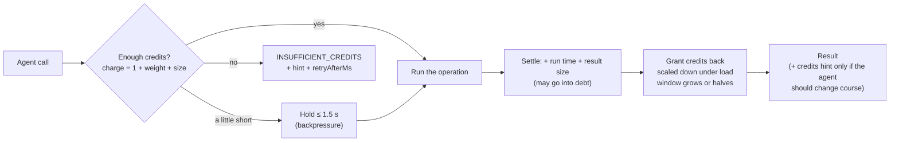
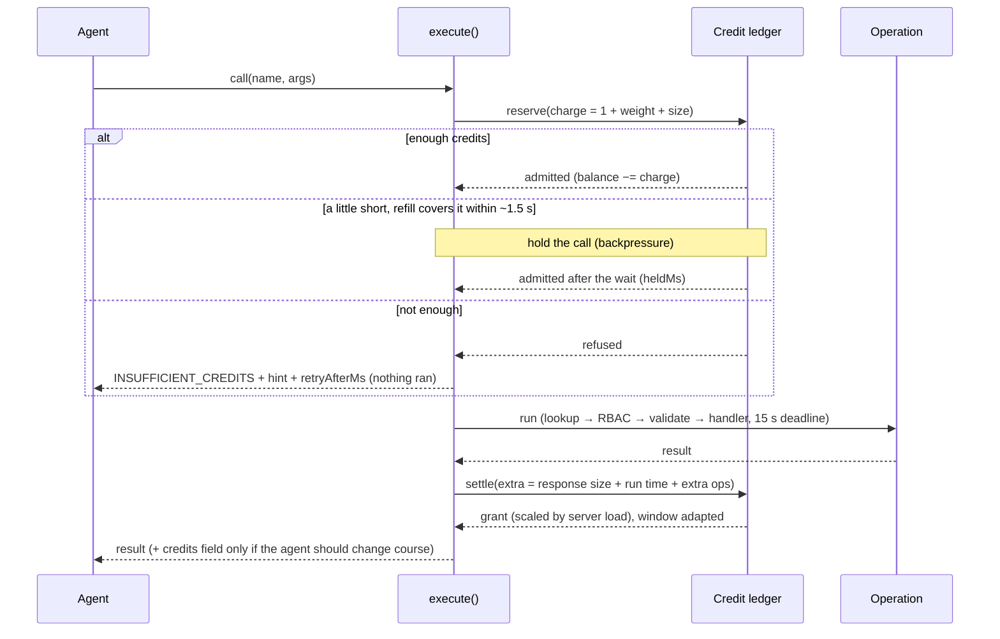

# NavWebMcp credits: flow control for agent traffic (≥ 1.4.0)

This document explains the credit mechanism in full: why it exists, how a call is charged,
how credits come back, what an agent sees, how admins control it, and where its limits
are. [Section 0](#0-in-short) is the short version.

- [0. In short](#0-in-short)
- [1. The problem](#1-the-problem)
- [2. The idea, borrowed from SMB](#2-the-idea-borrowed-from-smb)
- [3. Vocabulary](#3-vocabulary)
- [4. The lifecycle of one call](#4-the-lifecycle-of-one-call)
- [5. What a call costs](#5-what-a-call-costs)
- [6. How credits come back](#6-how-credits-come-back)
- [7. A worked example](#7-a-worked-example)
- [8. What the agent sees: piggybacked hints](#8-what-the-agent-sees-piggybacked-hints)
- [9. Each surface, side by side](#9-each-surface-side-by-side)
- [10. Agents that know the protocol (optional)](#10-agents-that-know-the-protocol-optional)
- [11. Profiles: agents strict, people loose](#11-profiles-agents-strict-people-loose)
- [12. Admin controls](#12-admin-controls)
- [13. Related limits that ship with credits](#13-related-limits-that-ship-with-credits)
- [14. Storage and multiple instances](#14-storage-and-multiple-instances)
- [15. Configuration](#15-configuration)
- [16. Design decisions](#16-design-decisions)
- [17. Known limits](#17-known-limits)
- [18. Code map and tests](#18-code-map-and-tests)

---

## 0. In short

Agents can make the server slow for everyone. Before this, nothing limited:
- how many calls one agent client had in flight;
- how long its calls ran (a `ui_*` call over MCP waits up to 8 s for the user's tab);
- how far one request fanned out: `invoke` takes 50 calls, and each can be another `invoke`,
  so three levels is 125,000 operations;
- how large a request body was.

A per-minute rate limit doesn't fit this. It treats a 5 ms read like an 8 s wait and
ignores how busy the server is. A daily quota limits the wrong thing. What's needed is
**flow control**, and SMB2/3 (Windows file sharing) solved that with **credits**.

### How it works

Every agent client has a credit **balance** and a **window**, the most it may hold.

1. **Each call is charged up front:** 1 per request, plus the operation's **weight**, plus
   **size**.
   - Weight is read 1, write 2; a composite costs the number of operations it runs (`book`
     4); `invoke` costs what it will run.
   - Size is 1 per 4 KB of arguments.
   - Only the top-level call pays, before anything runs, so a composite is never cut off
     halfway through its writes.
2. **When it finishes, the real cost is settled.** Each full second it ran costs 1 more, and
   a large result costs more. Long calls can leave the agent **in debt**.
3. **Credits come back with the response**, normally what the call cost. The server hands
   back **less when it is busy**. That is SMB's server-controlled `CreditResponse`, and it
   makes heavy callers slow down by themselves.
4. **The window adapts.** A long or debt-making call halves it; quick calls grow it, up to 64.
   A slow trickle (2/s) refills the balance, so no agent is stuck at zero for good.

If an agent is a little short, the server **holds** the call for up to 1.5 s and then runs
it, so the agent just sees a slower call. Only if that's not enough is the call **refused**
(`INSUFFICIENT_CREDITS`); nothing runs, and the refusal is audited.



### Every function shows its cost

Agents see the price before they call. Every function returned by `explore`, `search`,
`describe_tool` and `getCapabilities` carries a `credits` attribute. On MCP, every tool in
`tools/list` carries `_meta["navwebmcp/credits"] = { cost }`. The attribute is the cost of
one call on its own, before size and run time:

```jsonc
// search({ pattern: "book" }) → one of functions[]
{ "name": "book", "permission": "write", "module": "reservation.booking", "credits": 5 }
```

| Function | `credits` |
|---|---|
| any read (`getGuest`, `explore`, …) | 2 |
| any write (`createTask`, …) | 3 |
| `book`, `seatGuest` | 5 |
| `hostVipGuest` | 8 |
| `ui_list`, `ui_get_state` | 3 |
| `ui_set_state`, `ui_action` | 4 |
| `invoke` | 1, plus the weights of what it runs |

A small, quick call is charged exactly the published number. The cost is part of the
`capabilityHash`, so a cost change invalidates cached manifests.

### Agents don't need to know any of this

The server does the accounting. It tells the agent what it needs to know **inside the
result the agent already reads**, and only when it matters. A steady-state call carries
nothing extra and costs no extra tokens. When the balance is low, the agent is in debt, the
window shrank, or the call was held or refused, the `Result` envelope gains a `credits`
field with one plain-language sentence:

```jsonc
{
  "success": true,
  "data": { … },
  "credits": {
    "balance": 3, "window": 16, "charged": 7, "granted": 2,
    "hint": "Credits low (3 of 16). That call cost 7 credits because it ran 4 s; wait ~3 s before the next call, or combine independent reads into one invoke({ calls: [...] }) batch."
  }
}
```

The mechanism is defined once, on the envelope, and each surface carries it its own way,
the same transport-agnostic approach as the rest of NavWebMcp:

| Surface | What a model reads | For protocol-aware clients |
|---|---|---|
| WebMCP (in-page) | `credits` in the returned Result | same |
| MCP | an extra `[credits] …` text block, only when there's a hint | `_meta["navwebmcp/credits"]` on every result; send `_meta["navwebmcp/credits"] = { request: n }` to ask for more |
| HTTP `/api/call` | `credits` in the body | `X-NavWebMcp-Credits-*` headers; refusal is `429` + `Retry-After` |

Agents learn about it from two sentences in the server instructions (sent on every MCP
`initialize`), from `getContext()`, which returns the current `credits` snapshot, and from
the `invoke` description: one batch pays the per-request cost once, so it is cheaper than
separate calls.

### Who is metered

| | Agents (MCP clients, the in-page agent) | People clicking in the UI | System |
|---|---|---|---|
| Window | 16, adapts between 2 and 64 | 128, between 32 and 512 | not metered |
| Run time | charged, 1 per full second | not charged | — |

### Admin controls

- **Management tab → Access → Credits** lists every caller with its balance, window,
  calls, credits spent and refusals, and has **Freeze** / **Unfreeze** buttons.
- An admin's agent can call **`getCreditLedgers`** and **`setClientCreditPolicy`** (cap
  the window, change the refill rate, freeze, or reset; requires confirmation).
- Every change is in the audit trail as `admin.credit_policy_set`.

### Limits that ship with it

| Limit | Default | Error |
|---|---|---|
| Nesting depth (`invoke` in `invoke` in a composite) | 3 levels | `FANOUT_LIMIT` |
| Operations under one top-level call | 200 | `FANOUT_LIMIT` |
| Handler deadline | 15 s | `HANDLER_TIMEOUT` (time still charged) |
| JSON request body | 64 KB | HTTP 413 |
| Failed sign-ins per IP and username | 10 per 5 min | HTTP 429 |
| Requests in progress per caller (the request gate) | 8 per agent, 16 per person | `INSUFFICIENT_CREDITS` at once, with a hint |
| One request holding the instance's state lock | 30 s | lock passed on, event logged |
| Malformed MCP body | — | HTTP 400, JSON-RPC `-32700` |

Callers that are already out of credits, or over the gate, are turned away **at the door**:
before the request queues for the instance, and before the MCP transport builds a server for
it. A refusal costs about what any request costs the framework.

### Configuration and limits

| Variable | Default | Purpose |
|---|---|---|
| `CREDITS_ENABLED` | on | `false` switches metering off |
| `CREDITS_CAPACITY` | `64` | Concurrent calls per instance at which grants drop to zero |
| `CREDITS_AGENT_*`, `CREDITS_HUMAN_*` | see [docs](#15-configuration) | Any profile field, e.g. `CREDITS_AGENT_MAX_WINDOW=128` |
| `OP_DEADLINE_MS` | `15000` | Handler deadline |
| `MAX_BODY_BYTES` | `65536` | JSON body cap |
| `LOGIN_MAX_ATTEMPTS`, `LOGIN_WINDOW_S` | `10`, `300` | Sign-in throttle |
| `CREDITS_MAX_INFLIGHT_AGENT`, `_HUMAN` | `8`, `16` | The request gate |
| `STATE_LOCK_MAX_MS` | `30000` | State-lock watchdog |
| `REDIS_COMMAND_TIMEOUT_MS`, `REDIS_SOCKET_TIMEOUT_MS` | `1000`, `3000` | A hung Redis is detected and skipped, never waited on |

**Storage:**
- **With Redis,** all instances share one ledger per caller, updated by compare-and-set
  (`npm run test:redis` checks it).
- **Without Redis,** limits apply per instance instead of switching off.

### Tested to destruction

Credits sit in front of every call, so if they break, the app is unreachable. They are tested
at four levels:
- **property-based fuzzing:** 480,000 random steps checked against six safety invariants;
- **failure injection:** Redis hung, throwing, returning garbage or losing every race;
  corrupt ledgers; never-ending requests;
- **unit and integration** tests;
- **a "Mad Max" stress harness** against real servers (`npm run test:stress`): floods,
  fan-out bombs, long calls, slow clients, malformed bodies, many agents, two instances
  sharing Redis, and Redis stopped and **frozen** mid-run.

Testing found and fixed four ways to take the app down or starve every caller. Three were
pre-existing:
- **a 10-byte malformed MCP request** wedged the whole instance;
- **a frozen Redis** hung every request;
- **reservations leaked** by killed instances;
- **a corrupt stored ledger.**

Final run when credits shipped (1.4.0): **184 / 184** end-to-end checks, plus 979 automated tests (975 in the suite and 4 against a live Redis). While one agent
floods at 40-way concurrency, other agents and people keep **100 %** success, and the flooder
gets 93 of its 2,870 calls through. Full report: [credits-test-report.md](credits-test-report.md).

**Known limits:**
- **A raw request flood still costs CPU.** A refusal is as cheap as any request the framework
  serves, but not free. Put a per-IP request limit at the edge (Vercel Firewall, a WAF or the
  load balancer) in front of production.
- **Proxies must overwrite the client IP header.** The sign-in throttle trusts
  `x-forwarded-for`; Vercel overwrites it, other proxies must too.

More in [17. Known limits](#17-known-limits).

---

## 1. The problem

Once agents can call an application's operations, one badly behaved agent, or just an
over-eager one, can make the server slow for everyone. Before credits, a single agent
client could:

| Abuse | Why it hurts |
|---|---|
| **Many calls at once** | Nothing limited how many requests one client had in flight. |
| **Long calls** | A `ui_*` call over MCP waits up to 8 s for the user's tab. A big composite or batch also takes a while. Each one ties up the server for that long. |
| **Unbounded fan-out** | `invoke` takes up to 50 calls, and each of them can be another `invoke`. Three levels is already 125,000 operations from one request. |
| **Huge requests** | Request bodies were read in full before any check. |

A plain "N requests per minute" rate limit is a blunt tool here. It treats a 5 ms read and
an 8 s relay wait as the same thing, and it doesn't react to how loaded the server actually
is. A daily quota is worse: it limits how much an agent may do in a day, not how hard it may
push right now.

What we want is **flow control**. Each caller may have a bounded amount of work in
flight. Expensive work counts for more. The server, not the client, decides how fast work
may flow, depending on its own load.

## 2. The idea, borrowed from SMB

SMB2/3, the Windows file-sharing protocol, solved this problem decades ago with
**credits**:

- The server grants the client a number of credits.
- Every request consumes credits (`CreditCharge`). A bigger request consumes more; SMB charges
  one credit per 64 KB of payload.
- Every response hands credits back (`CreditResponse`). The server decides how many, based on
  how busy it is.
- The client may ask for more (`CreditRequest`), but the server has the last word.
- The server makes sure a client is never left with zero credits and nothing outstanding,
  which would deadlock it.

The effect is that **the server controls both how much a client can have outstanding and
how fast credits flow back to it.** A well-behaved client never notices. A heavy client
slows down by itself, because its credits come back more slowly than it spends them.

NavWebMcp keeps that shape exactly and adds two cost factors SMB doesn't need:

- **operation type**: a write costs more than a read, and a composite costs what it runs;
- **time spent running**: long calls are the expensive ones on this server, so every full
  second a call runs costs a credit.

And because NavWebMcp clients are LLM agents that have never read this document, it adds
one more thing: **the server explains itself in plain language**, inside the results the
agent already reads (§8).

## 3. Vocabulary

| Term | Meaning |
|---|---|
| **Principal** | Who pays. Each agent client has its own ledger (`a:<clientId>`; the in-page agent is `webmcp-<sessionId>`), and each person has one (`h:<userId>`). System calls (seed data, scripts) are never metered. |
| **Ledger** | The principal's state: `balance`, `outstanding`, `window`, plus totals for the admin view. |
| **Balance** | Credits available now. It can be **negative** (debt) after an expensive call. |
| **Outstanding** | Credits reserved by calls that are still running. |
| **Window** | The most credits this principal may hold, balance plus outstanding. It shrinks and grows over time (§6). |
| **Charge** | What a call reserves up front (§5). |
| **Extra** | What a call turns out to cost on top of its charge once it has finished (§5). |
| **Grant** | Credits handed back with the response (§6). |
| **Pressure** | How loaded this server instance is, from 0 to 1 (§6). |
| **Hint** | One plain-language sentence the server adds to a result when the agent should change course (§8). |

## 4. The lifecycle of one call

Only **top-level** calls are metered. A call made from inside another (by `invoke`, or by a
composite such as `book`) is covered by its parent's cost. A composite therefore never runs
out of credits halfway through its writes. Admission happens before anything runs.



Step by step:

1. **Reserve.** Compute the charge (§5). If `balance ≥ charge`, take it: `balance −= charge`,
   `outstanding += charge`.
2. **Hold or refuse.** If the caller is short:
   - **Hold** (backpressure) if the trickle refill would cover the gap within `maxHoldMs`
     (1.5 s for agents). The server waits, then admits the call. A naive agent just sees a
     slower call. Each caller can have only one call held at a time.
   - **Refuse** otherwise, with `INSUFFICIENT_CREDITS` and a `retryAfterMs`. Nothing ran.
     The refusal is audited and counted as a denial in the usage metrics.
3. **Run.** The usual lookup, RBAC check, input validation and handler, now under a 15 s
   deadline.
4. **Settle.** Add the extra cost (§5) to what the call was charged. The balance may go
   negative.
5. **Grant and adapt.** Hand credits back and adjust the window (§6).
6. **Reply.** The surface always gets the credit state. The agent sees it in the result
   only when there's something to act on (§8).

## 5. What a call costs

**Up front (the charge)**, SMB's `CreditCharge`:

```
charge = REQUEST_COST + weight + floor(requestBytes / sizeUnit)
```

- **An idempotent replay (≥ 2.1.0) pays `REQUEST_COST` only.** It ran nothing, so the rest of
  the reservation is handed back when it settles. The same goes for an `invoke` single call
  that relays a replay.
- **`REQUEST_COST` = 1**, paid once per top-level request. It is what makes one batch cheaper
  than the same calls sent one by one.
- **`weight`:**

  | Operation | Weight |
  |---|---|
  | any read | 1 |
  | any write | 2 |
  | `book` / `seatGuest` / `hostVipGuest` | 4 / 4 / 7, the number of operations they run |
  | `ui_list`, `ui_get_state` | 2 (over MCP they wait on the user's tab) |
  | `ui_set_state`, `ui_action` | 3 |
  | `invoke` | the sum of the weights of everything it will run, read from its arguments |
  | unknown name | 1 (failed lookups still cost something) |

- **Size:** one credit per full `sizeUnit` (4 KB for agents) of arguments. A normal request
  pays nothing for size.

**After it ran (the extra):**

```
extra = floor(responseBytes / sizeUnit)              # big results
      + floor(durationMs / timeUnitMs) × timeRate    # each full second it ran (agents only)
      + undeclared nested operations                 # more ops ran than the charge expected
```

A quick call with a normal-size result has an extra of 0. An 8-second relay wait has an
extra of 8.

**Batch vs separate calls.** Three reads sent separately cost `3 × (1 + 1) = 6`. The same
three in one `invoke({ calls })` cost `1 + 3 = 4`.

**Every function publishes its cost.** An agent sees the price before it calls. Every
function in discovery carries a `credits` attribute: the cost of one call on its own,
`1 + weight`, before size and run time.

| Where | How the cost appears |
|---|---|
| `explore`, on each entry of `functions` | `{ "name": "book", "permission": "write", …, "credits": 5 }` |
| `search`, on each entry of `functions` | same |
| `describe_tool` | `"credits": 5` beside `permission`, `parallelSafe` and the schemas |
| `getCapabilities`, on each tool in the manifest | same |
| MCP `tools/list`, on each loaded tool | `_meta["navwebmcp/credits"] = { "cost": 5 }` |

For `invoke` the published cost is `1`, the per-request cost: the operations it runs add
their own weights on top. The number is the same one `chargeFor` charges, so a small, quick
call is charged exactly what was published. The cost is also part of the
`capabilityHash` fingerprint, so if an operation's cost changes, an agent's cached manifest
is invalidated.

```jsonc
// search({ pattern: "book" }) → functions[0]
{
  "name": "book", "title": "Book a Table", "description": "Book a table in ONE step: …", "permission": "write",
  "parallelSafe": false, "module": "reservation.booking",
  "path": "reservation/booking/book",
  "credits": 5
}
```

## 6. How credits come back

**The grant**, SMB's `CreditResponse`:

```
granted = min(asked, window − outstanding − balance) × (1 − pressure)
```

- **`asked`** is the client's `CreditRequest` if it sent one (§10), otherwise **what the call
  was charged**. So a quick, cheap call costs nothing net: its charge comes straight back.
- **`window − outstanding − balance`** stops the grant from overfilling the window. When the
  balance is negative, this room is larger, so grants pay the debt down first.
- **`pressure`** is the worse of two load signals on this instance:
  - **calls in flight**, compared with `CREDITS_CAPACITY` (64): 0 below half capacity,
    1 at full capacity;
  - **event-loop lag**, i.e. how late the server's timers fire: 0 at 50 ms, 1 at 400 ms.
    A Node instance swamped with quick requests has few calls in flight at any instant, but
    everyone waits in line for the CPU. Lag measures that wait, so it is what makes a flooding
    caller's grants dry up. Stress testing showed in-flight count alone never rose during a
    40-way flood.

  Under load the server hands back less than was spent, and heavy callers slow down by
  themselves.

**The window adapts (AIMD**, the same idea as TCP congestion control):

- A call longer than `longCallMs` (3 s for agents), or a call that leaves the caller in
  debt, **halves** the window, down to `minWindow`.
- A call that finishes quickly while pressure is low **grows** it by 1, up to `maxWindow`.

So an agent that keeps making long calls can soon hold only a couple of credits, which means
one call in flight at a time. An agent that behaves well grows its window up to 64.

**The trickle.** The balance also refills continuously toward the window at
`refillPerSec` (2/s for agents). This is SMB's starvation guard: an agent that ran up debt,
or was refused, always recovers. It also bounds how fast an indebted agent can go.

## 7. A worked example

An agent starts with the agent profile: balance 16, window 16. For clarity, this example
ignores the trickle refill between and during calls; in reality the trickle makes every
step a little more forgiving.

| # | Call | Charge | Extra | Grant | Balance after | Window after | Result carries a hint? |
|---|---|---|---|---|---|---|---|
| 1 | `explore()`, 5 ms | 1 + 1 = 2 | 0 | 2 | 16 | 17 (quick: +1) | No |
| 2 | `invoke` of 3 reads + `book`, 30 ms | 1 + 3 + 4 = 8 | 0 | 8 | 16 | 18 | No |
| 3 | `ui_set_state` over MCP, no tab answers, 8 s | 1 + 3 = 4 | 8 s → 8 | 4 | 8 | 9 (long: halved) | **Yes**: the window shrank |
| 4 | Another 8 s `ui_set_state` straight away | 4 | 8 | 4 | 0 | 4 (halved) | **Yes**: shrank, and low |
| 5 | `explore()` immediately | 2 | — | — | — | — | Short by 2, refill covers it in 1 s: **held 1 s**, then runs. Hint: *"waited 1 s for credits"* |
| 6 | Another call arrives while call 5 is still waiting | — | — | — | — | — | **Refused**, nothing ran: *"another call of yours is already waiting for credits. Send calls one at a time; retry in 1 s."* |

Calls 1 and 2 are the normal case. Nothing is added to the result, so it costs no tokens,
and the window grows. Calls 3 and 4 are the abuse case: long calls make the agent pay for
their time, shrink what it may hold, and it is told so in plain words. Calls 5 and 6 show
the server pacing the agent without the agent needing to understand why.

## 8. What the agent sees: piggybacked hints

The agent doesn't need to know this protocol. The server tells it what to do inside the
results it already reads.

The protocol-level `Result` envelope (`lib/result.ts`), which every surface returns, gains
one optional field:

```jsonc
{
  "success": true,
  "data": { … },
  "credits": {
    "balance": 3,       // credits available now (may be negative)
    "window": 16,       // most credits you may hold right now
    "charged": 7,       // what this call cost in total
    "granted": 2,       // credits handed back with this response
    "retryAfterMs": 2000, // only on a refusal
    "heldMs": 900,      // only if the call was held for credits
    "hint": "Credits low (3 of 16). That call cost 7 credits because it ran 4 s; wait ~3 s before the next call, or combine independent reads into one invoke({ calls: [...] }) batch."
  }
}
```

**It is attached only when the agent should change what it's doing:**

- the balance is below 25 % of the window;
- the balance went negative;
- the window shrank;
- the call was held;
- the call was refused.

In the steady state there is no `credits` field at all, so a well-behaved agent pays no
tokens for the mechanism.

**`hint` is always one actionable sentence**, written for a model that knows nothing about
credits. It says what happened, why, and what to do next. The wording lives in one place,
`lib/credits/hint.ts`:

| Situation | Hint (example) |
|---|---|
| Low balance | *Credits low (3 of 16). That call cost 2 credits; wait ~3 s before the next call, or combine independent reads into one invoke({ calls: [...] }) batch.* |
| Debt after a long call | *That call cost 9 credits because it ran 8 s; your balance is now -4 (of 8). Wait ~4 s before the next call, or combine …* |
| Window shrank | *That call cost 12 credits because it ran 8 s; you can now hold at most 9 credits because your calls run long or cost more than they return. Make fewer, smaller calls; …* |
| Held | *This call waited 1 s for credits (0 of 4 left). Slow down: wait ~1 s before the next call, or combine …* |
| Refused, out of credits | *Refused: out of credits (0 of 4 left). Retry in 3 s. Calls cost more when they are large or slow; combine …* |
| Refused, another call held | *Refused: another call of yours is already waiting for credits. Send calls one at a time; retry in 1 s.* |
| Refused, frozen by an admin | *Refused: an administrator has paused this agent's access. Don't retry; tell the user.* |

A refusal also puts the hint in `error.message` of `INSUFFICIENT_CREDITS`, because every agent
reads error messages.

**Discovery, up front and cheap:**

- **Server instructions.** These are sent to every MCP client (in `server/discover` on the
  2026-07-28 revision, on `initialize` before it), and to the
  in-page bridge. They carry two sentences: calls cost credits by type, size and run time;
  if a result carries `credits.hint` or a `[credits]` note, follow it; and batch reads with
  `invoke`.
- **`getContext()`** returns a `credits` snapshot:
  `{ balance, window, maxWindow, refillPerSec, frozen }`.
- **Each function's cost** is shown wherever functions are discovered: `explore`, `search`,
  `describe_tool`, `getCapabilities` and MCP `tools/list` (§5).
- **The `invoke` description** says a batch costs fewer credits than separate calls.

## 9. Each surface, side by side

The mechanism is defined once, against the `Result` envelope. Each surface carries it in its
own native way, so NavWebMcp stays transport-agnostic.

| Surface | What a naive LLM reads | What a protocol-aware client can use |
|---|---|---|
| **WebMCP** (in-page `document.modelContext`) | `credits` in the returned Result | the same field |
| **MCP** (Streamable HTTP) | an extra text block `"[credits] …"` in `content`, only when there is a hint. `structuredContent` is untouched, so it still validates against the tool's outputSchema | `_meta["navwebmcp/credits"]` with `{ balance, window, charged, granted, … }` on **every** metered result |
| **HTTP** `POST /api/call` | `credits` in the JSON body | headers `X-NavWebMcp-Credits-Balance`, `-Window`, `-Charged`, `-Granted` on every metered response. A refusal is HTTP **429** with `Retry-After` |

An MCP tool result with a hint, as the model sees it:

```jsonc
{
  "content": [
    { "type": "text", "text": "{ …the data… }" },
    { "type": "text", "text": "[credits] Credits low (3 of 16). That call cost 2 credits; wait ~3 s before the next call, or …" }
  ],
  "structuredContent": { …the data… },
  "_meta": { "navwebmcp/credits": { "balance": 3, "window": 16, "charged": 2, "granted": 2, "hint": "…" } }
}
```

## 10. Agents that know the protocol (optional)

Nothing depends on this; it is for clients that want to manage their own pacing.

- **Read the state on every call:** `_meta["navwebmcp/credits"]` on MCP, or the
  `X-NavWebMcp-Credits-*` headers on HTTP.
- **Ask for a bigger grant** (SMB's `CreditRequest`):
  - MCP: send `params._meta["navwebmcp/credits"] = { "request": n }` with the tool call;
  - HTTP: send the header `X-NavWebMcp-Credit-Request: n`.

  The server grants up to `n`, still limited by the window and by load. The value is
  capped at 1024.
- **Plan before you start** with `getContext().credits`.
- **Pace yourself:** don't send a call whose charge is more than your balance; batch reads;
  prefer composites.

## 11. Profiles: agents strict, people loose

| | agent (MCP clients and the in-page agent) | human (people clicking in the UI) |
|---|---|---|
| initial / min / max window | 16 / 2 / 64 | 128 / 32 / 512 |
| refill | 2 credits/s | 20 credits/s |
| size unit | 4 KB | 16 KB |
| run time charged | 1 credit per full second | not charged |
| "long call" threshold | 3 s | 10 s |
| longest hold | 1.5 s | 1 s |

People get a safety net that a person clicking can't realistically hit. System actors
(seed data, scripts, benchmarks) are never metered.

## 12. Admin controls

| Where | What |
|---|---|
| **Management tab → Access → Credits** | Every metered caller with its balance, window and max window, calls, credits spent, calls refused and last call. **Freeze** / **Unfreeze** buttons. |
| `getCreditLedgers` (admin operation) | The same table for an admin's agent, filterable by `kind` (agent / human). |
| `setClientCreditPolicy` (admin operation, `requiresConfirmation`) | For one caller: cap `maxWindow`, change `refillPerSec`, `frozen: true/false`, or `reset: true` back to the defaults. Takes effect on its next call. |
| `GET` / `POST /api/admin/credits` | The HTTP API behind the tab. |

Every policy change is written to the SOC2 audit trail as `admin.credit_policy_set`, with
who did it and what changed. Every refusal is an audited operation event with
`errorCode: INSUFFICIENT_CREDITS`, counted as a denial in usage metrics.

Freezing an agent is softer than revoking it: its token stays valid, but every call is
refused with *"an administrator has paused this agent's access"*. Use it when an agent is
misbehaving and you don't want to disconnect it for good.

## 13. Related limits that ship with credits

Credits meter work; these limits cap the shape of a single request.

| Limit | Default | What happens |
|---|---|---|
| Nesting depth (`invoke` inside `invoke`, composites inside them) | 3 levels | The call that would nest deeper isn't run: `FANOUT_LIMIT` |
| Operations run under one top-level call | 200 | Further nested calls aren't run: `FANOUT_LIMIT` |
| Handler deadline | 15 s (`OP_DEADLINE_MS`, or `deadlineMs` on an operation) | `HANDLER_TIMEOUT`. The time is still charged. The handler may still finish in the background, so read back before retrying a write, or (≥ 2.1.0) pass an `idempotencyKey` and resend the same call. |
| JSON request body (`/api/call`, `/api/ui/relay`, `/api/admin/credits`, `/api/login`, MCP) | 64 KB (`MAX_BODY_BYTES`). Sign-in is 4 KB, and the UI snapshot keeps its own 256 KB | HTTP 413 `PAYLOAD_TOO_LARGE`. Reading stops at the cap instead of buffering everything first. |
| Failed sign-ins per IP **and username** | 10 per 5 min (`LOGIN_MAX_ATTEMPTS`, `LOGIN_WINDOW_S`) | HTTP 429 `TOO_MANY_ATTEMPTS` + `Retry-After`. Only failures count. Someone guessing one account can't lock every other user behind the same IP (an office NAT) out. |
| Requests in progress per caller, per instance (the **request gate**) | 8 per agent client, 16 per person (`CREDITS_MAX_INFLIGHT_AGENT`, `_HUMAN`) | Further requests are answered at once with `INSUFFICIENT_CREDITS` and a hint; nothing runs. Counted from arrival until the response is fully sent. |
| Time one request may hold the instance's state lock | 30 s (`STATE_LOCK_MAX_MS`) | The lock is handed to the next request and the event is logged. |
| Malformed MCP body (not JSON, not a JSON-RPC object or batch) | — | HTTP 400, JSON-RPC `-32700`, before it reaches the transport. |

### Protection at the door

Two checks run **before** a request does any expensive work: before it queues for the
instance's state lock, and before the MCP transport builds a server for it.

1. **The request gate** (`lib/credits/gate.ts`). One caller may have only a few requests in
   progress on this instance at once, so it can never fill the line everybody else waits in.
2. **The quick refusal** (`quickRefusal` in `lib/credits/index.ts`). A caller that is frozen,
   or whose balance can't cover even the cheapest call within the hold time, is refused on
   the spot. That costs about as much as any request to the framework: 5–6 ms here, versus
   about 12 ms for a real MCP call.

Both answer **in-band**. On MCP the answer is a tool result with `isError` and the hint; on
HTTP it is 429 with the hint and `Retry-After`. The model reads why, instead of seeing a
transport error.

Reading the request body, which a slow client can trickle in, also happens before the lock.
A slow upload therefore never holds the instance.

## 14. Storage and multiple instances

- **On Redis** (`REDIS_URL`), each principal has one JSON ledger,
  `webmcp:credits:<env>:l:<principal>`. It is updated by **read → compute → compare-and-set**:
  a small Lua script writes the new ledger only if its version number hasn't changed, and the
  update is retried on conflict. All instances therefore share one ledger per caller and
  never overwrite each other. Admin overrides live beside it at `…:o:<principal>`. An idle
  ledger expires after a day.
- **Without Redis, or while it's down,** an in-process map is used. Limits then apply per
  instance instead of switching off.
- **All the arithmetic is in pure functions** (`refill`, `reserve`, `settle` in
  `lib/credits/ledger.ts`), shared by both paths, so the Redis path and the in-memory path
  can't drift apart.

**What can't take the app down.** Each of these is covered by a test:

| Failure | What happens |
|---|---|
| Redis down | In-process ledger. Metering continues per instance. |
| Redis **connected but not answering** | Every credit command is bounded by `CREDITS_REDIS_TIMEOUT_MS` (300 ms), then falls back to memory. A call never hangs on Redis. |
| A corrupt stored ledger or override (NaN, wrong types, bad JSON) | Discarded; the caller starts fresh. Never trusted, never a permanent lock-out. |
| An instance killed mid-call, so its settle never runs | Each reservation carries its own id and time. A reservation older than `CREDITS_HOLD_STALE_MS` (120 s) expires, so no caller is starved by credits nobody will ever release. |
| A settle that arrives after its reservation expired | Releases nothing; no double release. |
| Many concurrent calls from one caller | Serialized per caller inside the instance, so they don't fight over the compare-and-set. Across instances, up to 10 jittered retries. |
| Endless distinct callers | The in-process ledger map is LRU-bounded (`CREDITS_MEMORY_MAX_LEDGERS`, 20,000). The admin list is capped at 2,000. |
| A bug inside the credit code | Admission fails **open**: the call runs unmetered and the error is logged. Metering exists to protect availability, so it must never be the reason for an outage. |

## 15. Configuration

| Variable | Default | Purpose |
|---|---|---|
| `CREDITS_ENABLED` | on | Set to `false` to switch metering off entirely |
| `CREDITS_CAPACITY` | `64` | Concurrent metered calls per instance behind `pressure` |
| `CREDITS_<AGENT\|HUMAN>_INITIAL_WINDOW` / `_MIN_WINDOW` / `_MAX_WINDOW` | see §11 | The window |
| `CREDITS_<AGENT\|HUMAN>_REFILL_PER_SEC` | see §11 | The trickle |
| `CREDITS_<AGENT\|HUMAN>_SIZE_UNIT` | see §11 | Bytes per credit |
| `CREDITS_<AGENT\|HUMAN>_TIME_UNIT_MS`, `_TIME_RATE` | see §11 | Run-time charge |
| `CREDITS_<AGENT\|HUMAN>_LONG_CALL_MS` | see §11 | When a call counts as long |
| `CREDITS_<AGENT\|HUMAN>_MAX_HOLD_MS` | see §11 | The longest backpressure wait |
| `OP_DEADLINE_MS` | `15000` | Handler deadline |
| `MAX_BODY_BYTES` | `65536` | JSON body cap |
| `LOGIN_MAX_ATTEMPTS`, `LOGIN_WINDOW_S` | `10`, `300` | Sign-in throttle |
| `CREDITS_MAX_INFLIGHT_AGENT`, `CREDITS_MAX_INFLIGHT_HUMAN` | `8`, `16` | The request gate |
| `CREDITS_LAG_LOW_MS`, `CREDITS_LAG_HIGH_MS` | `50`, `400` | Event-loop lag that maps to pressure 0 and 1 |
| `CREDITS_REDIS_TIMEOUT_MS` | `300` | Longest a credit check waits on Redis |
| `CREDITS_HOLD_STALE_MS` | `120000` | When an unsettled reservation is treated as lost |
| `CREDITS_MEMORY_MAX_LEDGERS` | `20000` | Size bound of the in-process ledger map |
| `STATE_LOCK_MAX_MS` | `30000` | Watchdog on the per-instance state lock |

## 16. Design decisions

- **Flow control, not a quota.** The goal is to stop one caller hurting everyone else right
  now, not to ration how much it may do in a day. A window plus server-controlled grants does
  that, and it adapts to load. If you ever need billing, this is where a durable ledger would
  plug in.
- **Charge for time.** The expensive thing on this server is a call that holds resources
  for seconds, not a large number of cheap ones. Charging per second makes the expensive case
  expensive without penalising normal traffic.
- **Only the top-level call pays, and pays up front.** A composite or batch is admitted or
  refused as a whole, before anything runs. Refusing halfway through a multi-step write
  would leave half-done work.
- **Hold before refusing.** A short wait is invisible to a naive agent, whereas an error
  forces it to reason about it. Holding is limited to one call per caller, and it never
  happens while the instance's state lock is held, which would stall every request.
- **Hints only when they matter.** A credits field on every result would cost every agent
  tokens on every call. Attaching it only at the moments the agent should act keeps the
  cost at zero for well-behaved agents.
- **In-band text for models, `_meta` and headers for programs.** Models read `content` and
  error messages; many MCP clients drop `_meta`. Programs prefer structured data. Each
  gets what it reads.
- **Fail to per-instance, not open.** If Redis is down, limits keep working per instance
  instead of disappearing.

## 17. Known limits

- **Raw request floods need an edge limit too.** Inside the app, a refused request costs about
  as much as any request the framework serves (5–6 ms). That is about half of a real MCP call,
  but not zero. One client hammering a single Node process at full speed still uses CPU that
  everyone else waits for. In testing, other callers stayed 100 % successful, but a person's
  p95 rose to about 1.4 s during a 40-way flood on a laptop running both the load and the
  server. Put a per-IP request rate limit at the edge (Vercel Firewall, a WAF, or the load
  balancer) in front of production. Credits decide *how much work* each caller gets; the edge
  limit decides *how many packets* reach the app. Report: [credits-test-report.md](credits-test-report.md).
- **No holding inside the state lock.** For that reason a short caller is refused, not held,
  on routes that hold the lock (`/api/call`); `retryAfterMs` still tells it when to retry.
- **One held call per instance, not globally.** With several instances, a caller could have
  one call held on each.
- **The sign-in throttle trusts `x-forwarded-for`.** It keys on that header together with the username. Vercel sets the header itself;
  behind any other proxy, make sure the proxy overwrites it, or a client can rotate it to
  avoid the throttle.
- **A deadline doesn't cancel the handler.** `HANDLER_TIMEOUT` frees the caller, but the
  handler may still complete.
- **About four Redis round trips per metered call:** a read and a compare-and-set to
  reserve, and the same again to settle.

## 18. Code map and tests

| File | Role |
|---|---|
| `lib/credits/policy.ts` | Profiles, env overrides, who pays (`principalOf`), `chargeFor`, `extraFor` |
| `lib/credits/ledger.ts` | Ledger state; pure `refill` / `reserve` / `settle`; the Redis CAS and in-memory storage |
| `lib/credits/pressure.ts` | In-flight counter → pressure |
| `lib/credits/hint.ts` | When a hint is needed, and its wording |
| `lib/credits/index.ts` | Admission (including the hold), settlement, `peek` for `getContext`; installs the port |
| `lib/credits/admin.ts` | Ledger listing and per-caller overrides for the management layer |
| `lib/credits/port.ts` | The browser-safe interface `execute()` calls through |
| `lib/operations/execute.ts` | The hook: credits stage, fan-out caps, deadline |
| `lib/adapters/mcp.ts`, `app/api/call/route.ts` | How MCP and HTTP carry the credit state |
| `lib/http-limits.ts`, `lib/login-throttle.ts` | Body caps, sign-in throttle |
| `lib/credits/gate.ts` | The request gate: requests in progress per caller, held until the response body is sent |
| `lib/shared-state/mutex.ts`, `lib/shared-state/redis.ts` | State-lock watchdog; Redis command, ping and socket timeouts |
| `app/api/admin/credits/route.ts`, `components/management/AccessPanel.tsx` | Admin API and the Credits table |

| Test | Covers |
|---|---|
| `tests/unit/credits/ledger.test.ts` | Charges, batch discount, size and time costs, reserve/settle, debt, AIMD, pressure, `CreditRequest`, trickle, freeze, overrides |
| `tests/unit/credits/execute.test.ts` | Through `execute()`: who pays, no field in steady state, bursts refused with hints, audited refusals, hold, busy refusal, time charge, fan-out caps, deadline, `getContext` |
| `tests/unit/credits/surfaces.test.ts` | Hint wording, MCP `_meta` and `[credits]` block, refusal over MCP, `CreditRequest` via `_meta`, body cap, sign-in throttle |
| `tests/integration/redis-live.test.ts` | The compare-and-set against a real Redis (`npm run test:redis`) |
| `tests/unit/credits/ledger-fuzz.test.ts` | 480,000 random steps checking six safety invariants; corrupt and hostile stored data; 1,000 concurrent updates; bounded memory |
| `tests/unit/credits/redis-failures.test.ts` | Redis that hangs, throws, returns garbage or loses every compare-and-set |
| `tests/unit/credits/gate.test.ts` | The request gate, quick refusal, lag pressure and fair share |
| `tests/unit/shared-state/mutex-watchdog.test.ts` | A never-ending request can't wedge the instance |
| `scripts/credits-stress.mjs` (`npm run test:stress`) | 14 attack and load scenarios against real servers, with and without Redis, including Redis outages. Results and fixed bugs: [credits-test-report.md](credits-test-report.md) |
