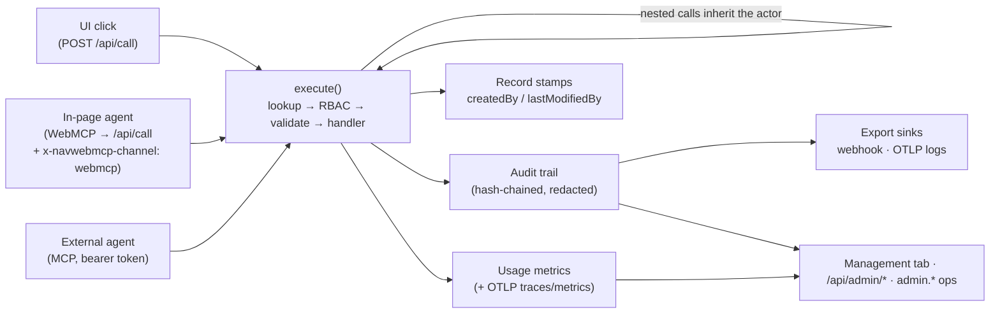

# Management layer: monitoring, telemetry and SOC2 audit

Once agents can act inside an application, the people running it need answers that a
plain request log can't give:

- **Who did this?** Was this reservation created by a person clicking in the app, or by
  an AI agent acting for them? Which agent? Through which surface?
- **How is the app being used?** How much of the work is done by agents now? Which
  operations do they call, how often do they fail or get denied, and how fast is it?
- **Who is connected right now,** and how do I cut off one agent without logging the
  user out?
- **Can I prove it?** For SOC 2, the audit trail must be complete, tamper-evident,
  retained, and free of personal data it doesn't need.

The management layer answers all four. It has six parts, each built on the one
before it:

| # | Part | What it gives you | Main code |
|---|---|---|---|
| 1 | [One execution path](#1-one-execution-path-and-the-actor) | Every call, from every surface, knows **who** made it (human / agent / system) and **how** (channel, session, request) | `lib/operations/execute.ts` |
| 2 | [Sessions and agent identity](#2-sessions-and-agent-identity) | A session per sign-in and an identity per agent, each separately **revocable** | `lib/management/` |
| 3 | [SOC2 audit trail](#3-the-soc2-audit-trail) | Append-only, **hash-chained**, redacted, retained, exportable record of every call and sign-in event | `lib/audit/` |
| 4 | [Who created it, on the record](#4-who-created-it-on-the-record) | `createdBy` / `lastModifiedBy` on business records, linked to the audit event | `lib/provenance.ts` |
| 5 | [Usage telemetry](#5-usage-telemetry) | Human vs agent usage, adoption, errors, latency vs SLO; optional **OpenTelemetry** export | `lib/telemetry/` |
| 6 | [Admin surface](#6-the-admin-surface-apis-agent-operations-and-the-management-tab) | `/api/admin/*`, `admin.*` operations for agents, and the **Management** tab | `app/api/admin/`, `lib/operations/management.ts`, `components/management/` |

The SOC 2 control mapping, the configuration an auditor will expect, and the known
limits are in [`docs/management-soc2.md`](management-soc2.md).

## How a call is observed



## 1. One execution path, and the actor

Before this layer, each surface (`/api/call`, the MCP adapter, nested calls from
`invoke` and composites) did its own RBAC, validation and logging, and the server
couldn't tell a person's click from the in-page agent's: both arrived at `/api/call`
with the same cookie. Now **every** call goes through `execute()`
(`lib/operations/execute.ts`):

```
lookup → RBAC → input validation → handler → output check → audit + metrics
```

Rejected calls (unknown operation, wrong role, invalid input) are recorded too. HTTP
statuses and each surface's error codes are unchanged.

Every call carries an **actor** and **call metadata** (`lib/operations/types.ts`):

```ts
interface Actor {
  type: "human" | "agent" | "system";   // who acted
  userId: string; role: Role;            // the accountable person (for agents: who authorised it)
  assurance: "verified" | "asserted";    // how sure the server is (below)
  sessionId?: string;                    // the human sign-in session behind it
  agent?: { clientId: string; name?: string; version?: string; sessionId?: string };
}
interface CallMeta {
  requestId: string;       // one per top-level request
  callId?: string;         // one per operation call (= its audit event id)
  parentCallId?: string;   // set on nested calls
  channel: "ui" | "webmcp" | "mcp" | "internal";
  ip?: string; userAgent?: string;
}
```

How each surface is classified:

| Surface | `actor.type` | `channel` | `assurance` | Identity comes from |
|---|---|---|---|---|
| A person clicking in the app | `human` | `ui` | `asserted` | the signed session cookie |
| The in-page WebMCP agent | `agent` | `webmcp` | `asserted` | the signed session cookie, plus the `x-navwebmcp-channel: webmcp` header the page adds to the agent's calls (`x-navwebmcp-agent` carries its name) |
| An external MCP agent | `agent` | `mcp` | `verified` | the server-issued bearer token, which names the agent client |
| In-process calls (tests, scripts) | `system` | `internal` | `asserted` | — |

The cookie always proves **who**. Whether a person or the in-page agent pressed the
button is the browser's word, so it is recorded as `asserted` rather than `verified`,
and an auditor can filter on that.

**Nested calls inherit the actor.** When a person books through the `book` composite,
its inner `searchAvailability`, `createReservation` and `getReservation` calls are
recorded as that person's too. They share the request id and point at the `book` call
through `parentCallId`, so the whole chain can be reconstructed (and shows up as one
trace in OpenTelemetry).

**In-page `ui_*` writes.** The 1.3.0 UI operations run entirely in the browser and never
reach the server. The page reports their writes to `POST /api/audit/report`, and they
are recorded with `reportedBy: "client"`. The endpoint only accepts operations that
really run in the page (`runsInPage`), so it can't be used to plant records of server
operations.

**Why "ports".** The operation registry, and so `execute()`, is also bundled into the
browser, while the audit store, telemetry and management service need `node:crypto` and
the Redis client. So `execute()` talks to them through dependency-free ports
(`lib/audit/port.ts`, `lib/telemetry/port.ts`, `lib/management/port.ts`) that the server
entry points switch on by importing the real modules — the same pattern as
`lib/ui-relay/port.ts`. `next build` confirms nothing server-only reaches the client.

## 2. Sessions and agent identity

Previously an agent token *was* the user: every agent of the same user got an identical
token, so two agents couldn't be told apart and none could be revoked; and logout only
deleted the cookie, so a copied cookie kept working.

**Sessions.** Each sign-in now gets a session id inside the signed cookie
(`lib/auth-tokens.ts`). A demo role switch keeps the same session.

**Agent clients.** Each agent token names an **agent client** (`cid`) and the session
that authorised it:

| Kind | Where it comes from | Use |
|---|---|---|
| `default` | The token shown in the Agent tab — one per session and role, stable across page loads | Quick start |
| `connected` | `POST /api/agent-clients { "label": "Claude Desktop" }` — a new, separately revocable client | One per agent you connect |
| `legacy` | Tokens issued before this change | Still accepted; revocable only per user |

**What ending each one does:**

| Action | The session | Agents it authorised | Who can |
|---|---|---|---|
| Logout | Ends on its next request (cookie cleared) | **Keep working** | the user |
| Revoke an agent client | — | That agent only, from its next call | the user (own), an admin (any) |
| Revoke a session | Ends | **Stop too** | an admin |

A revocation is never turned back into a logout, and revoking an already-logged-out
session still cuts off its agents.

**Liveness.** Every authenticated request records a heartbeat (at most once a minute per
session or client, per server instance). "Connected" means active in the last 5
minutes. MCP agents' self-reported software (`clientInfo` name and version) is recorded
when the server sees it.

**Storage.** Long-lived Redis hashes (`webmcp:mgmt:<env>:*`, 90 days), separate from the
24-hour demo snapshot (`lib/management/records.ts`). Records are written once; "ended",
"last seen" and "software" live in their own hashes keyed by the same id, so a heartbeat
on one server can't overwrite a revocation made on another.

Every API route and the MCP endpoint authenticate through `lib/management/auth.ts`
(`authenticateSession`, `authenticateAgentToken`), which adds these checks on top of the
signature and expiry checks in `lib/auth-tokens.ts`.

**Self-service endpoint** — `/api/agent-clients` (any signed-in user, own clients only):

| Method | Body | Does |
|---|---|---|
| `GET` | — | List your agent clients with last-seen and status |
| `POST` | `{ "label": "Claude Desktop" }` | Create a new agent client; returns `{ clientId, agentToken }` |
| `DELETE` | `{ "clientId": "c_…" }` | Revoke one of yours (`404` for an unknown id or someone else's) |

## 3. The SOC2 audit trail

`lib/audit/` replaces the old 100-entry, 24-hour activity log as the system of record.
(The activity log still exists for the UI's live feed.)

**An event** (`lib/audit/types.ts`, versioned `v: 1`):

```jsonc
{
  "v": 1, "seq": 19, "id": "4ccaf980-…",          // id = the call id
  "ts": "2026-11-23T19:37:18.996Z",
  "category": "operation",                          // operation | auth | admin
  "action": "createReservation",
  "outcome": "success",                             // success | failure | denied
  "actor": { "type": "agent", "userId": "u_alice", "role": "customer", "assurance": "verified",
             "sessionId": "s_…", "agent": { "clientId": "c_…", "name": "Claude Desktop" } },
  "channel": "mcp",
  "requestId": "533f…", "callId": "4ccaf980-…", "parentCallId": "6c55…",
  "ip": "203.0.113.7", "userAgent": "…",
  "target": { "type": "reservation", "id": "ja21du1p" },   // which record
  "input":  { "slotId": "slot_2026-12-04_1400", "name": "Noa Cohen", "partySize": 2 },  // redacted
  "output": { "reservation": { "id": "ja21du1p", … } },                                // redacted
  "durationMs": 0.67,
  "prevHash": "…", "hash": "24ede96e…"
}
```

`denied` is kept apart from `failure` because auditors look for denials specifically:
RBAC refusals, failed sign-ins, declined confirmations, use of revoked credentials.

**Target record.** Each event records the record it touched, so "everything that
happened to reservation X" is one query. It is inferred from the output (a create
returns `{ reservation: { id } }`) or the input's id fields. An operation can declare
it instead with the optional `audit.target` field on `defineOperation`.

**Tamper evidence** (`lib/audit/chain.ts`). Each event's hash is
`HMAC-SHA256(AUDIT_HMAC_KEY, prevHash ‖ seq ‖ canonical JSON of the event)`. Editing,
deleting, reordering or truncating any stored event breaks verification from that point
on, and someone with write access to Redis but not the key can't rebuild a valid chain.
`verifyAuditChain()` (and `GET /api/admin/audit/verify`) recomputes it and reports where
it breaks.

**Append-only storage** (`lib/audit/store.ts`). A Redis Stream whose entry ids are the
chain sequence numbers, plus a head key. Appends are compare-and-set in one Lua script:
if another server instance appended first, the event is re-linked on top of it, so
concurrent serverless instances can't fork the chain. Without `REDIS_URL` the same chain
is kept in memory (and reported as not durable). If Redis fails, the event is kept in
memory, the error is logged, and the business call still succeeds.

**Redaction** (`lib/audit/redact.ts`), applied before hashing and storage:

| Data | Treatment |
|---|---|
| Passwords, tokens, cookies, API keys | Dropped entirely |
| Email, phone, card number, CVV, address, date of birth, passport, IBAN | Key kept, value `[REDACTED]` |
| Extra per-operation keys | Declared with `audit.redact` on the operation |
| Long strings, big arrays, huge payloads | Capped (500 chars, 50 items, 8 KB per field) |

**Retention.** `AUDIT_RETENTION_DAYS` (default 365). Events older than that are trimmed;
each trim is itself an audit event, and the oldest kept event becomes the new anchor
for verification. Longer retention belongs in an export sink.

**What is recorded:**

| Category | Events |
|---|---|
| `operation` | Every call through `execute()` (including denials and invalid input), MCP calls rejected for a bad token, in-page `ui_*` writes |
| `auth` | `auth.login` (success, and failure with IP and attempted username — never the password), `auth.logout`, `auth.role_switch` (both roles), `auth.agent_client_created`, `auth.agent_client_revoked`, `auth.session_rejected` (a revoked session used), `auth.agent_token_rejected` (a revoked agent tried to connect) |
| `admin` | `admin.agent_client_revoked`, `admin.session_revoked`, `admin.audit_export`, `audit.retention_trim`, and every non-admin attempt on an admin endpoint (`denied`) |

**Export sinks** (`lib/audit/sinks/`), the off-platform copy. They run after the event
is stored, so a slow or failing destination can't lose an event or slow down the call:

| Sink | Enabled by | Sends |
|---|---|---|
| Webhook (SIEM collectors, Splunk HEC-style) | `AUDIT_WEBHOOK_URL` | `{ events: [...] }`, signed with HMAC-SHA256 in `x-navwebmcp-signature` when `AUDIT_WEBHOOK_SECRET` is set |
| OTLP logs | `OTEL_EXPORTER_OTLP_ENDPOINT` | OpenTelemetry log records at `/v1/logs` with actor, agent, target and chain attributes |

Add your own by implementing `{ name, enabled(), send(events) }` and appending it to
`AUDIT_SINKS`.

**The activity feed** (`GET /api/audit`, polled by the UI every 4 s) is now scoped:
non-admins see their own calls in full, and only the operation name, time and outcome
of other users' calls — enough for the page to know when to refresh, without exposing
anyone else's data. (Before, every signed-in user could read everyone's inputs and
outputs.)

## 4. Who created it, on the record

The audit trail is the system of record; business records also carry the answer
themselves, so a UI or an agent reading a reservation sees it immediately
(`lib/provenance.ts`):

```jsonc
"createdBy": {
  "at": "2026-11-23T19:37:18.995Z",
  "actorType": "agent",            // human | agent | system
  "userId": "u_alice", "role": "customer",
  "channel": "mcp",
  "agentClientId": "c_Nvl4c7HFXkfv", "agentName": "Claude Desktop",
  "sessionId": "s_…",
  "auditId": "4ccaf980-…",         // the audit event for this exact change
  "requestId": "533f…"
}
```

`createdBy` is written when a record is created and `lastModifiedBy` when it changes, by
18 operations: reservations (create, check-in, check-out), guests and their preferences,
loyalty points, communications, tasks (create, update, complete), shift notes,
inspections, schedule items, table status, adjustments, no-show fees, and refunds (the
adjustment and the refunded payment). The stamps are part of the output schemas, so MCP
clients see them.

Where a caller types a name in themselves (a shift note's `author`, a table's
`updatedBy`), that field is kept, but the stamp records who really did it.

In the UI, a badge shows it on My Reservations, the all-reservations list and task
search: **👤 Created by Alice (the app)**, **🤖 Created by Alice · via Gemini in Chrome
(in-page agent)**. Hover it for the time, agent client and audit event id.

Not stamped: cancelled reservations (cancelling deletes the record; the audit trail has
who cancelled it) and seed data.

## 5. Usage telemetry

`lib/telemetry/` counts every call by **operation · read/write · channel · actor type ·
outcome**, with a latency histogram (5 ms to 5 s buckets). Counts are kept per minute
for 48 hours and per hour for 90 days, plus per-hour counts of distinct users and
distinct agent clients. One Redis round trip per call; best-effort (a metrics failure
never fails a call). Without Redis, it counts in memory.

`getUsageSummary()` (`lib/telemetry/summary.ts`) — what `GET /api/admin/metrics`, the
`getUsageMetrics` operation and the Overview page return:

| Group | Fields |
|---|---|
| Adoption | active users, active agent clients, **share of writes made by agents**, share of calls made by agents |
| Usage | calls by actor type (human / agent / system), by channel, top operations each split by actor type, a time series |
| Efficiency | error rate, denial rate, calls per request (how much composites fan out), p50 / p95 / p99 latency, and whether p99 meets the PRD's **200 ms** target |
| Right now | people signed in and agents connected (last 5 minutes) |

Percentiles are approximate: each is the upper bound of its histogram bucket ("p99 ≤
50 ms").

**OpenTelemetry** (`lib/telemetry/otlp.ts`, plain `fetch`, no SDK), switched on by
`OTEL_EXPORTER_OTLP_ENDPOINT`:

- **Traces** (`/v1/traces`): one span per call. Trace id from the request id, span id from
  the call id, parent from `parentCallId` — so `book` appears as one trace with its nested
  calls underneath. Attributes include `gen_ai.tool.name`, `gen_ai.agent.id`,
  `gen_ai.agent.name`, `mcp.session.id`, `enduser.id`, `navwebmcp.actor.type`,
  `navwebmcp.channel`.
- **Metrics** (`/v1/metrics`): `navwebmcp.calls` (counter) and `navwebmcp.call.duration`
  (histogram), delta temporality, with the same dimensions.
- Batched per request and sent after the response (`next/server` `after()`).
  `OTEL_EXPORTER_OTLP_HEADERS`, `OTEL_SERVICE_NAME`, `OTEL_TRACES_EXPORTER=none` and
  `OTEL_METRICS_EXPORTER=none` are honoured.

## 6. The admin surface: APIs, agent operations and the Management tab

Everything here is **admin only**, checked by one guard (`lib/management/guard.ts`) —
the single place to swap in the planned fine-grained `can("manageAccess")` check. A
non-admin request is refused and recorded as a `denied` audit event. The routes and the
operations share one implementation (`lib/management/service.ts`), so the two can't
drift.

**Admin APIs:**

| Route | Does |
|---|---|
| `GET /api/admin/audit` | Search the trail, newest first. Filters: `userId`, `actorType`, `channel`, `category`, `action`, `outcome`, `targetType`, `targetId`, `clientId`, `sessionId`, `requestId`, `since`, `until`; paging with `limit` and `beforeSeq` (pass back `nextBeforeSeq`) |
| `GET /api/admin/audit/verify` | Recompute the hash chain: `{ ok, checked, firstSeq, lastSeq, brokenAt?, durable }` |
| `GET /api/admin/audit/export?format=csv\|ndjson` | Download matching events oldest first, with the chain hashes (same filters, up to 50,000 events). Formula injection is defused in CSV. The export is audited |
| `GET /api/admin/metrics?from&to&topOperations` | The usage summary above (default: last 24 h) |
| `GET /api/admin/sessions` · `DELETE { sid }` | List sign-in sessions · revoke one |
| `GET /api/admin/clients` · `DELETE { clientId }` | List every user's agent clients · revoke one |
| `GET /api/admin/health` | Is this configuration auditable? Redis configured and reachable, audit durable, HMAC key source, retention, enabled sinks, OpenTelemetry, and warnings |
| `GET /api/admin/users` | The user roster (now behind the same guard) |
| `GET /api/admin/credits?kind=agent\|human` · `POST { kind, id, maxWindow?, refillPerSec?, frozen?, reset? }` | Every caller's credit ledger · cap, freeze or reset one caller ([credits](credits.md#12-admin-controls)) |

**Operations for admins' agents** — module `admin.*`, discovered through `explore` /
`search` like any other business operation:

| Operation | Module | Answers |
|---|---|---|
| `getEntityHistory` | `admin.audit` | *"Who created this reservation, a person or an agent?"* — the full history of one record, oldest first, plus `createdBy` (actor type, user, channel, agent, the creating operation, audit id) |
| `queryAudit` | `admin.audit` | Search the trail (same filters as the API) |
| `verifyAuditChain` | `admin.audit` | Is the trail intact? |
| `getUsageMetrics` | `admin.monitoring` | Usage, adoption, human vs agent split, latency vs SLO |
| `listUserSessions` | `admin.access` | Who is signed in |
| `listAgentClients` | `admin.access` | Which agents are connected, with their software |
| `revokeSession` ⚠️ | `admin.access` | End a session and the agent tokens it authorised |
| `revokeAgentClient` ⚠️ | `admin.access` | Disconnect one agent |

⚠️ require `confirm: true`; both are audited. For example, an admin's agent asking
about a reservation an MCP agent made:

```json
// invoke({ "name": "getEntityHistory", "args": { "type": "reservation", "id": "ja21du1p" } })
{
  "target": { "type": "reservation", "id": "ja21du1p" },
  "createdBy": { "actorType": "agent", "userId": "u_alice", "channel": "mcp",
                 "agentClientId": "c_Nvl4c7HFXkfv", "action": "createReservation",
                 "at": "2026-11-23T19:37:18.996Z", "auditId": "4ccaf980-…" },
  "count": 3,
  "events": [ /* book → createReservation → getReservation, all by that agent */ ]
}
```

These are business operations: they change `capabilityHash`, not `PROTOCOL_VERSION`,
and they add no new error codes.

**The Management tab** (admins only):

| View | What's on it |
|---|---|
| Health line (every view) | Whether the audit trail is durable, retention, export destinations, OpenTelemetry, and warnings for anything not auditable |
| Overview | Calls, share of changes made by agents, active users and agents, connected now, error and denial rates, p99 vs target; calls over time stacked by people / agents / system (legend, hover details, table view); the busiest operations split by who calls them. Time range: hour, 24 h, 7 d, 30 d |
| Audit trail | Filters, results with who / on whose behalf / action / outcome / record / channel; expand a row for assurance, agent client, session, request, parent call, IP, timing, hash and the redacted input/output. Click a record for its full history. "Verify integrity", Export CSV / NDJSON |
| Sessions & agents | Every agent client (owner, software, last active, status) and every sign-in session (user, started, last active, IP / browser, status), each with Revoke |
| Users | The demo user roster (moved here from under every tab) |

## Configuration

| Variable | Default | Purpose |
|---|---|---|
| `REDIS_URL` | — | Durable storage for the audit trail, sessions, agent clients, metrics (and shared state). **Required for an auditable deployment** |
| `AUDIT_HMAC_KEY` | `AUTH_SECRET`, then an insecure built-in default | Key for the audit hash chain. Keep it apart from the Redis credentials |
| `AUTH_SECRET` | insecure built-in default | Signs session cookies and agent tokens |
| `AUDIT_RETENTION_DAYS` | `365` | In-store audit retention |
| `AUDIT_WEBHOOK_URL`, `AUDIT_WEBHOOK_SECRET` | — | Audit export webhook, and its HMAC signing secret |
| `OTEL_EXPORTER_OTLP_ENDPOINT` | — | OpenTelemetry collector: audit logs, traces and metrics |
| `OTEL_EXPORTER_OTLP_HEADERS` | — | `k1=v1,k2=v2` sent with every OTLP request |
| `OTEL_SERVICE_NAME` | `navwebmcp` | OTLP `service.name` |
| `OTEL_TRACES_EXPORTER`, `OTEL_METRICS_EXPORTER` | — | Set to `none` to switch either off |
| `REDIS_CONNECT_TIMEOUT_MS` | `1500` | How long the first Redis connection may take before falling back to memory |
| `REDIS_RETRY_COOLDOWN_MS` | `30000` | After a failure, how long requests skip Redis while it reconnects in the background |
| `DEMO_MODE` | unset | `true` auto-signs-in visitors; leave unset or `false` in production |

## Testing it

| Command | Covers |
|---|---|
| `npm test` | Everything, with no Redis needed: one call path and actor labels (`tests/unit/execute.test.ts`), sessions and revocation (`tests/unit/management/`), the audit chain, redaction, store, sinks and end-to-end "who created it" (`tests/unit/audit/`), record stamps (`tests/unit/provenance.test.ts`), telemetry and OTLP (`tests/unit/telemetry.test.ts`), admin access and operations (`tests/unit/management/admin.test.ts`), the strict output contract of every operation, and Redis fail-fast |
| `npm run test:redis` | The Redis paths against a real Redis (concurrent audit appends, tamper detection, metrics, revocation) — see [Testing against a real Redis locally](development.md#testing-against-a-real-redis-locally) |

## Known limits

- The demo users and passwords are hard-coded; production needs a real identity provider.
- UI vs in-page agent on `/api/call`, and in-page `ui_*` reports, are declared by the browser (`asserted`). MCP calls are `verified`.
- While Redis is unreachable, new audit events stay in the serving instance's memory; use an export sink and watch `/api/admin/health`.
- Metrics are best-effort; use the audit trail, not metrics, as evidence.
- The MCP transport is stateless, so an agent's software name is only known on the request where it introduced itself; later calls may show it as unknown.
