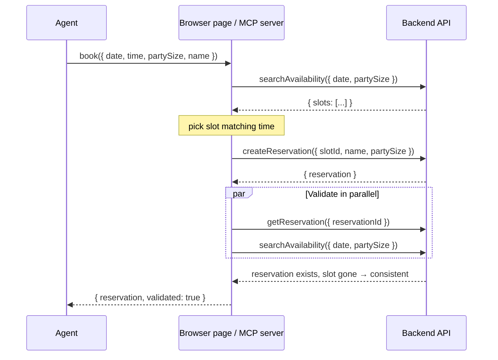
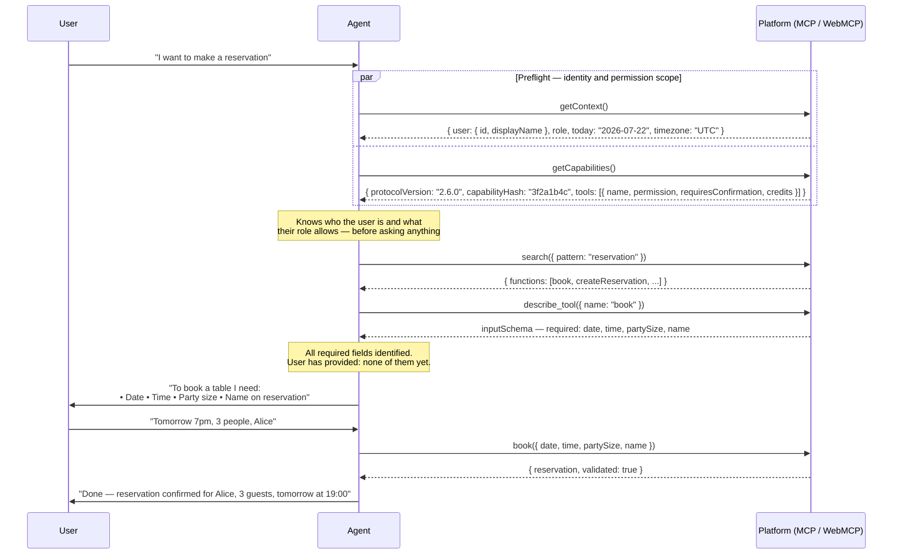
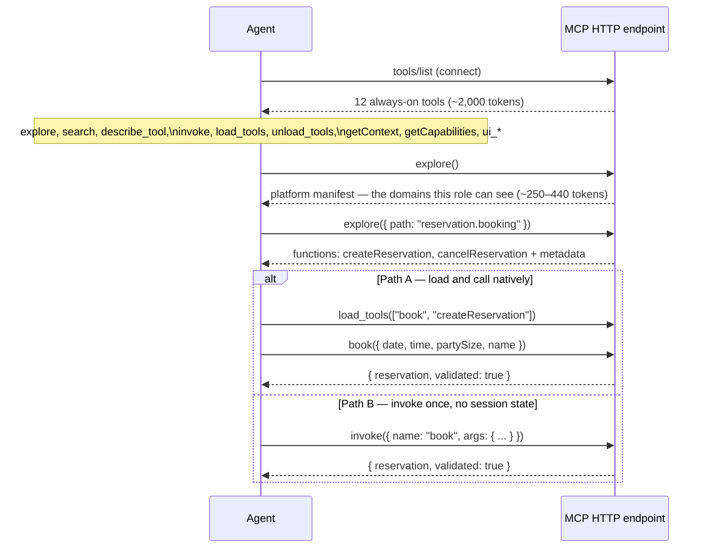

# NavWebMcp protocol guide

How an agent talks to a NavWebMcp server: connect, discover, call, recover from errors. This is the protocol at **2.6.0** (`lib/protocol.ts`). What changed in each version is in [`CHANGELOG.md`](../CHANGELOG.md), and the consumer-side rules an agent should follow are in the [agent skill](../skills/navwebmcp-agent/SKILL.md).

```
WebMCP          W3C Web Machine Learning CG draft standard (document.modelContext)
  └ NavWebMcp   this protocol: progressive tool disclosure, RBAC, composite operations,
                structured errors, idempotent writes, dependent batches, credits
      └ AgentBridge   this repo's reference implementation
```

Related guides: [credits](credits.md) (flow control), [UI components](ui-components-guide.md) (operating what the user sees), [operations reference](operations.md) (every operation), [WebMCP alignment](webmcp-alignment.md) (where we follow or depart from the draft).

- [1. The core idea](#1-the-core-idea)
- [2. One registry, two surfaces](#2-one-registry-two-surfaces)
- [3. Connect and preflight](#3-connect-and-preflight)
- [4. Discover](#4-discover)
- [5. Execute](#5-execute)
- [6. Compact text results (≥ 2.3.0)](#6-compact-text-results--230)
- [7. RBAC and confirmation gates](#7-rbac-and-confirmation-gates)
- [8. Errors](#8-errors)
- [9. Versioning](#9-versioning)
- [10. WebMCP standard and polyfill](#10-webmcp-standard-and-polyfill)
- [11. The agent skill](#11-the-agent-skill)

## 1. The core idea

Every existing approach makes the **agent** orchestrate multiple calls:

```
Agent → searchAvailability()   →  parse slot list, extract slotId
Agent → createReservation()    →  parse result, decide to validate
Agent → getReservation()       →  finally confirm success
```

Three round-trips. Three reasoning gaps. Growing context. The agent must understand your domain well enough to sequence the calls correctly — that knowledge lives in the prompt, re-processed on every call, and can hallucinate.

**AgentBridge flips this.** Business logic lives in the frontend as a composite function registered into `document.modelContext`. The agent calls one tool and gets a validated result:

```
Agent → book({ date, time, partySize, name })  →  { reservation, validated: true }
```

One call. Zero reasoning gaps. The orchestration runs invisibly — in the browser (session-cookie auth) or in-process on the server (bearer token auth).

### A composite call, step by step



The agent sees none of steps 1–3. Source: `lib/core/book.ts`. `seatGuest` (`lib/core/seatGuest.ts`) and `hostVipGuest` (`lib/core/hostVipGuest.ts`) follow the same pattern for front-desk seating and a 7-step CRM+front-desk chain, respectively.

**When the post-condition check disagrees.** The check runs right after a write that succeeded. On a multi-instance deploy it can land on a server instance that hasn't seen that write yet, so a failed check usually means a stale read, not a failed write. The composites therefore only act when the write itself is genuinely missing:

| Composite | Write not visible afterwards | Secondary check disagrees |
|---|---|---|
| `book` | Reservation missing → cancels it (harmless if absent) and returns `VALIDATION_FAILED` | Slot still shows open → success with `validated: false` |
| `seatGuest` | Status not `checked-in` → `VALIDATION_FAILED`, no rollback | Table not yet shown occupied → success with `validated: false` |
| `hostVipGuest` | Status not `checked-in` → `VALIDATION_FAILED` before any points are awarded, no rollback | — |

`seatGuest` and `hostVipGuest` never "undo" with `checkOutGuest`. Checking out bills the visit and frees the table, which is the wrong outcome for a guest who really was seated.

## 2. One registry, two surfaces

```mermaid
flowchart TD
    REG["lib/operations/\nOperation registry\n(61 business ops + 8 meta + 4 ui_*)"]

    REG -->|lib/adapters/mcp.ts| MCP["MCP Streamable HTTP\napp/api/[transport]/\nBearer token · 8h TTL"]
    REG -->|lib/adapters/webmcp.ts| WEB["In-page WebMCP\ndocument.modelContext\nSession cookie"]

    MCP --> EXT["External agents\nClaude Code · Claude Desktop\nMCP Inspector"]
    WEB --> BRW["Browser agents\nin-page JS · console"]

    subgraph book_surfaces["book() — same orchestration, different caller injection"]
        OP["lib/core/book.ts\nbookOrchestration(input, call)"]
        OP -->|makeDispatch(ctx)\nin-process handlers| MCP
        OP -->|serverCall → fetch('/api/call')\nbrowser HTTP| WEB
    end
```

Both surfaces expose `book()`, `seatGuest()`, and `hostVipGuest()` (the latter two gated to `support`/`admin`). The only difference is the `call` function injected into the `lib/core/*.ts` orchestration:

| Surface | `call` implementation | Auth |
|---|---|---|
| In-page WebMCP | `serverCall` → `fetch("/api/call")` | Session cookie |
| MCP Streamable HTTP | `makeDispatch(ctx)` → handler in-process | Bearer token |

The same 61 business operations are exposed over both surfaces simultaneously. Adding an operation to `lib/operations/` and registering it in `lib/operations/index.ts` makes it automatically available on both the MCP HTTP endpoint and `document.modelContext` — with full RBAC, audit logging, and progressive disclosure on both. Each operation's `inputSchema` and `outputSchema` are published on both surfaces too: as MCP `inputSchema`/`outputSchema` (with `structuredContent` on results), and as the WebMCP `ModelContextTool` members of the same names. Where we follow or depart from the WebMCP draft is tracked in [webmcp-alignment.md](webmcp-alignment.md).

## 3. Connect and preflight

**Two MCP generations, one endpoint (≥ 2.4.0).** `/api/mcp` speaks the 2026-07-28 revision (stateless: the protocol version and client info travel in each request's `_meta`, and `server/discover` returns the server's identity, capabilities and instructions) and serves 2025-era clients that open with `initialize` through the SDK's stateless fallback. Tools, schemas and results are the same on both. A version the server doesn't speak gets `UnsupportedProtocolVersionError`, listing the supported ones. `serverInfo.version` is the NavWebMcp semver either way.

When an agent connects to the MCP HTTP endpoint, `tools/list` returns **only the always-on tools**: the 8 below, plus the 4 `ui_*` tools for operating on-screen components (since 1.3.0; see the [UI components guide](ui-components-guide.md)):

| Tool | Role | What it returns |
|---|---|---|
| `getContext` | **Preflight** | Who the user is and what day it is: `{ user: { id, displayName }, role, now, today, timezone, locale, authenticated, page, credits? }` |
| `getCapabilities` | **Preflight** | What their role allows: `{ protocolVersion, capabilityHash, count, tools: [{ name, title, permission, roles, requiresConfirmation, idempotent?, credits }] }` |
| `explore` | Discovery | Module tree navigation by dot-path |
| `search` | Discovery | Find operations by Linux-style glob |
| `describe_tool` | Discovery | Full input and output JSON Schema for named operation(s) |
| `invoke` | Execution | Call any operation, single or batch (with `$ref` between calls), without loading |
| `load_tools` | Session | Promote operations to native MCP tools for this session |
| `unload_tools` | Session | Remove promoted tools from `tools/list` |

**The agent should call `getContext` and `getCapabilities` in parallel immediately after connecting.** This is the preflight:

- `getContext` answers *who is this user, and what day is it?* — identity, role, locale, and the platform's `now` / `today` / `timezone`. The agent resolves "tomorrow" against the platform clock rather than its own, and can skip domains the user won't need.
- `getCapabilities` answers *what is this role allowed to do?* — the full tool list scoped to the caller's role, including which operations require explicit confirmation. The agent can rule out unauthorised tools without fetching their schemas first.

With this information in hand before any `explore` call, the agent can identify every relevant operation, fetch only the schemas it needs, aggregate all required parameters in one pass, and ask the user a **single consolidated question** rather than sequential one-at-a-time prompts.

### Gather first, ask once

The protocol is designed so the agent does all its research before saying a word to the user. The user gets one question, provides all the information in one reply, and the operation executes.



`getContext` tells the agent who the user is and what the platform's date is. `getCapabilities` gives the role-scoped tool catalogue (name, permission, roles, whether confirmation is required, whether it's idempotent, and its credit cost) without full input schemas, plus `protocolVersion` (the semver of the protocol contract, identical for every role) and `capabilityHash` (an 8-hex content hash of that role's tool set, used to cache-bust when the registry drifts). Together they answer: *who is this person and what are they allowed to do?* The agent has this before the first `explore` call, so it can skip irrelevant domains, identify every required parameter by inspecting schemas, and surface a single consolidated question rather than a sequential Q&A.

**Agent instructions**: delivered at connect time via `server/discover` on the 2026-07-28 MCP revision, `initialize.instructions` on 2025-era MCP clients, and `document.modelContext.instructions` (WebMCP), both sourced from `lib/agent-instructions.ts`. The instructions contract:
1. Call `explore()` (and `describe_tool()`) to discover every required parameter before asking the user anything.
2. Identify **all** missing information in one pass.
3. Ask for all missing values in a **single message** — never a sequential Q&A.
4. Only after every required value is confirmed, execute write operations.

The combined effect: a user types *"I want to make a reservation"* and the agent responds with exactly one question listing every field it needs. The user fills them in. The operation executes. No back-and-forth.

## 4. Discover



On connection only the 12 always-on tools appear (8 navigation, 4 `ui_*`): names, short descriptions and input schemas, about **2,000 tokens**. They publish no output schema in `tools/list` (≥ 2.5.0); `describe_tool` returns it if an agent needs it. With all 61 business operations loaded as well, `tools/list` is about **41,300 tokens** (measured as characters ÷ 4 on an admin token, 2.5.0). `tests/unit/mcp-connect-cost.test.ts` keeps the connect cost under 2,200 tokens. Progressive disclosure keeps the connect cost fixed however large the registry grows; the rest is fetched only when needed.

**`explore()` — tree navigation by path you already know:**

```json
// Step 1: understand the platform (no args)
// → { app: "AgentBridge Hospitality", modules: [reservation, crm, frontoffice, tasks, ...] }
// Role-scoped: a customer sees 4 domains (~250 tokens); an admin sees all 8, adding
// housekeeping, finance, support and admin (~440 tokens)

// Step 2: inspect a domain
explore({ "path": "reservation" })
// → { submodules: [reservation.availability, reservation.booking, reservation.search, reservation.admin] }

// Step 3: inspect a leaf module
explore({ "path": "reservation.booking" })
// → { functions: [{ name: "createReservation", permission: "write" }, { name: "cancelReservation", requiresConfirmation: true }] }

// Wildcard: entire subtree in one call
explore({ "path": "reservation.*" })

// Multi-path: two modules in one round-trip
explore({ "path": ["reservation.booking", "crm.guests"] })
```

**`search()` — discovery when you don't know the path:**

Patterns are Linux-style globs matched against `module/path/functionName` strings. A bare keyword with no metacharacters is auto-expanded to `**/*keyword*`.

```json
search({ "pattern": "**/*reservation*" })
// → { functions: [createReservation, cancelReservation, ...], modules: [...] }

search({ "pattern": "reservation" })
// identical — bare keyword auto-expanded

search({ "pattern": "*refund*" })
// → { functions: [{ name: "issueRefund", module: "finance.adjustments" }] }
```

Search is **role-scoped**: a `customer` token running `search({ pattern: "finance/**" })` returns nothing — finance is admin-only and results are filtered by role.

**`describe_tool()` — get the full input and output schema before calling:**

```json
describe_tool({ "name": ["searchAvailability", "createReservation"] })
// → { tools: [{ name, description, permission, inputSchema: { ... }, outputSchema: { ... } }, ...] }
```

`outputSchema` describes the success `data`, e.g. `searchAvailability` → `{ slots: Slot[], count, message }`, so an agent can plan the next call (here: pass a slot's `id` to `createReservation`) without a trial run. `describe_tool` also reports `credits` (the call's base cost), `parallelSafe`, `requiresConfirmation` and, on writes, `idempotent: true`.

## 5. Execute

**Path A — load tools for the session** (best when calling the same ops 3+ times):

```
explore()                                 → platform manifest
explore({ path: "reservation.booking" })  → see booking functions
load_tools(["book", "searchAvailability"])→ promote to native tools
book({ date, time, partySize, name })     → call as a native MCP tool
```

Loaded tools persist per-token for the 8-hour session lifetime. Different agents get independent load states.

**Path B — invoke once without loading** (best for one-off calls):

```json
// Single:
invoke({ "name": "searchAvailability", "args": { "date": "2026-07-23", "partySize": 2 } })

// Batch — reads run in parallel, writes run in order (a call with a $ref also waits for the call it refers to):
invoke({
  "calls": [
    { "name": "searchAvailability", "args": { "date": "2026-07-23", "partySize": 2 } },
    { "name": "listReservations",   "args": {} }
  ]
})
// → { "results": [ <availability>, <reservations> ] }  — one round-trip, two results
```

**Dependent batches (protocol ≥ 2.2.0).** A call can use an earlier call's result: any
argument value may be `{ "$ref": "<i>.data.<path>" }`, with keys and `[n]` indexes only.
The call waits for call `i`; if that call failed or the path isn't there, it isn't run and
gets `DEPENDENCY_FAILED`. Selection happens in the operation's own inputs, so `[0]` is the
right item (`searchAvailability` takes an optional `time` for exactly this):

```js
invoke({ calls: [
  { name: "searchAvailability", args: { date: "2026-12-01", partySize: 2, time: "18:00" } },
  { name: "createReservation",  args: { slotId: { "$ref": "0.data.slots[0].id" }, name: "Dana", partySize: 2 } },
  { name: "getReservation",     args: { reservationId: { "$ref": "1.data.reservation.id" } } }
] })
// → the whole booking flow in one round trip
```

A ref that doesn't parse, or points at the same or a later call, fails the whole batch with `INVALID_INPUT` before anything runs. Refs inside a nested `invoke` belong to that inner batch.

**Results.** A single `invoke` returns exactly the operation's own result, `{ success: true, data }` or `{ success: false, error }`, with no second envelope (≥ 2.0.0). A batch returns `{ results }`, one such result per call, in request order. Errors are described in [§ 8](#8-errors).

**Safe retries (protocol ≥ 2.1.0).** Every server-side write accepts an optional
`idempotencyKey` (1–128 chars), and says so with `idempotent: true` in `describe_tool` and
`getCapabilities` (`idempotentHint` on MCP). Resending the same key with the same arguments
returns the first result with `idempotency: { key, replayed: true }` and writes nothing
again, for 24 hours (`IDEMPOTENCY_TTL_SECONDS`), at a cost of 1 credit. The same key with other arguments is
`IDEMPOTENCY_CONFLICT`; a call still running under it is `IDEMPOTENCY_IN_PROGRESS`
(retryable). A failed call frees its key. With a key, a `HANDLER_TIMEOUT` becomes
retryable: the server keeps the key until the write really finishes. Keys live in Redis
when it is configured, so two instances never both run the same key
(`lib/idempotency/`). A keyed composite passes derived keys to the writes it runs, so a
retried `book` is idempotent end to end.

```js
invoke({ name: "book", args: { date: "2026-12-01", time: "18:00", partySize: 2, name: "Dana",
                               idempotencyKey: "b7e0c6e4-…" } })
// retry after a timeout or a dropped connection → same reservation, { idempotency: { replayed: true } }
```

| Situation | Use |
|---|---|
| Calling the same ops 3+ times in a session | Path A — load once, call cheaply |
| One-off call | Path B — invoke directly |
| Don't know what the platform offers yet | `explore()` first |
| Know the function name but not the schema | `describe_tool()` then Path B |
| Two read results needed simultaneously | Path B batch — parallel dispatch |
| Steps that only pass ids along | Path B batch with `$ref` — one round trip |
| A write you might retry | Pass an `idempotencyKey` |

## 6. Compact text results (≥ 2.3.0)

Tool results carry their JSON twice: as
`structuredContent` and as a text block, which is what most hosts show the model. The text
block is indented by default, as it always was. To save tokens, ask for compact JSON on
the connection, with `?format=compact` on the URL or an `X-NavWebMcp-Format: compact`
header (the header wins):

```bash
claude mcp add --transport http booking "http://localhost:3000/api/mcp?format=compact" \
  --header "Authorization: Bearer <your-agent-token>"
```

A protocol-aware client can also choose per call with `_meta["navwebmcp/format"]`
(`"compact"` or `"pretty"`). Only whitespace changes: `structuredContent`, `_meta`, the
`[credits]` / `[idempotency]` notes and credit charges are the same either way. An unknown
value is ignored. Measured savings: [benchmarks](benchmarks.md#compact-text--230).

## 7. RBAC and confirmation gates

Every operation carries a `roles` array checked on every call. Three roles exist: `customer` (own-data read/write), `support` (customer ops + cross-user read), and `admin` (all ops).

### Confirmation: previews and tokens (≥ 2.6.0)

Destructive operations carry `requiresConfirmation: true`: `cancelReservation`, `cancelAnyReservation`, `checkOutGuest`, `deleteTask`, `issueRefund`, `applyNoShowFee`, and the admin `revokeSession`, `revokeAgentClient` and `setClientCreditPolicy`. The gate is in `execute()`, so it holds on every surface (MCP, in-page WebMCP, `/api/call`) and at every depth (inside `invoke` too).

A call without approval runs nothing and answers `CONFIRMATION_REQUIRED` with what it would do and a token that approves exactly that:

```json
{ "code": "CONFIRMATION_REQUIRED", "retryable": false,
  "message": "Nothing was done yet. Needs the user's approval: Refund 42 of 42 on payment pay_12 (in full): \"Cold food\".",
  "confirmation": {
    "preview": { "summary": "Refund 42 of 42 on payment pay_12 (in full): \"Cold food\".",
                 "data": { "paymentId": "pay_12", "paymentAmount": 42, "refundAmount": 42, "isPartial": false } },
    "token": "c1.eyJ1Ijoi….Qm9i…", "expiresAt": "2026-11-26T12:05:00.000Z" } }
```

- **The preview** comes from the operation's own `preview(input, ctx)`, which reads but never writes. If it fails (`NOT_FOUND`, `ALREADY_REFUNDED`, `FEE_ALREADY_APPLIED`, …), that failure is the answer: nobody is asked to approve an impossible action.
- **The token** is an HMAC (key `CONFIRMATION_SECRET`, else `AUTH_SECRET`) over the user, the agent client, the operation, a hash of the arguments (without `confirm`, `idempotencyKey` and the control fields), an expiry (5 minutes, `CONFIRMATION_TTL_SECONDS`) and a nonce. Re-calling with `confirmationToken` runs the call. The token works once: its nonce is recorded in shared state (Redis `SET NX` when configured), so two instances can't both accept it.
- **`CONFIRMATION_STALE`**: the arguments changed, the token expired, was used, or isn't valid for this caller or operation. It carries a new preview and token for the call as sent.
- **`confirm: true`** still works (the approval is audited as `asserted`). With `REQUIRE_CONFIRMATION_TOKEN=true` an agent's bare `confirm: true` is refused with `CONFIRMATION_REQUIRED`, preview and token; a person in the UI is not affected.
- **MCP elicitation**: when the client declares the `elicitation` capability, the server asks the user itself. The tool call answers `input_required` with an `elicitation/create` form (the preview text and an *Approve* checkbox) and the tokens as `requestState`; the client re-sends the call with the answer. Nothing is held open between the two requests, so it works on serverless. Declining gives `CONFIRMATION_DENIED`. A batch with several destructive calls asks once, listing each; a batch that has already written something in the same round isn't re-run for this, and gets the tokens back instead.
- **WebMCP**: the in-page dialog (`app/providers.tsx`) shows the server's preview; approving re-sends the call with the token. An in-page agent that passes `confirm: true` gets no dialog, unless the server requires tokens.
- **Audit**: each approved destructive call records `approvedBy`: `human` (a person in the UI), `asserted` (`confirm: true` from anyone else), `confirmation-token`, or `user-elicitation`, the one case where the server itself asked the person. That answer is reported by the MCP client that showed the form, so it is as trustworthy as that client.

### `dryRun` (≥ 2.6.0)

Every write that runs on the server accepts `dryRun: true`. The call goes through the same gates (credits, role, strict input), then runs only the preview and returns `{ dryRun: true, preview, confirmation? }`; `confirmation` (a token) is there on destructive operations. Nothing is written, no idempotency key is claimed, it's charged as a read, and the audit trail records `dryRun: true`. Operations without their own `preview` get a generic one listing the arguments. A dry run's data is this shape, not the operation's `outputSchema` (the MCP adapter lets it through the SDK's output check).

## 8. Errors

Every error has the same shape on every surface (≥ 2.0.0), so an agent can act on it without parsing prose:

```json
{ "code": "UNKNOWN_TOOL", "message": "No operation named 'searchAvailabilty'.",
  "retryable": false, "suggestions": ["searchAvailability"],
  "hint": "No operation has this name. Try suggestions, else use search(); don't guess.",
  "requestId": "4f1c2a9e-…", "callId": "9b2e71d0-…" }
```

- `retryable`: whether re-sending the identical call can help.
- `details`: one `{ path, message }` per bad field (`INVALID_INPUT`, `DEPENDENCY_FAILED`, `IDEMPOTENCY_CONFLICT`).
- `confirmation`: the preview and token on `CONFIRMATION_REQUIRED` and `CONFIRMATION_STALE` (≥ 2.6.0).
- `hint`: the server's one-line next step.
- `suggestions`: did-you-mean names for `UNKNOWN_TOOL`, only from operations the caller's role can see.
- `requestId` / `callId`: find the call in the audit trail. When `invoke` relays a failure, `callId` is the inner call's.

The protocol-level codes (`PROTOCOL_ERROR_CODES` in `lib/result.ts`). Operations add their own domain codes (`NO_AVAILABILITY`, `SLOT_UNAVAILABLE`, `ALREADY_CHECKED_IN`, …), which default to not retryable.

| Code | Retryable | Meaning |
|---|---|---|
| `UNAUTHENTICATED` | no | Credentials missing or expired |
| `FORBIDDEN` | no | The caller's role can't do this |
| `INVALID_INPUT` | no | Arguments failed validation; fix the fields in `details` |
| `UNKNOWN_TOOL` | no | No operation has this name; try `suggestions` |
| `NOT_FOUND` | no | A referenced entity doesn't exist |
| `CONFIRMATION_REQUIRED` | no | Needs the user's approval; carries `confirmation.preview` and `.token` (≥ 2.6.0) |
| `CONFIRMATION_STALE` | no | The token doesn't match this call; carries a new preview and token (≥ 2.6.0) |
| `CONFIRMATION_DENIED` | no | The user refused |
| `CANCELLED` | no | The caller cancelled; nothing was done |
| `VALIDATION_FAILED` | no | A composite's write couldn't be confirmed afterwards |
| `INSUFFICIENT_CREDITS` | yes | Out of credits; wait `credits.retryAfterMs` ([credits](credits.md)) |
| `FANOUT_LIMIT` | no | Nested too deep (> 3) or too many operations (> 200) in one request |
| `HANDLER_TIMEOUT` | no (yes with an `idempotencyKey`) | Didn't finish within the deadline (15 s); may still take effect |
| `HANDLER_ERROR` | yes | Unexpected server failure; retry at most once |
| `IDEMPOTENCY_CONFLICT` | no | The key was used with other arguments (≥ 2.1.0) |
| `IDEMPOTENCY_IN_PROGRESS` | yes | The keyed call is still running (≥ 2.1.0) |
| `DEPENDENCY_FAILED` | no | A `$ref`'s earlier call failed or lacks that path (≥ 2.2.0) |

The `ui_*` operations have their own codes; see the [UI components guide](ui-components-guide.md#error-codes).

## 9. Versioning

`getCapabilities()` returns two distinct fields, deliberately not one:

| Field | Scope | Changes when | Maintained by |
|---|---|---|---|
| `protocolVersion` | Global — same for every role | The NavWebMcp contract itself changes: the manifest shape, a meta-op signature, the `Result` envelope, or an error code's meaning | Hand-bumped in `lib/protocol.ts`, following the rules in `CHANGELOG.md` |
| `capabilityHash` | Role-scoped — differs by caller | The visible operation registry drifts (an operation is added, removed, or reshaped) for that role | Computed automatically: DJB2 over each operation's full input and output JSON Schemas, flags and credit cost |

Cache the manifest keyed on both: a changed `capabilityHash` means refresh the tool list; a `protocolVersion` MAJOR change means re-read the contract. `serverInfo.version` on the MCP handshake is the same `protocolVersion` semver — not a hash.

This is deliberately independent of `package.json`'s version, which tracks the demo app build, not the wire protocol. The two will legitimately diverge.

**Version history** (details and migration notes in [`CHANGELOG.md`](../CHANGELOG.md)):

| Version | What it added |
|---|---|
| 1.0.0 | Progressive disclosure, RBAC, composites, `protocolVersion` + `capabilityHash` |
| 1.1.0 | Output schemas and MCP `structuredContent` |
| 1.2.0 | Cancellation (`AbortSignal`, `CANCELLED`); closes in-page gaps against the WebMCP draft |
| 1.3.0 | Agent-operable UI components (`ui_*`) |
| 1.4.0 | Credits (flow control), fan-out limits, handler deadline |
| 2.0.0 | Flat `invoke` results, one set of error codes, structured errors, platform clock (breaking) |
| 2.1.0 | Idempotency keys |
| 2.2.0 | Dependent batches (`$ref`) |
| 2.3.0 | Opt-in compact text in MCP results |
| 2.4.0 | MCP 2026-07-28 (`server/discover`, stateless) alongside 2025-era clients; native tools answer bad arguments with `INVALID_INPUT` |
| 2.5.0 | Smaller connect cost: no output schemas for the always-on tools in `tools/list`, shorter descriptions |
| 2.6.0 | Confirmation previews and one-use tokens (`CONFIRMATION_STALE`), MCP elicitation, `dryRun` on every write, opt-in `REQUIRE_CONFIRMATION_TOKEN` |

## 10. WebMCP standard and polyfill

```
WebMCP        — W3C Web Machine Learning CG draft standard (document.modelContext)
  └ NavWebMcp — this protocol: progressive tool disclosure, RBAC, composite operations
      └ AgentBridge — this repo's reference implementation of NavWebMcp
```

This project implements the WebMCP draft standard incubated by the W3C Web Machine Learning Community Group, and layers **NavWebMcp** — progressive tool disclosure, RBAC, and composite operations — on top of it. The polyfill (`lib/webmcp-polyfill.ts`) installs a full `ModelContextImpl` on `document.modelContext` for browsers that don't yet support it natively, and is a no-op once the standard ships. AgentBridge adds on top: `permission` scopes, RBAC, `requiresConfirmation` gates, audit logging, progressive disclosure, protocol versioning, and `executeBatch`.

## 11. The agent skill

Anyone implementing NavWebMcp — in this repo's stack or any other — should ship [`skills/navwebmcp-agent/`](../skills/navwebmcp-agent/SKILL.md) to their own agent. It is the consumer-side half of the protocol: how to connect efficiently, discover operations, choose between sequential/parallel/bulk invocation, prefer composite operations, and handle errors — independent of any specific server implementation. It carries its own `version` and a `protocol` compatibility range in its frontmatter, so it can be revised without implying the protocol changed. Copy the directory into `<your-repo>/.claude/skills/` or `~/.claude/skills/`.
