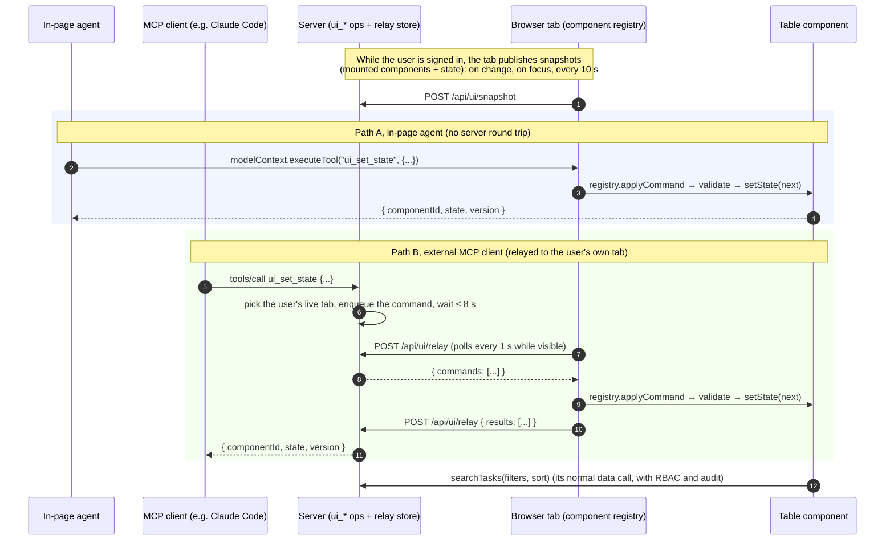

# Agent-operable UI components: build guide (≥ 1.3.0)

> **Who this guide is for:** teams adding agent control of on-screen components (table
> filters, sort, tabs) to their **own** application. It is self-contained: the contract,
> the protocol, a step-by-step build, and a worked example. Nothing here depends on this
> repo's code. This repo's files are named only as a reference implementation you can read.
> The formal spec is [ui-components.md](ui-components.md).

**Contents:**

- [The problem](#the-problem)
- [The idea](#the-idea-operate-component-state-not-the-dom)
- [How a call flows](#how-a-call-flows)
- [The contract](#the-contract)
- [The four operations](#the-four-operations)
- [Patch rules](#patch-rules)
- [Error codes](#error-codes)
- [The relay](#the-relay-for-mcp-clients)
- [Build it in your app](#build-it-in-your-app-step-by-step)
- [Worked example](#worked-example-show-me-the-open-tasks-highest-priority-first)
- [Security](#security-requirements)
- [Conformance checklist](#conformance-checklist)
- [Reference implementation map](#reference-implementation-in-this-repo)

## The problem

Business operations return data **to the agent**. Take a page with a filterable task table,
and a user who says *"show me the open tasks, highest priority first"*. The agent can call
`searchTasks({ status: "open" })`, but that changes nothing on screen:

- the user's filter still says "Any status";
- the table is still in its default order;
- the agent can only read the rows back in chat.

That's the right tool when the agent needs the data itself. It's the wrong tool when the
**user** is meant to see the result.

The obvious workaround is to drive the DOM (find the select, click it, pick an option). That
is exactly what this protocol exists to avoid. It's slow, it breaks whenever the UI changes,
and the agent has to read the page structure to do it.

## The idea: operate component state, not the DOM

Each agent-operable component publishes a **typed state contract**, for example a table's
`{ filters, sort }`. The agent changes that state. The component applies the change through
**its own state setter**, so it is indistinguishable from the user using the controls. The
component then reloads its rows through its normal business operation, so access control
and audit apply to the data unchanged.

| | Business operation | UI component |
|---|---|---|
| Lives | Server, fixed registry | Browser, only while mounted |
| Changes | Business data | What the user sees |
| Discovered by | `explore` / `getCapabilities` | `ui_list` |
| Confirmation | Destructive ops need `confirm: true` | Never needed, view only |
| Agent uses it when | **It** needs the data or must change records | The **user** should see the result |

The agent only needs four generic tools, whatever the number of components. Components come
and go as the user navigates, and the tool list stays the same.

## How a call flows

There are two ways in, and both end in **the same function** in the page.



## The contract

Every mounted component publishes one contract, which `ui_list` returns:

```ts
interface UiComponentContract {
  id: string;                       // stable, page-unique: "tasks.table", "app.nav"
  kind: "table" | "tabs";           // standard kind → standard state shape
  title: string;
  description?: string;             // what it is; agents read this
  stateSchema: JSONSchema;          // JSON Schema of the FULL state
  state: Record<string, unknown>;   // exactly what the user sees right now
  version: number;                  // +1 on every change, by the user or an agent
  actions: { name: string; description: string }[];
  view?: { total?: number; shown?: number };  // row counts after the last load
}
```

### Standard kinds

A *kind* fixes the overall shape of the state, so an agent learns each shape once and can
then drive every table in every app. Only the filter fields vary per table, and the agent
reads those from `stateSchema`.

**`table`**: `{ filters, sort }`

```jsonc
{
  "filters": { "status": "open" },                     // the table's own fields, all optional; absent = "any"
  "sort": [{ "column": "priority", "direction": "desc" }]   // priority order; [] = default order
}
```

- `filters` is a strict object (unknown keys are rejected), and every field is optional.
- `sort` is an array of `{ column, direction: "asc" | "desc" }`. `column` is an enum of the
  sortable columns. Each table caps the array with `maxItems` (1 if the backend sorts on one
  column).
- Pagination is reserved for a later minor version.

**`tabs`**: `{ activeTab }`

```jsonc
{ "activeTab": "tasks" }   // enum = ONLY the tabs this user's role may see
```

The app's main tab bar is registered as `app.nav`. A component that isn't on the current tab
isn't mounted, so agents navigate by setting `app.nav` first.

**Actions.** Every component with a declared initial state gets a `reset` action. A component
may declare more, for example `refresh`.

## The four operations

All four are **always on**: listed at connect, never behind `load_tools`.

| Op | Input | Success `data` | Annotations |
|---|---|---|---|
| `ui_list` | `kind?`, `tabId?` | `{ tabId, activeTab, openTabs, components: UiComponentContract[] }` | read-only |
| `ui_get_state` | `componentId`, `tabId?` | `{ componentId, kind, state, version, view? }` | read-only |
| `ui_set_state` | `componentId`, `patch`, `expectedVersion?`, `tabId?` | `{ componentId, state, version }` | not read-only, **not destructive** |
| `ui_action` | `componentId`, `action`, `args?`, `tabId?` | `{ componentId, action, state, version }` | not read-only, **not destructive** |

Input constraints are strict (unknown keys are rejected):

- `componentId`: 1–100 chars, `^[a-z][a-z0-9_.-]*$` (case-insensitive).
- `tabId`: 1–64 chars.
- `action`: 1–64 chars.
- `expectedVersion`: an integer ≥ 0.
- `patch` and `args`: objects.

Results use the standard NavWebMcp envelope: `{ success: true, data }` or
`{ success: false, error: { code, message } }`.

The `ui_*` ops never ask the user for confirmation. They change only the view, and the
business data behind it is still loaded through RBAC-checked operations. Tell your agent so
in its instructions (see step 6), or it may stop to ask before every filter change.

## Patch rules

A `ui_set_state` patch is **merged** into the current state, and then the **whole** result
is validated:

| Patch value | Effect |
|---|---|
| Plain object | Merged recursively: `{ filters: { status: "open" } }` keeps the other filters |
| Array | Replaces the array: `{ sort: [] }` restores the default order |
| Scalar | Replaces the value |
| `null` | **Removes** the key: `{ filters: { status: null } }` clears that one filter |

- **All or nothing.** If the merged state doesn't match `stateSchema`, the whole patch is
  rejected with `UI_INVALID_PATCH`. Nothing changes and the version doesn't move. The error
  message lists each failing path and the allowed values.
- **Version.** It bumps only when the state really changed, whether the user or an agent
  changed it.
- **Concurrency.** The user can edit the same table while the agent works. Pass the `version`
  you read as `expectedVersion`. If the user changed it since, you get `UI_STALE_STATE` and
  nothing is applied.

<a id="ui-error-codes"></a>
## Error codes

| Code | Meaning | Agent should |
|---|---|---|
| `UI_COMPONENT_NOT_FOUND` | No mounted component with that id. The message lists the mounted ids | Switch tabs via `app.nav`, then `ui_list` |
| `UI_INVALID_PATCH` | The merged state doesn't match `stateSchema` | Fix the patch against `stateSchema`, retry once |
| `UI_STALE_STATE` | `expectedVersion` is out of date because the user changed it | `ui_get_state`, then decide again |
| `UI_UNKNOWN_ACTION` | The component has no such action | Use an action listed by `ui_list` |
| `UI_NO_ACTIVE_PAGE` | The user has no open, signed-in tab (MCP only) | Ask the user to open the app |
| `UI_TIMEOUT` | The tab didn't answer within 8 s (MCP only) | `ui_get_state` to see whether it applied |

## The relay (for MCP clients)

An external MCP client has no browser tab of its own. The server relays its calls to **the
same user's** open tab. The tab only ever makes outbound HTTP calls, so this works on
serverless hosting and needs no WebSocket.

| Endpoint (cookie session) | Body | Response |
|---|---|---|
| `POST /api/ui/snapshot` | `{ tabId, activeTab, visible, focusedAt, components: UiComponentContract[] }`, or `{ tabId, closed: true }` | `{ success: true }` |
| `POST /api/ui/relay` | `{ tabId, results: [{ cmdId, result: Envelope }] }` | `{ success: true, data: { commands: UiCommand[] } }` |

```ts
type UiCommand =
  | { cmdId: string; type: "set_state"; componentId: string; patch: object; expectedVersion?: number }
  | { cmdId: string; type: "action";    componentId: string; action: string; args?: object };
```

| Rule | Value used here |
|---|---|
| `tabId` | A random id per browser tab, kept in `sessionStorage` (survives reloads, not shared between tabs) |
| When the page publishes a snapshot | Debounced (200 ms) on every component change, on focus and visibility change, and as a heartbeat every **10 s** |
| How long a snapshot stays live | **30 s** after the last publish. A closing tab sends `{ closed: true }` with `navigator.sendBeacon` |
| Which tab a command goes to | The explicit `tabId`, else the **visible** tab the user focused most recently, else the most recently focused tab |
| How often the page polls `/api/ui/relay` | Every **1 s** while visible, every 5 s while hidden. After applying commands, it posts their results straight away |
| How long the server waits for a result | Up to **8 s**, then `UI_TIMEOUT`. Results are kept for 60 s |
| Storage | In-process memory for a single instance. Use a shared store (Redis here) across serverless instances |
| Limits | Snapshot ≤ 256 KB, ≤ 50 components. ≤ 50 results per poll |

**Reads don't touch the browser.** `ui_list` and `ui_get_state` on the server answer from the
latest snapshot, which is at most about 10 s old and refreshed on every change. **Writes**
always go to the live tab.

## Build it in your app, step by step

This uses a hypothetical **Orders** page as the example, with an orders table filtered by
status and customer and sortable by date or total. The code is TypeScript with Zod. Any
schema library that can produce JSON Schema works.

### Step 1: the page-side registry (framework-agnostic)

This one class is the **single choke point**: both paths apply changes through
`applyCommand`.

```ts
// ui-registry.ts
import type { ZodType } from "zod";
import { zodToJsonSchema } from "zod-to-json-schema";

type State = Record<string, unknown>;
type Result<T> = { success: true; data: T } | { success: false; error: { code: string; message: string } };
const ok = <T>(data: T): Result<T> => ({ success: true, data });
const fail = (code: string, message: string): Result<never> => ({ success: false, error: { code, message } });

export interface Registration {
  id: string; kind: "table" | "tabs"; title: string; description?: string;
  schema: ZodType<State>;
  getState: () => State;
  setState: (next: State) => void;                 // the component's own setter
  actions?: Record<string, { description: string; run: (args: State, set: (s: State) => void) => unknown }>;
  getView?: () => { total?: number; shown?: number } | undefined;
}

export function mergePatch(base: State, patch: State): State {
  const out: State = { ...base };
  for (const [k, v] of Object.entries(patch)) {
    const isObj = (x: unknown): x is State => typeof x === "object" && x !== null && !Array.isArray(x);
    if (v === null) delete out[k];
    else if (isObj(v) && isObj(out[k])) out[k] = mergePatch(out[k] as State, v);
    else out[k] = v;
  }
  return out;
}

export class UiRegistry {
  private entries = new Map<string, { reg: Registration; version: number; last: string }>();
  private listeners = new Set<() => void>();

  register(reg: Registration) {
    const entry = { reg, version: 1, last: JSON.stringify(reg.getState()) };
    this.entries.set(reg.id, entry);
    this.emit();
    return () => { if (this.entries.get(reg.id) === entry) { this.entries.delete(reg.id); this.emit(); } };
  }

  /** Call after ANY state change (user-driven too), so `version` stays honest. */
  touch(id: string) {
    const e = this.entries.get(id); if (!e) return;
    const now = JSON.stringify(e.reg.getState());
    if (now !== e.last) { e.last = now; e.version++; }
    this.emit();
  }

  list() {
    return [...this.entries.values()].map(({ reg, version }) => ({
      id: reg.id, kind: reg.kind, title: reg.title, description: reg.description,
      stateSchema: zodToJsonSchema(reg.schema, { $refStrategy: "none" }),
      state: reg.getState(), version,
      actions: Object.entries(reg.actions ?? {}).map(([name, a]) => ({ name, description: a.description })),
      view: reg.getView?.(),
    }));
  }

  async applyCommand(cmd: { type: "set_state" | "action"; componentId: string; patch?: State;
                            expectedVersion?: number; action?: string; args?: State }): Promise<Result<unknown>> {
    const e = this.entries.get(cmd.componentId);
    if (!e) return fail("UI_COMPONENT_NOT_FOUND",
      `No mounted component '${cmd.componentId}'. Mounted: ${[...this.entries.keys()].join(", ") || "none"}.`);

    if (cmd.type === "action") {
      const a = e.reg.actions?.[cmd.action!];
      if (!a) return fail("UI_UNKNOWN_ACTION", `'${e.reg.id}' has no action '${cmd.action}'.`);
      await a.run(cmd.args ?? {}, (s) => e.reg.setState(s));
    } else {
      if (cmd.expectedVersion !== undefined && cmd.expectedVersion !== e.version)
        return fail("UI_STALE_STATE", `'${e.reg.id}' is at version ${e.version}, not ${cmd.expectedVersion}.`);
      const parsed = e.reg.schema.safeParse(mergePatch(e.reg.getState(), cmd.patch ?? {}));
      if (!parsed.success) return fail("UI_INVALID_PATCH",
        parsed.error.issues.map((i) => `${i.path.join(".")}: ${i.message}`).join("; "));
      e.reg.setState(parsed.data);
    }
    this.touch(e.reg.id);
    const state = e.reg.getState();
    return ok(cmd.type === "action"
      ? { componentId: e.reg.id, action: cmd.action, state, version: e.version }
      : { componentId: e.reg.id, state, version: e.version });
  }

  subscribe(fn: () => void) { this.listeners.add(fn); return () => this.listeners.delete(fn); }
  private emit() { this.listeners.forEach((fn) => fn()); }
}

export const uiRegistry = new UiRegistry();   // one per page
```

### Step 2: make a component operable

**a. Define the state schema** with the standard `table` shape. Mirror the backing data
operation's inputs, so the agent can set exactly what the user could, nothing more. Give
every field a `.describe()`, because that text is what the agent reads.

```ts
import { z } from "zod";

export const ORDERS_TABLE = z.object({
  filters: z.object({
    status:     z.enum(["pending", "paid", "shipped", "refunded"]).optional().describe("Order status"),
    customerId: z.string().min(1).max(64).optional().describe("Customer id, e.g. c_042"),
  }).strict().describe("Active filters; an absent key means 'any'"),
  sort: z.array(z.object({
    column:    z.enum(["createdAt", "total"]),
    direction: z.enum(["asc", "desc"]),
  }).strict()).max(1).describe("Sort keys in priority order; [] for the default order"),
}).strict();
export type OrdersTableState = z.infer<typeof ORDERS_TABLE>;
```

**b. Lift every agent-operable control into one state object.** The user's controls and the
agent both write to it, and the data fetch reads from it. In React it looks like this
(`useAgentComponent` is about 40 lines; this repo's version is
`lib/ui-components/useAgentComponent.ts`):

```tsx
function OrdersTable() {
  const INITIAL: OrdersTableState = { filters: {}, sort: [] };
  const [table, setTable] = useState(INITIAL);
  const rows = useOrders(table);            // your existing fetch, now keyed on `table`

  useAgentComponent({
    id: "orders.table", kind: "table", title: "Orders",
    description: "The Orders page list. Rows come from listOrders.",
    schema: ORDERS_TABLE,                   // module-level, so it is referentially stable
    state: table, setState: setTable, initialState: INITIAL,   // initialState adds a `reset` action
    actions: { refresh: { description: "Reload the rows", run: () => rows.refetch() } },
    view: { total: rows.total, shown: rows.items.length },
  });

  return (
    <select value={table.filters.status ?? ""}
            onChange={(e) => setTable((t) => ({ ...t, filters: { ...t.filters, status: e.target.value || undefined } }))}>
      {/* … the user's controls read and write the same `table` object … */}
    </select>
  );
}
```

What the hook must do (port it to any framework):

1. **Register on mount, unregister on unmount**, with `getState` reading a ref that always
   holds the latest state.
2. **Wrap `setState`** so the ref is updated **eagerly**, before the re-render. Otherwise
   `applyCommand` would report the old state.
3. **Call `uiRegistry.touch(id)`** whenever the state or the view changes, including
   user-driven changes. That is what keeps `version` and the published snapshot accurate.

**Without a framework**, call `uiRegistry.register({...})` when the widget is created, call
`uiRegistry.touch(id)` in your change handler, and call the returned function when the widget
is destroyed.

**c. Register your navigation as a `tabs` component** with id `app.nav`. Its `activeTab` enum
must list **only the tabs the current role can see**. Re-register it when the role changes.

### Step 3: expose the four tools in the page (WebMCP)

```ts
const tabId = getTabId();   // sessionStorage-backed, e.g. "tab_<uuid>"

const local = {
  ui_list:      () => ({ success: true, data: { tabId, activeTab: activeTab(), openTabs: 1, components: uiRegistry.list() } }),
  ui_get_state: ({ componentId }) => { const c = uiRegistry.list().find((x) => x.id === componentId);
                  return c ? { success: true, data: { componentId: c.id, kind: c.kind, state: c.state, version: c.version, view: c.view } }
                           : { success: false, error: { code: "UI_COMPONENT_NOT_FOUND", message: `No mounted component '${componentId}'` } }; },
  ui_set_state: (i) => uiRegistry.applyCommand({ type: "set_state", ...i }),
  ui_action:    (i) => uiRegistry.applyCommand({ type: "action", ...i }),
};

for (const [name, run] of Object.entries(local)) {
  navigator.modelContext.registerTool({
    name, description: DESCRIPTIONS[name], inputSchema: INPUT_SCHEMAS[name],
    annotations: { readOnlyHint: name === "ui_list" || name === "ui_get_state" },
    execute: (input) => run(input),   // runs in the page, no server round trip
  });
}
```

Keep the auth, role check and strict input validation you already apply to your other
in-page tools (in this repo, `AgentBridge.call`). Only the final dispatch differs.

### Step 4: the server-side operations (MCP surface)

Register the same four names on your MCP server. Reads answer from the snapshot. Writes are
relayed.

```ts
async function ui_set_state({ componentId, patch, expectedVersion, tabId }, { userId }) {
  const page = await relay.pickPage(userId, tabId);        // live snapshot, visible + most recently focused first
  if (!page) return fail("UI_NO_ACTIVE_PAGE", "The user has no open app tab. Ask them to open the app.");
  const cmd = { cmdId: `cmd_${crypto.randomUUID()}`, type: "set_state", componentId, patch, expectedVersion };
  await relay.enqueue(userId, page.tabId, cmd);
  return (await relay.awaitResult(userId, cmd.cmdId, { timeoutMs: 8000 }))
      ?? fail("UI_TIMEOUT", "The user's tab did not respond in time. Check with ui_get_state.");
}

async function ui_list({ kind, tabId }, { userId }) {
  const page = await relay.pickPage(userId, tabId);
  if (!page) return fail("UI_NO_ACTIVE_PAGE", "…");
  return ok({ tabId: page.tabId, activeTab: page.activeTab, openTabs: (await relay.livePages(userId)).length,
              components: page.components.filter((c) => !kind || c.kind === kind) });
}
// ui_get_state: read from page.components. ui_action: like ui_set_state with type "action".
```

Every key in the relay store is scoped by `userId`, including snapshots, queues and results.
The MCP bearer token and the browser session must resolve to the **same user id**.

### Step 5: the relay endpoints and the page loop

The server side is the two endpoints from [the relay table](#the-relay-for-mcp-clients). Each
authenticates by session cookie, validates and size-limits the body, and reads or writes only
the session user's keys.

The page side starts once the user is signed in. The snippet uses four small helpers you
supply:

- `post`: a JSON `fetch` POST that returns the parsed body.
- `debounce`: delays calls until changes stop for the given time.
- `tabId`: the id from step 3.
- `activeTab()`: reads `app.nav`'s state.

```ts
function startUiRelay() {
  let focusedAt = Date.now(), stopped = false;
  const snapshot = () => ({ tabId, activeTab: activeTab(), visible: document.visibilityState === "visible",
                            focusedAt, components: uiRegistry.list() });
  const publish = debounce(() => post("/api/ui/snapshot", snapshot()), 200);

  async function poll(results = []) {
    if (stopped) return;
    const { data } = await post("/api/ui/relay", { tabId, results }).catch(() => ({ data: { commands: [] } }));
    if (data.commands.length) {
      const out = [];
      for (const cmd of data.commands) out.push({ cmdId: cmd.cmdId, result: await uiRegistry.applyCommand(cmd) });
      publish();
      return poll(out);                       // hand the results back immediately
    }
    setTimeout(poll, document.visibilityState === "visible" ? 1000 : 5000);
  }

  const off = uiRegistry.subscribe(publish);
  addEventListener("focus", () => { focusedAt = Date.now(); publish(); });
  document.addEventListener("visibilitychange", publish);
  addEventListener("pagehide", () => navigator.sendBeacon("/api/ui/snapshot", JSON.stringify({ tabId, closed: true })));
  const heartbeat = setInterval(() => post("/api/ui/snapshot", snapshot()), 10_000);
  post("/api/ui/snapshot", snapshot()); poll();
  return () => { stopped = true; off(); clearInterval(heartbeat); };
}
```

If your app already polls something, exclude `ui_*` calls from any "data changed, refetch
everything" logic. They don't change stored data.

### Step 6: tell the agent

Add this to your server instructions (MCP `server/discover` / `initialize.instructions`) and to
`modelContext.instructions`:

```text

## Operating the UI (what the user sees)
Business operations return data to YOU; the screen does not change. When the user should SEE
the result ("show me…", "filter the list to…", "sort by…", "open the X tab"), operate the UI:
- ui_list() → mounted components with their state, stateSchema and actions.
- ui_set_state({ componentId, patch }) → objects merge, arrays replace, null clears a key.
  Pass expectedVersion to avoid overwriting the user's own change.
- ui_get_state({ componentId }) → state and row counts. ui_action({ componentId, action }) → e.g. reset.
- A component on another tab isn't mounted: set app.nav { activeTab } first, then ui_list again.
- ui_* ops change only the view, never business data: no user confirmation needed.
```

### Worked example: "Show me the open tasks, highest priority first"

These calls ran against this app, signed in as an admin, with the user starting on the
Reservations tab. The responses are the app's actual output, abridged where marked `…` and in
the `stateSchema` objects.

**1. Look at what's on screen.**

```jsonc
→ ui_list({})
← { "success": true, "data": {
    "tabId": "tab_cfbd69fb-909f-4beb-b6e9-09d827d1273c",
    "activeTab": "reservations",
    "openTabs": 1,
    "components": [{
      "id": "app.nav", "kind": "tabs", "title": "App tabs",
      "description": "The app's main tab bar: reservations (Reservations), frontdesk (Front Desk), guests (Guests), tasks (Tasks), …",
      "state": { "activeTab": "reservations" }, "version": 1, "actions": [],
      "stateSchema": { "type": "object", "additionalProperties": false, "required": ["activeTab"],
        "properties": { "activeTab": { "type": "string", "enum": ["reservations", "frontdesk", "guests", "tasks", "housekeeping", "finance", "agent", "bugs"] } } }
    }] } }
```

There's no task table, because it lives on the Tasks tab.

**2. Navigate.**

```jsonc
→ ui_set_state({ "componentId": "app.nav", "patch": { "activeTab": "tasks" } })
← { "success": true, "data": { "componentId": "app.nav", "state": { "activeTab": "tasks" }, "version": 2 } }
```

The user's screen switches to Tasks.

**3. Read the table's contract.**

```jsonc
→ ui_list({ "kind": "table" })
← { "success": true, "data": { "activeTab": "tasks", "components": [{
      "id": "tasks.table", "kind": "table", "title": "Task Search",
      "state": { "filters": {}, "sort": [] }, "version": 1, "view": { "total": 5, "shown": 5 },
      "actions": [{ "name": "refresh", "description": "Re-run the search with the current filters" },
                  { "name": "reset", "description": "Restore the default state (clears filters and sort)" }],
      "stateSchema": { "properties": {
        "filters": { "properties": {
          "status":     { "enum": ["open", "in_progress", "completed", "cancelled"] },
          "department": { "type": "string", "maxLength": 100 },
          "assigneeId": { "enum": ["u_alice", "u_carol", "u_bob"] },
          "reservationId": { "type": "string", "maxLength": 64 } } },
        "sort": { "maxItems": 1, "items": { "properties": {
          "column": { "enum": ["createdAt", "updatedAt", "priority", "title", "status"] },
          "direction": { "enum": ["asc", "desc"] } } } } } }
    }] } }
```

**4. Apply the filter and sort in one patch.**

```jsonc
→ ui_set_state({ "componentId": "tasks.table",
    "patch": { "filters": { "status": "open" }, "sort": [{ "column": "priority", "direction": "desc" }] } })
← { "success": true, "data": { "componentId": "tasks.table",
    "state": { "filters": { "status": "open" }, "sort": [{ "column": "priority", "direction": "desc" }] },
    "version": 2 } }
```

The user's controls now read **open · Sort: Priority · Descending**. The table reloaded
through `searchTasks` and shows *Clean Room 205* (high), then *VIP guest arrival preparation*
(medium), then *Restock minibar Room 101* (low). Over the relay this round trip took about
1.1 s. The Activity Log shows `AGENT ui_set_state`, followed by the table's own
`UI searchTasks`.

**5. Report back to the user.**

```jsonc
→ ui_get_state({ "componentId": "tasks.table" })
← { "success": true, "data": { "componentId": "tasks.table", "kind": "table",
    "state": { "filters": { "status": "open" }, "sort": [{ "column": "priority", "direction": "desc" }] },
    "version": 2, "view": { "total": 3, "shown": 3 } } }
```

The agent says: *"Done. Your task list now shows the 3 open tasks, highest priority first."*

**What the guard rails return** (same run):

```jsonc
// A column that isn't sortable: rejected, nothing changes
→ ui_set_state({ "componentId": "tasks.table", "patch": { "sort": [{ "column": "assigneeId", "direction": "up" }] } })
← { "success": false, "error": { "code": "UI_INVALID_PATCH", "message":
    "Patch does not fit 'tasks.table' (see its stateSchema): sort.0.column: Invalid enum value. Expected 'createdAt' | 'updatedAt' | 'priority' | 'title' | 'status', received 'assigneeId'; sort.0.direction: Invalid enum value. Expected 'asc' | 'desc', received 'up'" } }

// The user flipped the sort direction after the agent read version 2
→ ui_set_state({ "componentId": "tasks.table", "expectedVersion": 2, "patch": { "filters": { "assigneeId": "u_carol" } } })
← { "success": false, "error": { "code": "UI_STALE_STATE", "message":
    "'tasks.table' is at version 3, not 2: the user changed it. Re-read with ui_get_state." } }

// Clear one filter and keep the sort
→ ui_set_state({ "componentId": "tasks.table", "patch": { "filters": { "status": null } } })

// Back to the defaults
→ ui_action({ "componentId": "tasks.table", "action": "reset" })
← { "success": true, "data": { "componentId": "tasks.table", "action": "reset",
    "state": { "filters": {}, "sort": [] }, "version": 4 } }
```

### Security requirements

- **Same user only.** Every snapshot, queue entry and result is keyed by the authenticated
  user id. An MCP token can only reach tabs signed in as that same user, and a page can only
  answer commands addressed to its own user.
- **View state only.** No business data travels through the relay. Contracts carry filters and
  sort, never rows. The component reloads rows through the same RBAC-checked operation the
  user's clicks use, so an agent can never see more than the user could.
- **Role-limited navigation.** The `app.nav` enum lists only tabs the role can see. Hidden tabs
  are therefore not reachable, even by a crafted patch.
- **The page validates.** Patches are validated against the component's own schema in the
  page. The server only relays and size-limits them (snapshot ≤ 256 KB, ≤ 50 components, ≤ 50
  results per poll).
- **Strict inputs.** Unknown keys are rejected at every layer: tool inputs, `filters`, `sort`
  items, and the state itself.

### Conformance checklist

An implementation is conformant when all of these hold.

**The page:**

- [ ] Every agent-operable component registers while mounted and unregisters on unmount.
- [ ] Its state uses a standard kind shape (`table` is `{ filters, sort }`, `tabs` is
  `{ activeTab }`), with strict objects and `.describe()` on every field.
- [ ] User-driven changes call `touch` (or the equivalent), so `version` increases on every
  real change, and only then.
- [ ] Agent changes go through the component's own setter. The DOM is never scripted.
- [ ] `applyCommand` merges the patch, validates the whole result, and is all-or-nothing.
- [ ] The navigation component is `app.nav`, and its enum is limited to the role's tabs.

**The protocol:**

- [ ] All four `ui_*` ops are always on, with strict inputs, and return the success shapes
  listed under [the four operations](#the-four-operations).
- [ ] `ui_set_state` and `ui_action` never require confirmation and are not marked destructive.
- [ ] The six `UI_*` error codes are used with the meanings in the table above.

**The relay** (if you support MCP clients):

- [ ] Everything is keyed by user id. Commands go to the explicit tab, else the visible and
  most recently focused live tab.
- [ ] A snapshot TTL is set, and the heartbeat interval is well inside it. Writes time out
  with `UI_TIMEOUT`.
- [ ] A shared store is used across server instances.

**Tests worth copying** from `tests/unit/` in this repo:

- `ui-registry.test.ts`: merge, validation, version and stale checks, actions.
- `ui-relay.test.ts`: TTL, tab selection, once-only delivery, user isolation, timeout, routes.
- `webmcp-ui.test.ts`: in-page tools never call the server.

### Reference implementation in this repo

| Piece | File |
|---|---|
| Wire schemas and error codes | `lib/ui-components/contract.ts` |
| Page registry (`applyCommand`, `mergePatch`) | `lib/ui-components/registry.ts` |
| React hook | `lib/ui-components/useAgentComponent.ts` |
| Standard kinds (`tableStateSchema`, `tabsStateSchema`) | `lib/ui-components/kinds.ts` |
| In-page tool handlers | `lib/ui-components/local.ts` |
| Server `ui_*` ops | `lib/operations/ui.ts` |
| Relay store (memory, or Redis) | `lib/ui-relay/store.ts`. It is reached through `lib/ui-relay/port.ts`, which keeps `redis` out of the browser bundle |
| Relay endpoints | `app/api/ui/snapshot/route.ts`, `app/api/ui/relay/route.ts` |
| Page relay loop | `lib/ui-relay/client.ts`, started in `app/providers.tsx` |
| Example components | `components/TaskSearchCard.tsx` (`tasks.table`), `components/AppShell.tsx` (`app.nav`) |
